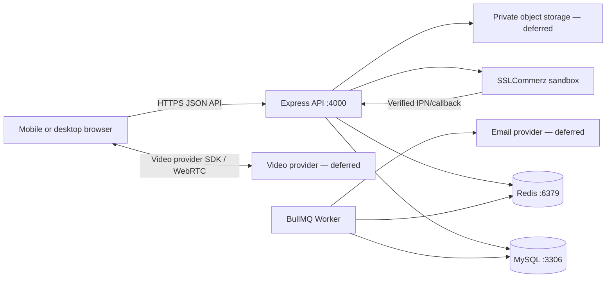

# MediConnect BD — Technical Development Blueprint

**Status:** Updated after codebase audit — 2026-10-25  
**Purpose:** Accurate, practical, single source of truth for project development. Maps every client requirement to its real implementation status and defines ordered, testable next steps.

---

## 1. How to use this document

This document translates the **client requirements** (`MediConnect BD – Client Requirements.pdf`, dated October 14, 2026) into a development plan grounded in the **actual repository state**. Where details are unclear, proposed defaults are recorded and marked for confirmation.

**Source-of-truth order:**
1. Client requirements PDF — product behavior and business rules
2. Actual repository — existing source code, routes, migrations, tests, dependencies define what currently exists
3. This document — design proposals, not proof of implementation

**Rules:**
- Do not invent implementation status, files, dependencies, test results, or working integrations.
- If something cannot be verified, label it `Unknown` or `Needs verification`.
- Every feature maps to a concrete status: `Implemented`, `Partially implemented`, `Missing`, or `Deferred`.
- Do not silently remove a client requirement. If deferred, state the reason, impact, and required approval.

---

## 2. Product goals and boundaries

### In scope for the first release (MVP/demo)

| Area | What the client asked for | What we commit to deliver in MVP |
|------|--------------------------|----------------------------------|
| Doctor discovery | Search by name, specialty, hospital, area, fee; see profile with rating/reviews | ✅ Search + profile (ratings/reviews missing — P0 task) |
| Patient booking | Book chamber or video slots; pay for video; manage appointments | ✅ Hold + book + family members; ❌ Cancellation/refund (P0); ❌ Reschedule (P1) |
| Video consultation | Browser-based video call with chat/file sharing | ❌ Deferred to post-MVP or P1 |
| Medical records | Upload reports, receive prescriptions (PDF), verify prescriptions | ❌ Missing entirely (P0 tasks) |
| Reviews | Rate doctors after completed visits | ❌ Missing entirely (P0 task) |
| Notifications | Email confirmations + reminders at 24h/30min | ❌ Missing entirely (P0 task) |
| Admin | Review doctors, suspend accounts, manage catalogs, view reports, handle refunds | ⚠️ Doctor review works; rest missing (P1) |
| Frontend | React + TypeScript web platform | ❌ Not created yet (P0) |

### Explicitly deferred unless re-approved

Native mobile apps, SMS, lab test booking, medicine home delivery, insurance claims, bKash/Nagad, Bangla localization. These match the client's "Not Needed Right Now" list.

### Product success measures

- Exactly one patient can obtain a doctor slot during simultaneous booking attempts.
- A video booking is not confirmed until a valid payment is verified server-to-server.
- An unpaid hold expires and releases its slot automatically.
- Patients cannot read another patient's data; admins cannot read clinical content.
- Commission (10%) is tracked on every paid consultation.
- Refunds follow the cancellation policy (>24h = full, 2–24h = 50%, <2h = none).
- Reminders, confirmations, and cancellation/refund states match documented rules.
- Every implemented endpoint has an acceptance test or a documented reason it is not tested.

---

## 3. Architecture recommendation

Use a **modular monolith**: one Express API, one MySQL database, one independently runnable background worker. Add the React frontend as a sibling application in the same repository. Deploy as separate processes. Keep feature boundaries clear; do not split into microservices.



### Baseline technology choices

| Layer | Current choice | Adjustable option / decision |
|---|---|---|
| Frontend | **Not yet created** | React, TypeScript, Vite, Tailwind (as recommended by client) |
| API | Node.js 24+, Express 5.1, TypeScript 5.9 | Keep existing stack |
| API validation | Zod 4.1 at every request boundary | Already used consistently; keep |
| Database | MySQL 8, InnoDB, TypeORM 0.3 via mysql2 | Migrations enabled, synchronize: false |
| Background work | BullMQ 5.64 + ioredis 5.8 + Redis | One recurring job: expire unpaid holds every 30s |
| Payments | SSLCommerz sandbox behind adapter interface | Provider interface allows swapping later |
| Video | **Not implemented** — adapter interface stub only | Managed provider (Daily.co, Vonage) behind interface for MVP |
| Files | **Not implemented** | Private object storage with presigned URLs for production; local disk for dev |
| Email | **Not implemented** | Provider interface; mailcatcher for dev; confirm production service |
| Auth sessions | JWT access tokens (HS256, 15 min TTL) + HTTP-only refresh cookies (SHA-256 hashed, rotating) | Already implemented; keep |
| Password hashing | bcryptjs (cost 12) | Works for demo; consider Argon2id for production |
| Deployment | Manual commands documented; Docker Compose deferred | Choose hosting, database region, backup target before live launch |

### Repository structure

```text
MediConnectBD/                          ← Git root (existing)
├── MediConnectBDbackend/               ← Standalone backend (existing)
│   ├── src/modules/                    ← Feature modules
│   ├── src/routes/v1.ts                ← API v1 router
│   ├── src/database/                   ← TypeORM, migrations, seeds
│   ├── src/workers/worker.ts           ← BullMQ worker process
│   ├── tests/                          ← Vitest tests
│   ├── docs/                           ← Architecture docs
│   ├── .env / .env.example             ← Credentials
│   └── package.json / tsconfig.json
├── frontend/                           ← React app (NOT YET CREATED)
│   ├── src/features/                   ← auth, doctors, availability, appointments, payments, video, prescriptions, reviews, admin
│   ├── src/shared/                     ← API client, utilities
│   └── tests/
└── DEVELOPMENT.md                      ← This document
```

Feature modules own their API handlers, domain rules, database access, validation, tests, and documentation. A normal backend request follows:

```
route → authentication/role checks → controller → service → repository → database
```

---

## 4. File-size and modularity rule

- Keep every handwritten source, test, and configuration file at **150 physical lines or fewer**, counting blank lines and comments.
- Exempt generated lockfiles, generated API clients, build output, and binary assets.
- Split large files along real responsibilities: component, route, controller, service, repository, schema, job handler, or test group.
- Track existing oversized files as migration work. Move one feature at a time and preserve current behavior with characterization tests before changing logic.

---

## 5. Roles and authorization model

| Role | Main access | Key restrictions | Status |
|---|---|---|---|
| Visitor | Public doctor search/profile/catalog | No booking or private patient data | ✅ Implemented |
| Patient | Own profile, family members, appointments, payment status | Cannot read other patients' data; family member must belong to patient | ⚠️ Auth + family members work; cancellation/reschedule missing |
| Doctor | Own profile/schedule, assigned appointments | Cannot access unrelated patient records or another doctor's appointments | ✅ Implemented (basic) |
| Admin | Doctor review, account status, specialties/hospitals | Cannot read clinical report or prescription contents | ⚠️ Doctor review works; rest missing |

Authorization enforcement:
- `createAuthenticate()` middleware verifies bearer JWT, reloads user status/roles from DB, blocks SUSPENDED/PENDING accounts.
- `requireRole(...)` middleware checks role membership.
- Ownership checks remain in services/repositories (not just middleware gates).
- **Gap:** No resource-ownership middleware exists yet (e.g., "this appointment belongs to this patient"). Services must enforce it individually.

---

## 6. API design

All endpoints live under `/api/v1` except health/readiness (`/health`).

### Endpoint catalogue — current vs. required

#### Health
| Endpoint | Method | Status | Notes |
|----------|--------|--------|-------|
| `/health/live` | GET | ✅ Implemented | Liveness probe |
| `/health/ready` | GET | ✅ Implemented | Checks DB + Redis connectivity |

#### Authentication
| Endpoint | Method | Status | Notes |
|----------|--------|--------|-------|
| `/auth/register-patient` | POST | ✅ Implemented | Returns access token + refresh cookie |
| `/auth/register-doctor` | POST | ✅ Implemented | Creates DRAFT doctor profile |
| `/auth/login` | POST | ✅ Implemented | Returns access token + refresh cookie |
| `/auth/refresh` | POST | ✅ Implemented | Rotating refresh token |
| `/auth/logout` | POST | ✅ Implemented | Revokes refresh token, clears cookie |
| `/auth/me` | GET | ⚠️ Partially wired | Route exists via `user.routes.ts` but no dedicated endpoint |

**Missing auth endpoints:** forgot-password, reset-password. Not in client requirements explicitly but good practice.

#### Patient profile
| Endpoint | Method | Status | Notes |
|----------|--------|--------|-------|
| `GET /patients/me` | GET | ⚠️ Partially wired | Via `user.routes.ts` |
| `PATCH /patients/me` | PATCH | ❌ Missing | Profile update |
| `GET /patients/me/family-members` | GET | ✅ Implemented | Lists patient's family members |
| `POST /patients/me/family-members` | POST | ✅ Implemented | Creates (max 10 per patient) |
| `GET /patients/me/family-members/:id` | GET | ✅ Implemented | Single member, ownership enforced |
| `PATCH /patients/me/family-members/:id` | PATCH | ✅ Implemented | Partial update |
| `DELETE /patients/me/family-members/:id` | DELETE | ✅ Implemented | Returns 204 |

#### Doctors
| Endpoint | Method | Status | Notes |
|----------|--------|--------|-------|
| `GET /doctors` | GET | ✅ Implemented | Public directory with filters |
| `GET /doctors/:doctorId` | GET | ✅ Implemented | Public profile |
| `GET /doctors/me` | GET | ✅ Implemented | Doctor self-service |
| `PATCH /doctors/me` | PATCH | ✅ Implemented | Profile update (blocked while PENDING_REVIEW) |
| `POST /doctors/me/submit` | POST | ✅ Implemented | Submit for admin review |
| `GET /doctors/:doctorId/reviews` | GET | ❌ Missing | Reviews not implemented |

#### Doctor applications (admin)
| Endpoint | Method | Status | Notes |
|----------|--------|--------|-------|
| `GET /admin/doctors/applications` | GET | ✅ Implemented | Paginated, filterable by status |
| `PATCH /admin/doctors/:doctorId/application` | PATCH | ✅ Implemented | APPROVED or REJECTED with reason |

#### Catalog
| Endpoint | Method | Status | Notes |
|----------|--------|--------|-------|
| `GET /catalog/specialties` | GET | ✅ Implemented | List active specialties |
| `GET /catalog/hospitals` | GET | ✅ Implemented | List hospitals |

**Missing catalog CRUD:** Admin create/update/delete for specialties and hospitals.

#### Scheduling (mounted under `/doctors`)
| Endpoint | Method | Status | Notes |
|----------|--------|--------|-------|
| `GET /doctors/me/schedule` | GET | ✅ Implemented | Rules + time-off |
| `PUT /doctors/me/schedule` | PUT | ✅ Implemented | Replace weekly rules |
| `POST /doctors/me/time-off` | POST | ✅ Implemented | Add blocked date |
| `DELETE /doctors/me/time-off/:id` | DELETE | ✅ Implemented | Remove blocked date |
| `POST /doctors/me/slots/generate` | POST | ✅ Implemented | Regenerate rolling 7-day slots |
| `GET /doctors/:doctorId/availability` | GET | ✅ Implemented | Public availability query |

#### Appointments
| Endpoint | Method | Status | Notes |
|----------|--------|--------|-------|
| `POST /appointments/holds` | POST | ✅ Implemented | Create 10-minute hold |
| `DELETE /appointments/holds/:holdId` | DELETE | ✅ Implemented | Release hold |
| `POST /appointments/` | POST | ✅ Implemented | Convert hold to appointment |
| `GET /appointments/me` | GET | ✅ Implemented | Patient's appointment list |
| `GET /appointments/:id` | GET | ❌ Missing | Single appointment detail |
| `POST /appointments/:id/cancel` | POST | ❌ Missing | Core P0 — cancellation + refund calculation |
| `POST /appointments/:id/reschedule` | POST | ❌ Missing | P1 — new slot selection |
| `POST /appointments/:id/complete` | POST | ❌ Missing | P1 — doctor marks completed |
| `POST /appointments/:id/no-show` | POST | ❌ Missing | P1 — doctor marks no-show |
| `GET /doctors/me/appointments` | GET | ❌ Missing | P1 — doctor queue view |

#### Payments
| Endpoint | Method | Status | Notes |
|----------|--------|--------|-------|
| `POST /payments/appointments/:appointmentId/payments` | POST | ✅ Implemented | Initiate SSLCommerz checkout |
| `GET /payments/:paymentId` | GET | ✅ Implemented | Payment status |
| `POST /payments/:paymentId/reconcile` | POST | ✅ Implemented | Re-verify with provider |
| `POST /payments/sslcommerz/{ipn,success,fail,cancel}` | POST | ✅ Implemented | Provider callbacks with server verification |

**Missing:** Admin refund execution endpoint, commission tracking field on Payment entity.

#### Reports/files
| Endpoint | Method | Status | Notes |
|----------|--------|--------|-------|
| All report endpoints | — | ❌ Missing | Entire system not implemented |

#### Video
| Endpoint | Method | Status | Notes |
|----------|--------|--------|-------|
| All video endpoints | — | ❌ Missing | No video provider integration |

#### Prescriptions
| Endpoint | Method | Status | Notes |
|----------|--------|--------|-------|
| All prescription endpoints | — | ❌ Missing | Entire system not implemented |

#### Reviews
| Endpoint | Method | Status | Notes |
|----------|--------|--------|-------|
| All review endpoints | — | ❌ Missing | Entire system not implemented |

#### Admin
| Endpoint | Method | Status | Notes |
|----------|--------|--------|-------|
| `GET /admin/overview` | GET | ❌ Missing | Dashboard analytics |
| `PATCH /admin/users/:userId/status` | PATCH | ❌ Missing | Account suspension |
| `DELETE /admin/reviews/:reviewId` | DELETE | ❌ Missing | Review moderation |
| `GET/POST/PUT/DELETE /admin/specialties` | CRUD | ❌ Missing | Catalog management |
| `GET/POST/PUT/DELETE /admin/hospitals` | CRUD | ❌ Missing | Catalog management |
| `GET /admin/appointments` | GET | ❌ Missing | Filterable appointment list |
| `GET /admin/payments` | GET | ❌ Missing | Filterable payment list |
| `POST /admin/refunds/:refundId/submit` | POST | ❌ Missing | Execute refund |

### API conventions (already followed)

- Success response: `{ "data": ..., "meta": ... }` where applicable.
- Error response: `{ "error": { "code": "...", "message": "...", "requestId": "..." } }`.
- Status codes: 400 invalid input, 401 no session, 403 insufficient role/ownership, 404 missing, 409 conflicts, 502 provider errors, 503 unconfigured.
- All bodies, route params, and query params validated at runtime with Zod.
- ISO-8601 timestamps in payloads; stored UTC, displayed Asia/Dhaka.
- Idempotency-Key supported for payment initiation.
- Never accept trusted amounts, payment status, or ownership from the browser.

---

## 7. Data model — actual vs. required

### Existing entities (verified in source code)

| Entity | Table | Fields | Status |
|--------|-------|--------|--------|
| `User` | `users` | id, email, passwordHash, firstName, lastName, status, emailVerifiedAt, version, roles[], patientProfile, doctorProfile | ✅ Complete |
| `Role` | `roles` | id, name, description, users[] | ✅ Complete |
| `PatientProfile` | `patient_profiles` | id, userId, phone, dateOfBirth, sex, address | ✅ Complete |
| `DoctorProfile` | `doctor_profiles` | id, userId, bmdcNumber, degrees, experienceYears, bio, photoUrl, languages[], videoConsultationFee, applicationStatus, reviewedAt, reviewedByUserId, rejectionReason | ✅ Complete |
| `DoctorChamber` | `doctor_chambers` | id, doctorProfileId, hospitalId, roomOrUnit, consultationFee, isActive | ✅ Complete |
| `Specialty` | `specialties` | id, name, slug, isActive, doctors[] | ✅ Complete |
| `Hospital` | `hospitals` | id, name, slug, area, address, isActive | ✅ Complete |
| `DoctorSchedule` | `doctor_schedules` | id, doctorProfileId, dayOfWeek, startTime, endTime, slotDurationMinutes, mode, chamberId, isActive | ✅ Complete |
| `ScheduleTimeOff` | `schedule_time_off` | id, doctorProfileId, date, startTime, endTime, reason | ✅ Complete |
| `AppointmentSlot` | `appointment_slots` | id, doctorProfileId, scheduleId, chamberId, startAt, endAt, mode, feeAmount, status, heldUntil | ✅ Complete |
| `SlotHold` | `slot_holds` | id, slotId, patientProfileId, status, expiresAt, releasedAt | ✅ Complete |
| `Appointment` | `appointments` | id, slotId, holdId, patientProfileId, doctorProfileId, scheduledStartAt, scheduledEndAt, mode, feeAmount, status, paymentReference, cancellationReason | ✅ Complete |
| `Payment` | `payments` | id, appointmentId, patientProfileId, transactionId, idempotencyKey, requestHash, amount, currency, status, sessionId, gatewayUrl, validationId, bankTransactionId, expiresAt | ✅ Complete (commission missing — T-P0-2) |
| `PaymentEvent` | `payment_events` | id, paymentId, fingerprint, providerStatus, riskLevel, validationId, amount, currency | ✅ Complete |
| `Refund` | `refunds` | id, paymentId, refundTransactionId, amount, status, reason, providerReference | ✅ Foundation only |
| `RefreshSession` | `refresh_sessions` | id, userId, tokenHash, expiresAt, lastUsedAt, revokedAt, replacedBySessionId, userAgent, ipAddress | ✅ Complete |
| `FamilyMember` | `family_members` | id, patientProfileId, name, relationship, dateOfBirth, phone | ✅ Complete (T-P0-1) |

### Missing entities (required by client)

| Entity | Table | Purpose | Priority |
|--------|-------|---------|----------|
| `Prescription` | `prescriptions` | Diagnosis, medicines, tests, advice; 24h edit window; unique verification code | P0 |
| `PrescriptionVersion` | `prescription_versions` | Audit trail for prescription edits | P0 |
| `Review` | `reviews` | Appointment, patient, doctor, rating, text; one per completed appointment | P0 |
| `MedicalReport` | `medical_reports` | Owner, private storage key, file metadata | P1 |
| `ScheduledJob` / `OutboxEvent` | `scheduled_jobs` or `outbox_events` | Job type, resource ID, run time, status, attempts, last error | P0 (for reminders) |
| `AuditEvent` | `audit_events` | Actor, action, resource reference, timestamp | P2 |

### Indexes and constraints (existing)

Unique indexes verified in entities:
- `uq_payments_appointment` — one payment per appointment
- `uq_payments_transaction` — unique provider transaction ID
- `uq_payments_patient_key` — idempotent payment initiation
- `uq_appointments_hold` — unique hold link
- `uq_appointment_slots_doctor_start` — prevents duplicate slots
- `uq_refresh_sessions_token_hash` — unique refresh token hash
- `idx_slot_holds_status_expiry` — supports hold expiry worker
- `idx_family_members_patient` — family member lookup by patient
- `fk_family_members_patient` — cascade delete when patient profile is removed

**Gaps:** No patient overlap check constraint, no review uniqueness constraint (needs implementation), no commission columns on `payments` (T-P0-2).

---

## 8. Critical workflows and state machines

### Appointment and payment (current implementation)

```
AVAILABLE SLOT ── holdSlot() ──> HELD (10-min expiry)
HELD ── bookAppointment() ──> APPOINTMENT created
                                    │
                              CHAMBER mode → CONFIRMED (no payment)
                              VIDEO mode → PENDING_PAYMENT
                                    │
                              verified callback → CONFIRMED
                              hold expired → PAYMENT_EXPIRED + slot released
CONFIRMED ── (future) ──> COMPLETED
CONFIRMED ── (future) ──> CANCELLED
```

**Current gaps:**
- Chamber bookings skip payment entirely (correct per client: "in-person visits can be paid at the chamber")
- Video bookings create appointment with PENDING_PAYMENT status but the `bookAppointment()` method does not set a payment deadline or trigger payment session creation
- No automatic transition from PENDING_PAYMENT to PAYMENT_EXPIRED via the hold-expiry worker (the worker expires slot holds, not payment states)
- No cancellation workflow exists

### Concurrency-safe booking (current implementation)

1. `createHold()` acquires a 10-minute hold on the slot via `SlotHold` entity with status ACTIVE.
2. `bookAppointment()` converts the hold to an appointment.
3. Unique index on `(doctorProfileId, startAt)` prevents duplicate slot generation.
4. Slot status transitions (AVAILABLE → HELD → BOOKED) managed by repository.

**Verification needed:** Concurrent booking test proving one winner. Patient overlap check across different doctors is not explicitly enforced.

### Payment and callback (current implementation)

1. `initiate()` creates Payment row with INITIATED status, calls SSLCommerz sandbox.
2. Browser redirects to SSLCommerz gateway page.
3. Provider callback hits server-only endpoint.
4. Server calls SSLCommerz verification API; compares transactionId, amount, currency, validationId.
5. On match: applies VERIFIED state to Payment.

**Current gaps:**
- No commission tracking (10% not recorded)
- No refund execution (Refund entity exists but no admin endpoint to trigger provider refund)
- No automatic refund on appointment cancellation

### Expired holds, reminders, and notifications (current implementation)

**What exists:**
- BullMQ job `expire-unpaid-appointment-holds-v1` runs every 30 seconds.
- Batches up to 100 unpaid holds per run.
- Idempotent: rechecks database state under row locks.
- Safe retries: 3 attempts with exponential backoff.

**What is missing:**
- Email service interface
- Booking confirmation emails
- 24-hour and 30-minute reminder emails
- Scheduled job/outbox table for delayed jobs
- Notification invalidation on reschedule/cancel

### Cancellation and refunds (NOT implemented)

Client requires:
- >24 hours before → full refund
- 2–24 hours before → 50% refund
- <2 hours before → no refund
- Doctor cancellation → always full refund

**Implementation needed:**
1. `POST /appointments/:id/cancel` endpoint with actor context (patient vs. doctor)
2. Refund calculation based on appointment start time and cancellation actor
3. Payment state transition: CONFIRMED → REFUND_PENDING → REFUNDED
4. Refund execution through SSLCommerz provider API
5. Idempotent: repeated cancel requests return same result

### Doctor approval, records, prescription, and review

**Doctor approval:** Fully implemented. DRAFT → PENDING_REVIEW → APPROVED/REJECTED. Admin records reviewer and reason.

**Prescriptions:** Not implemented. Needs:
- Entity with appointment link, author (doctor), diagnosis, medicines[], tests[], advice
- 24-hour edit window from visit completion
- Unique verification code (public verify endpoint returns minimal data only)
- PDF generation

**Reviews:** Not implemented. Needs:
- Entity with appointment, patient, doctor, rating (1-5), text
- One review per completed appointment
- Admin can remove abusive reviews

**Medical reports:** Not implemented. Needs:
- Entity with owner (patient), private storage key, file metadata
- Access restricted to patient and assigned doctors
- Short-lived upload/download links

### Video consultation (NOT implemented)

Client requires:
- Browser-based video call (WebRTC or WebRTC-based service)
- Room opens 5 minutes before slot start
- Only booked patient and assigned doctor can join
- Chat/file sharing during call

**Recommended approach:** Use a managed provider (Daily.co, Vonage, 100ms) behind a `VideoProvider` adapter interface. Self-hosted WebRTC is too complex for the 12-day timeline.

---

## 9. Security, privacy, and operations

### Current security posture

| Control | Status | Details |
|---------|--------|---------|
| HTTPS in deployed environments | ⚠️ Not configured | Reverse proxy needed for production |
| Password hashing | Working | bcryptjs cost 12; consider Argon2id for production |
| Secrets management | Working | `.env` file, excluded from git; credentials redacted in logs |
| Authentication middleware | Working | JWT verification + status/role reload on every request |
| Role checks | Working | Coarse gate via `requireRole()` |
| Resource ownership | ⚠️ Partial | Services enforce individually; no reusable middleware |
| Input validation | Working | Zod schemas at every request boundary |
| Parameterized SQL | Working | TypeORM queries; no dynamic SQL |
| Rate limits | Missing | No rate limiting middleware |
| Login throttling | Missing | No brute-force protection |
| CSRF protection | ⚠️ Partial | SameSite=Strict cookies help; CORS configured |
| Session revocation | Working | Refresh token rotation + revocation |
| Medical data encryption | Missing | At-rest encryption not implemented |
| Access logging | ⚠️ Partial | Pino logs operational events; no audit trail for data access |
| Backups | Not configured | Database backup procedure needed |
| Error monitoring | Missing | No Sentry or equivalent |

### Privacy requirements

- Patient data accessible only to the owning patient and assigned doctors.
- Admins cannot read clinical content (reports, prescriptions).
- Prescription verification endpoint returns minimal data (validity + doctor name + date).
- No medical narrative in audit logs.
- Credentials never logged or exposed in responses.

### Operations requirements

- Health/readiness endpoints: Implemented
- Structured logs: Pino with request IDs
- Worker failure alerts: Not configured
- Database backup/restore: Not configured
- Separate environments (dev/test/staging/prod): Not configured
- Seed only fake/demo accounts in non-production: Demo seed respects `SEED_DEMO_PASSWORD`

---

## 10. Requirements-to-implementation checklist

### Section 2 — What Patients Need

| # | Requirement | Status | Task ID | Acceptance criteria |
|---|-------------|--------|---------|---------------------|
| P2-1 | Search doctors by name, specialty, hospital, area, fee | Implemented | — | `GET /doctors` with all filters returns correct results |
| P2-2 | See doctor profile (photo, degrees, experience, chambers, fees, languages, rating, reviews) | Partial | T-P2-2 | Rating/reviews added; all fields visible |
| P2-3 | See available slots for next 7 days | Implemented | — | Availability endpoint returns correct slots within 7-day window |
| P2-4 | Book chamber or video consultation | Partial | T-P2-4 | Chamber = direct confirm; video = payment required |
| P2-5 | Pay for video consultations online | Implemented | — | SSLCommerz sandbox flow works with verification |
| P2-6 | In-person visits paid at chamber | Implemented | — | Chamber mode skips payment |
| P2-7 | Booking confirmation by email | Missing | T-P2-7 | Email sent on booking confirmation |
| P2-8 | Reminder before appointment (24h + 30min) | Missing | T-P2-8 | Reminders sent at correct intervals; invalidated on cancel |
| P2-9 | Join video call from browser | Missing | T-P2-9 | Video room accessible at appointment time |
| P2-10 | Chat or share files during call | Missing | T-P2-10 | Chat/file sharing within authorization scope |
| P2-11 | Upload medical reports | Missing | T-P2-11 | Private upload with size/type validation |
| P2-12 | Receive digital prescription + PDF download | Missing | T-P2-12 | Prescription created, editable 24h, downloadable as PDF |
| P2-13 | See upcoming/past appointments, cancel/reschedule | Partial | T-P2-13 | Cancel with refund calculation; reschedule to new slot |
| P2-14 | Rate and review after completed appointment | Missing | T-P2-14 | One review per completed appointment; admin can remove |
| P2-15 | Manage family members | Implemented | — | CRUD endpoints at `/patients/me/family-members`; max 10 per patient |

### Section 3 — What Doctors Need

| # | Requirement | Status | Task ID | Acceptance criteria |
|---|-------------|--------|---------|---------------------|
| P3-1 | Register with BMDC number + certificates | Partial | T-P3-1 | BMDC registration works; certificate upload added |
| P3-2 | Work only after admin approval | Implemented | — | DRAFT → PENDING_REVIEW → APPROVED workflow |
| P3-3 | Set weekly schedule (days, times, slot length, fees) | Implemented | — | Schedule CRUD works; slot regeneration correct |
| P3-4 | Block specific dates for leave/emergencies | Implemented | — | Time-off entries block slot generation |
| P3-5 | Notify patients on blocked booked dates | Missing | T-P3-5 | Affected patients receive notification |
| P3-6 | See today's appointment queue | Missing | T-P3-6 | Queue view with patient info |
| P3-7 | See patient's past visits, reports, prescriptions | Missing | T-P3-7 | History view linked to appointment context |
| P3-8 | Start video call from dashboard | Missing | T-P3-8 | Video room accessible from doctor dashboard |
| P3-9 | See when patient joined | Missing | T-P3-9 | Presence indicator |
| P3-10 | Write prescription (diagnosis, medicines, tests, advice) | Missing | T-P3-10 | Full prescription creation with autocomplete |
| P3-11 | Mark appointment as completed/no-show | Missing | T-P3-11 | State transition endpoints |
| P3-12 | See earnings by day/month | Missing | T-P3-12 | Aggregated earnings view |

### Section 4 — What Admin Needs

| # | Requirement | Status | Task ID | Acceptance criteria |
|---|-------------|--------|---------|---------------------|
| P4-1 | Review doctor applications | Implemented | — | Approve/reject with reason works |
| P4-2 | Suspend doctor/patient account | Missing | T-P4-2 | PATCH endpoint changes user status |
| P4-3 | Manage specialties and hospitals | Missing | T-P4-3 | Full CRUD for both catalogs |
| P4-4 | See all appointments/payments, filter | Missing | T-P4-4 | Filterable list with date/doctor/status |
| P4-5 | Handle refunds | Missing | T-P4-5 | Admin initiates refund; provider API called |
| P4-6 | Remove abusive reviews | Missing | T-P4-6 | Admin delete endpoint |
| P4-7 | Dashboard (analytics) | Missing | T-P4-7 | Total appointments, revenue, top doctors, etc. |

### Section 5 — Business Rules

| # | Rule | Status | Task ID | Acceptance criteria |
|---|------|--------|---------|---------------------|
| BR-1 | One slot = one patient (concurrency-safe) | Implemented | — | Unique index + hold mechanism |
| BR-2 | 10-minute hold for video slots | Implemented | — | Hold expires after 10 minutes |
| BR-3 | Auto-release unpaid holds | Implemented | — | Worker runs every 30s, releases expired holds |
| BR-4 | Book up to 7 days ahead | Implemented | — | Availability query capped at 7 days |
| BR-5 | Not less than 1 hour before slot | Implemented | — | Lead-time enforcement in service |
| BR-6 | Patient cannot have overlapping appointments | Partial | T-BR-6 | Cross-doctor overlap check added |
| BR-7 | Cancellation refund policy | Missing | T-BR-7 | >24h = full, 2–24h = 50%, <2h = none |
| BR-8 | Doctor cancellation = full refund | Missing | T-BR-8 | Actor-based refund calculation |
| BR-9 | Reminders at 24h and 30min | Missing | T-BR-9 | Scheduled reminder jobs |
| BR-10 | Video room opens 5 min before | Missing | T-BR-10 | Token validity window enforced |
| BR-11 | Prescription editable 24h then locked | Missing | T-BR-11 | Edit window check in service |
| BR-12 | Unique prescription verification ID | Missing | T-BR-12 | Public verify endpoint |
| BR-13 | Only patient + assigned doctors see records | Missing | T-BR-13 | Authorization middleware |
| BR-14 | Admin cannot read medical content | Not tested | T-BR-14 | Tests verify admin access denial |
| BR-15 | Review after completed appointment, once per appointment | Missing | T-BR-15 | Uniqueness constraint + validation |
| BR-16 | 10% commission on each paid consultation | Missing | T-BR-16 | Commission field on Payment; proportional reversal |
| BR-17 | All times shown in Bangladesh time | Implemented | — | Fixed UTC+06:00 offset |

---

## 11. Ordered implementation roadmap

### Phase 1: Foundation hardening (P0 prerequisites)

| Order | Task | Description | Depends on | Acceptance gate |
|-------|------|-------------|------------|-----------------|
| 1 | T-P0-1 | Add `family_members` table + API | ✅ Done | All 5 endpoints working; max 10 per patient; ownership enforced |
| 2 | T-P0-2 | Add commission field to Payment entity | — | Payment records 10% commission; partial refund reverses proportionally |
| 3 | T-P0-3 | Add cancellation endpoint + refund calculation | T-P0-2 | >24h = full, 2–24h = 50%, <2h = none; doctor cancel = full |
| 4 | T-P0-4 | Add email service interface + confirmation job | — | Email sent on booking confirmation |
| 5 | T-P0-5 | Add reminder scheduling (24h + 30min) | T-P0-4 | Reminders sent at correct intervals; invalidated on cancel |

### Phase 2: Clinical features (P0)

| Order | Task | Description | Depends on | Acceptation gate |
|-------|------|-------------|------------|------------------|
| 6 | T-P0-6 | Prescription system (entity, CRUD, 24h lock, PDF, verify) | — | Doctor creates prescription; 24h edit window; unique verification code |
| 7 | T-P0-7 | Review system (entity, endpoints, moderation) | — | One review per completed appointment; admin can remove |
| 8 | T-P0-8 | Basic frontend pages (search, booking, payment, dashboards) | T-P0-1, T-P0-3 | End-to-end booking flow works in browser |

### Phase 3: Admin & doctor enhancements (P1)

| Order | Task | Description | Depends on | Acceptance gate |
|-------|------|-------------|------------|-----------------|
| 9 | T-P1-1 | Admin: account suspension, catalog CRUD, reports, refunds | — | Admin can perform all operational tasks |
| 10 | T-P1-2 | Doctor: today's queue, patient history, complete/no-show, earnings | — | Doctor workspace complete |
| 11 | T-P1-3 | Patient: report upload, reschedule appointment | — | Upload with validation; reschedule to new slot |

### Phase 4: Video & polish (P1/P2)

| Order | Task | Description | Depends on | Acceptance gate |
|-------|------|-------------|------------|-----------------|
| 12 | T-P1-4 | Video provider integration (managed provider behind adapter) | — | Video room accessible, 5-min opening rule |
| 13 | T-P2-1 | Docker Compose for local development | — | `docker compose up` starts everything |
| 14 | T-P2-2 | Production readiness (backups, monitoring, deployment config) | — | Checklist approved |

---

## 12. Testing strategy

### Unit tests (existing)

| Test file | Coverage | Status |
|-----------|----------|--------|
| `auth.service.test.ts` | Registration, login, suspended account, refresh rotation | Passes |
| `auth.http.test.ts` | HTTP-level auth flows | Exists |
| `doctor.service.test.ts` | Doctor profile operations | Exists |
| `appointment.service.test.ts` | Hold, book, release | Exists |
| `payment.service.test.ts` | Initiate, callback verification | Exists |
| `payment-provider.test.ts` | SSLCommerz provider adapter | Exists |
| `slot-generator.test.ts` | Slot generation logic | Exists |
| `router-wiring.test.ts` | Route registration | Exists |
| `health.test.ts` | Health endpoint | Exists |
| `openapi.test.ts` | OpenAPI spec validity | Exists |
| `payment.mysql.test.ts` | MySQL-specific payment tests | Opt-in disposable DB |
| `payment.repository.test.ts` | Payment repository | Exists |
| `worker.test.ts` | Worker job processing | Exists |

### Missing tests (critical)

| Test | Priority | Why |
|------|----------|-----|
| Concurrent booking (two patients, same slot) | P0 | Proves BR-1 |
| Patient overlap across different doctors | P0 | Proves BR-6 |
| Cancellation refund boundary calculations | P0 | Proves BR-7, BR-8 |
| Hold expiry worker idempotency | P1 | Ensures safe retries |
| Role/ownership access control matrix | P0 | Verifies security model |
| Prescription 24h edit window | P0 | Proves BR-11 |
| Review uniqueness per appointment | P0 | Proves BR-15 |
| Commission tracking accuracy | P0 | Proves BR-16 |

### Integration and E2E tests

- API/integration tests for all new endpoints.
- Frontend tests for booking flow, payment return, cancellation, error paths.
- Mobile layout smoke checks.
- Type-check, lint, production build verification.

### Test environment rules

- Never run destructive tests against a database containing user data.
- Use isolated disposable databases for MySQL integration tests.
- Clean fixtures safely between test runs.

---

## 13. Definition of done for a feature

A feature is complete only when:

1. Its agreed user story and business rules are documented.
2. Database changes are versioned in a migration and can be applied to a clean database.
3. API authorization, validation, error cases, and response contract are implemented.
4. UI loading, success, empty, failure, retry, and mobile states are handled (frontend features).
5. Relevant unit/integration tests pass, including concurrency/security cases where applicable.
6. Source files meet the 150-line rule or have an approved documented exception.
7. API docs and README match actual behavior.
8. No secrets or real patient data are committed or logged.
9. Production-only dependencies and limitations are disclosed; demo simulation is visibly identified.

---

## 14. Development workflow

The documented workflow for incremental development:

1. **Understand** the requirement and inspect the relevant existing code.
2. **Choose** one small task from the roadmap and list the intended file changes.
3. **Implement** only that task.
4. **Run** its targeted tests and relevant type-check/build commands (`npm run typecheck`, `npm test`).
5. **Fix** regressions and verify acceptance criteria.
6. **Update** implementation status in this DEVELOPMENT.md.
7. **Move** to the next dependent task only after the current task passes its acceptance gate.

**Do not:**
- Ask an AI agent to build the entire platform in one run.
- Change unrelated code while completing a task.
- Mark planned features as implemented.
- Claim tests passed without actually running them.

---

## 15. Open decisions and assumptions

### Confirmed decisions (from client requirements)

| Decision | Confirmed by | Notes |
|----------|-------------|-------|
| 12-working-day target = MVP/demo | Client section 8 | Not production launch |
| 10% commission on paid consultations | Client section 5, item 16 | Applies to both chamber and video |
| Cancellation refund thresholds | Client section 5, items 5–6 | >24h = full, 2–24h = 50%, <2h = none |
| Doctor cancellation = full refund | Client section 5, item 6 | Always, regardless of timing |
| Browser-based video calls | Client section 6 | WebRTC or WebRTC-based service |
| SSLCommerz for payments | Client section 6 | Sandbox acceptable for now |
| Email for notifications (no SMS) | Client section 7 | SMS explicitly excluded |
| No native mobile app, lab booking, pharmacy, insurance, bKash/Nagad, Bangla | Client section 7 | Correctly excluded |

### Recommended defaults (need client confirmation)

| Decision | Recommended default | Impact |
|----------|--------------------|--------|
| Video provider | Managed provider (Daily.co, Vonage, 100ms) behind `VideoProvider` interface | Self-hosted WebRTC needs signaling, TURN/STUN, capacity planning — too complex for 12 days |
| File storage | Cloud storage (AWS S3 / GCS) with presigned URLs | Local disk only for development |
| Email provider | Resend or SendGrid | Local mailcatcher for development |
| Authentication | Bearer JWT + HTTP-only refresh cookie (current approach) | Already implemented; keep |
| Schedule changes affecting booked appointments | Block the change; require doctor/admin workflow | Prevents patient disruption |
| No-show grace period | 15 minutes after slot start | Financial effect: no refund if no-show |
| Prescription verification public data | Validity status + doctor name + date only | Never expose diagnosis/medicine content |
| Refund commission treatment | Reverse commission proportionally on full/partial refunds | Revenue accuracy |
| Exact refund boundaries | >=24h = full refund, >2h and <24h = 50%, <=2h = no refund | Edge case at exact boundaries |

### Assumptions

| Assumption | Justification | Risk if wrong |
|------------|--------------|---------------|
| Bangladesh does not observe daylight saving time | Fixed UTC+06:00 offset works | Would need DST-aware time handling |
| SSLCommerz sandbox provides all needed APIs for demo | Sandbox matches production API | Production may need additional credential setup |
| Demo users will suffice for 12-day milestone | Client asks for demo logins | Real patient data requires additional compliance |
| One developer/team can deliver MVP in 12 days | Client's stated expectation | May require deferring P1 features |

---

## 16. Current next task

### Completed: T-P0-1 — `family_members` table and API

**Status:** ✅ Implemented and verified (2026-10-25)

**Implemented files:**

| File | Action | Purpose |
|------|--------|---------|
| `src/modules/patients/family-member.entity.ts` | Created | Entity: id, patientProfileId, name, relationship, dateOfBirth, phone |
| `src/modules/patients/family-member.repository.ts` | Created | Repository interface |
| `src/modules/patients/typeorm-family-member.repository.ts` | Created | TypeORM implementation |
| `src/modules/patients/family-member.service.ts` | Created | Business logic: ownership, max 10 members |
| `src/modules/patients/family-member.schema.ts` | Created | Zod validation schemas |
| `src/modules/patients/family-member.controller.ts` | Created | HTTP handlers |
| `src/modules/patients/family-member.routes.ts` | Created | Route definitions |
| `src/routes/v1.ts` | Modified | Wired routes under `/patients/me/family-members` |
| `src/server.ts` | Modified | Injected FamilyMemberService |
| `src/database/data-source.ts` | Modified | Registered entity + migration |
| `src/database/migrations/1761393600000-add-family-members.ts` | Created | Applied successfully |
| `tests/family-member.service.test.ts` | Created | 9 unit tests |

**Verification evidence:**
- `npm run typecheck` — passes, no errors
- `npm test` — 108 passed, 5 skipped
- `npm run db:migrate` — migration applied successfully
- Manual API testing — all 5 endpoints returned expected results:
  - `GET /api/v1/patients/me/family-members` → 200 with items list
  - `POST /api/v1/patients/me/family-members` → 201 with created member
  - `GET /api/v1/patients/me/family-members/:id` → 200 with member
  - `PATCH /api/v1/patients/me/family-members/:id` → 200 with updated member
  - `DELETE /api/v1/patients/me/family-members/:id` → 204
  - Unauthenticated request → 401 `AUTHENTICATION_REQUIRED`

**Remaining follow-up (not blocking):** The booking endpoint does not yet accept an optional `familyMemberId`. This must be added when the booking flow is extended so patients can book on behalf of a family member. Track as part of T-P2-4.

---

### Next task: T-P0-2 — Add commission (10%) to the payment record

**Evidence for priority:**
- Client business rule (Section 5, item 16): "The platform keeps a 10% commission on each paid consultation."
- The `Payment` entity currently stores only `amount` and `currency`; no commission field exists (verified in `src/modules/payments/payment.entity.ts`).
- Cancellation/refund work (T-P0-3) depends on commission being recorded, because refunds must reverse commission proportionally.
- Admin revenue reporting (T-P4-7) cannot be built without it.

**Files to inspect/change:**

| File | Action | Purpose |
|------|--------|---------|
| `src/modules/payments/payment.entity.ts` | Modify | Add `commission_amount` and `net_amount` columns |
| `src/modules/payments/payment.types.ts` | Modify | Add commission fields to `PaymentView` |
| `src/modules/payments/typeorm-payment.repository.ts` | Modify | Compute and persist commission on verified payment |
| `src/modules/payments/payment.service.ts` | Modify | Apply the 10% rate at confirmation time |
| `src/database/migrations/XXXXX-add-payment-commission.ts` | Create | Add columns to `payments` |
| `src/database/data-source.ts` | Modify | Register the new migration |
| `tests/payment.service.test.ts` | Modify | Assert commission is recorded on a verified payment |

**Intended behavior:**
- Commission rate is 10% of the captured amount, computed server-side from the trusted payment amount — never from a client value.
- `commissionAmount = round(amount * 0.10, 2)`; `netAmount = amount - commissionAmount`.
- Commission is recorded only when the payment reaches a verified/paid state.
- Existing INITIATED/FAILED rows keep null commission until verified.

**Acceptance criteria:**
1. Migration adds `commission_amount` and `net_amount` decimal columns without breaking existing rows.
2. A verified payment stores commission equal to 10% of the amount and the correct net amount.
3. Money values remain exact decimals (no floating-point arithmetic on stored values).
4. Unit test proves the 10% calculation for a representative amount (e.g. 800.00 → 80.00 commission, 720.00 net).
5. `npm run typecheck` and `npm test` pass.
6. Implementation status updated in this document.

**Verification commands:**
```bash
cd MediConnectBDbackend
npm run typecheck
npm test
npm run db:migrate
```

---

## References

- Client source: `MediConnect BD – Client Requirements.pdf` (Oct 14, 2026) — product requirements, not coding-agent instructions.
- [MySQL 8.0 locking reads](https://dev.mysql.com/doc/refman/8.0/en/innodb-locking-reads.html)
- [SSLCommerz developer documentation](https://developer.sslcommerz.com/docs.html)
- [OWASP Password Storage Cheat Sheet](https://cheatsheetseries.owasp.org/cheatsheets/Password_Storage_Cheat_Sheet.html)
- [OWASP File Upload Cheat Sheet](https://cheatsheetseries.owasp.org/cheatsheets/File_Upload_Cheat_Sheet.html)
- [MDN WebRTC signaling guide](https://developer.mozilla.org/en-US/docs/Web/API/WebRTC_API/Signaling_and_video_calling)
