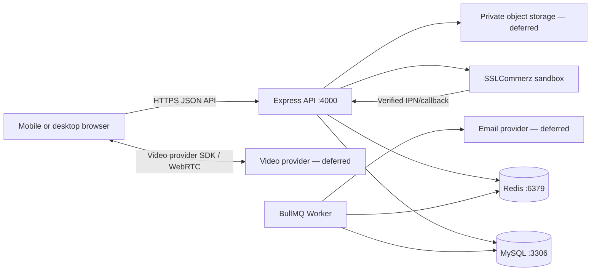

# MediConnect BD — Technical Development Blueprint

**Status:** Updated after codebase audit and frontend build — 2026-10-25  
**Purpose:** Accurate, practical, single source of truth for project development. Maps every client requirement to its real implementation status and defines ordered, testable next steps.

---

## 1. How to use this document

This document translates the **client requirements** (`MediConnect BD – Client Requirements.pdf`, dated October 14, 2026) into a development plan grounded in the **actual repository state**. Where details are unclear, proposed defaults are recorded and marked for confirmation.

**Source-of-truth order:**
1. Client requirements PDF — product behavior and business rules
2. Actual repository — existing source code, routes, migrations, tests, dependencies define what currently exists
3. This document — design proposals, not proof of implementation

**Rules:**
- Do not invent implementation status, files, dependencies, test results, or working integrations.
- If something cannot be verified, label it `Unknown` or `Needs verification`.
- Every feature maps to a concrete status: `Implemented`, `Partially implemented`, `Missing`, or `Deferred`.
- Do not silently remove a client requirement. If deferred, state the reason, impact, and required approval.

---

## 2. Product goals and boundaries

### In scope for the first release (MVP/demo)

| Area | What the client asked for | What we commit to deliver in MVP |
|------|--------------------------|----------------------------------|
| Doctor discovery | Search by name, specialty, hospital, area, fee; see profile with rating/reviews | ✅ Search + profile (ratings/reviews missing — P0 task) |
| Patient booking | Book chamber or video slots; pay for video; manage appointments | ✅ Hold + book + family members + cancellation/refund calculation; ❌ Reschedule (P1) |
| Video consultation | Browser-based video call with chat/file sharing | ❌ Deferred to post-MVP or P1 |
| Medical records | Upload reports, receive prescriptions (PDF), verify prescriptions | ❌ Missing entirely (P0 tasks) |
| Reviews | Rate doctors after completed visits | ❌ Missing entirely (P0 task) |
| Notifications | Email confirmations + reminders at 24h/30min | ❌ Missing entirely (P0 task) |
| Admin | Review doctors, suspend accounts, manage catalogs, view reports, handle refunds | ⚠️ Doctor review works; rest missing (P1) |
| Frontend | React + TypeScript web platform | ⚠️ Demo UI built (T-P0-8 partial); payment, video, records, reviews, admin reports pages missing |

### Explicitly deferred unless re-approved

Native mobile apps, SMS, lab test booking, medicine home delivery, insurance claims, bKash/Nagad, Bangla localization. These match the client's "Not Needed Right Now" list.

### Product success measures

- Exactly one patient can obtain a doctor slot during simultaneous booking attempts.
- A video booking is not confirmed until a valid payment is verified server-to-server.
- An unpaid hold expires and releases its slot automatically.
- Patients cannot read another patient's data; admins cannot read clinical content.
- Commission (10%) is tracked on every paid consultation.
- Refunds follow the cancellation policy (>24h = full, 2–24h = 50%, <2h = none).
- Reminders, confirmations, and cancellation/refund states match documented rules.
- Every implemented endpoint has an acceptance test or a documented reason it is not tested.

---

## 3. Architecture recommendation

Use a **modular monolith**: one Express API, one MySQL database, one independently runnable background worker. Add the React frontend as a sibling application in the same repository. Deploy as separate processes. Keep feature boundaries clear; do not split into microservices.



### Baseline technology choices

| Layer | Current choice | Adjustable option / decision |
|---|---|---|
| Frontend | React 19 + TypeScript 6 + Vite 8 + react-router-dom 7, hand-written CSS | Tailwind was recommended by the client but is **not** installed; the current stylesheet is plain CSS. Adopt Tailwind only if the team agrees it is worth the migration. |
| API | Node.js 24+, Express 5.1, TypeScript 5.9 | Keep existing stack |
| API validation | Zod 4.1 at every request boundary | Already used consistently; keep |
| Database | MySQL 8, InnoDB, TypeORM 0.3 via mysql2 | Migrations enabled, synchronize: false |
| Background work | BullMQ 5.64 + ioredis 5.8 + Redis | One recurring job: expire unpaid holds every 30s |
| Payments | SSLCommerz sandbox behind adapter interface | Provider interface allows swapping later |
| Video | **Not implemented** — adapter interface stub only | Managed provider (Daily.co, Vonage) behind interface for MVP |
| Files | **Not implemented** | Private object storage with presigned URLs for production; local disk for dev |
| Email | **Not implemented** | Provider interface; mailcatcher for dev; confirm production service |
| Auth sessions | JWT access tokens (HS256, 15 min TTL) + HTTP-only refresh cookies (SHA-256 hashed, rotating) | Already implemented; keep |
| Password hashing | bcryptjs (cost 12) | Works for demo; consider Argon2id for production |
| Deployment | Manual commands documented; Docker Compose deferred | Choose hosting, database region, backup target before live launch |

### Repository structure

```text
MediConnectBD/                          ← Git root (existing)
├── MediConnectBDbackend/               ← Standalone backend (existing)
│   ├── src/modules/                    ← Feature modules
│   ├── src/routes/v1.ts                ← API v1 router
│   ├── src/database/                   ← TypeORM, migrations, seeds
│   ├── src/workers/worker.ts           ← BullMQ worker process
│   ├── tests/                          ← Vitest tests
│   ├── docs/                           ← Architecture docs
│   ├── .env / .env.example             ← Credentials
│   └── package.json / tsconfig.json
├── frontend/                           ← React demo UI (existing, committed)
│   ├── src/features/                   ← auth, doctors, appointments, patient, doctor, admin
│   ├── src/shared/                     ← api.ts (fetch client), types.ts, format.ts
│   ├── src/components/ui.tsx           ← Card, Button, Field, Alert, Spinner, EmptyState, Badge
│   ├── src/App.tsx                     ← routes + RequireAuth role guard + role-aware nav
│   ├── vite.config.ts                  ← dev proxy /api → http://localhost:4000
│   └── package.json / tsconfig*.json
└── DEVELOPMENT.md                      ← This document
```

Feature modules own their API handlers, domain rules, database access, validation, tests, and documentation. A normal backend request follows:

```
route → authentication/role checks → controller → service → repository → database
```

### Frontend architecture (as built)

The frontend is a single-page React app that talks only to the existing API. It adds no new backend surface.

| Concern | Implementation | Why |
|---|---|---|
| Routing | `react-router-dom` v7, `BrowserRouter` in `src/main.tsx` | Standard SPA routing; no framework needed |
| Authorization | `RequireAuth` in `src/App.tsx` checks `user.roles` and redirects to `/login` | UI-level guard only. **The backend remains the authority**; the UI never decides access on its own |
| Session | Access token held in memory only; refresh token in the HTTP-only cookie | Access token is never written to `localStorage`, so XSS cannot exfiltrate it |
| API access | `src/shared/api.ts` — typed `fetch` wrapper, `ApiRequestError`, `API_BASE` defaults to the relative `/api/v1` | Relative base routes through the Vite proxy so the browser sees one origin |
| Dev proxy | `vite.config.ts` proxies `/api` → `http://localhost:4000` | The refresh cookie is `SameSite=Strict`. Without a single origin the cookie is dropped on reload and the session is lost. The proxy avoids weakening `SameSite` |
| Styling | `src/index.css`, mobile-first plain CSS | No CSS framework installed; keeps the dependency surface small |
| Time display | `src/shared/format.ts` uses `Intl.DateTimeFormat` with `timeZone: "Asia/Dhaka"` | Matches the backend's fixed UTC+06:00 slot generation |

**Critical constraint — `erasableSyntaxOnly`:** `frontend/tsconfig.app.json` enables `erasableSyntaxOnly`, so TypeScript constructor parameter properties (`constructor(public readonly x: T)`) are **rejected**. Declare class fields separately and assign them in the constructor body. This is why `ApiRequestError` in `src/shared/api.ts` is written the long way.

**Critical constraint — single-flight refresh:** Refresh tokens are single-use and rotate on every call; reusing a revoked token triggers `revokeAllSessions()` and returns `REFRESH_TOKEN_REUSED` (401). React StrictMode double-invokes effects in development, which fired two concurrent `/auth/refresh` calls and revoked the session. `src/features/auth/AuthContext.tsx` fixes this with a module-level `refreshInFlight` promise that serializes concurrent refreshes. **Do not remove this guard**, and do not add a second independent refresh path.

**Pages currently implemented:**

| Route | Page | Roles |
|---|---|---|
| `/login` | `LoginPage` — login with demo account shortcuts | public |
| `/doctors` | `DoctorSearchPage` — search + specialty filter | public |
| `/doctors/:doctorId` | `DoctorDetailPage` — profile, 7-day slots, hold, confirm booking | public |
| `/appointments` | `AppointmentsPage` — upcoming/past with status badges | PATIENT |
| `/family-members` | `FamilyMembersPage` — family member CRUD | PATIENT |
| `/doctor` | `DoctorDashboardPage` — profile, weekly schedule, time off | DOCTOR |
| `/admin/applications` | `AdminApplicationsPage` — approve/reject doctor applications | ADMIN |

**Frontend commands:**

```bash
cd frontend
npm install
npm run dev      # Vite dev server on :5173 (requires the API on :4000)
npm run build    # tsc -b && vite build
npm run lint     # oxlint
```

**Not yet built in the frontend:** payment return/redirect handling, video consultation, medical report upload, prescription view/download/verify, reviews, doctor earnings, admin reports and refunds, and appointment cancellation. These follow the backend tasks that provide their endpoints.

### Running the full stack locally

Three processes are needed: MySQL, Redis, the API, and the BullMQ worker. The frontend is a fourth.

**Backend scripts (verified in `MediConnectBDbackend/package.json`):**

| Script | Command | Purpose |
|---|---|---|
| `npm run dev` | `tsx watch src/server.ts` | API on :4000 |
| `npm run dev:worker` | `tsx watch src/workers/worker.ts` | BullMQ worker (expires unpaid holds) |
| `npm run dev:start` | `concurrently -k -n redis,api,worker ...` | Starts a local Redis, the API, and the worker together |
| `npm run typecheck` | `tsc -p tsconfig.json --noEmit` | Type check without emitting |
| `npm test` | `vitest run` | Full test suite |
| `npm run db:migrate` | `npm run build && npm run migration:run` | Build then run pending migrations |
| `npm run db:seed` | `npm run build && npm run seed` | Build then seed demo data |
| `npm run db:setup:local` | `node scripts/setup-local-database.cjs` | Create the local database and app user |

**Recommended startup order:**

```bash
# 1. MySQL must already be running (system service or container).
# 2. Backend — starts Redis, API, and worker together:
cd MediConnectBDbackend
npm run dev:start

# 3. Frontend, in a second terminal:
cd frontend
npm run dev
```

**Known issue with `dev:start`:** the script starts its own Redis on port 6379. If a Redis instance is already running, that step fails with `Address already in use` and `concurrently -k` may tear down the other processes. When Redis is already running, start the two Node processes directly instead:

```bash
cd MediConnectBDbackend
npx concurrently -k -n api,worker "npm run dev" "npm run dev:worker"
```

**Ports:** API `4000`, frontend `5173`, MySQL `3306`, Redis `6379`.

**Note:** `npm run dev` must be run from `MediConnectBDbackend/`, not the repository root — the root has no `package.json`.

---

## 4. File-size and modularity rule

- Keep every handwritten source, test, and configuration file at **150 physical lines or fewer**, counting blank lines and comments.
- Exempt generated lockfiles, generated API clients, build output, and binary assets.
- Split large files along real responsibilities: component, route, controller, service, repository, schema, job handler, or test group.
- Track existing oversized files as migration work. Move one feature at a time and preserve current behavior with characterization tests before changing logic.

---

## 5. Roles and authorization model

| Role | Main access | Key restrictions | Status |
|---|---|---|---|
| Visitor | Public doctor search/profile/catalog | No booking or private patient data | ✅ Implemented |
| Patient | Own profile, family members, appointments, payment status | Cannot read other patients' data; family member must belong to patient | ⚠️ Auth + family members + cancellation work; reschedule missing |
| Doctor | Own profile/schedule, assigned appointments | Cannot access unrelated patient records or another doctor's appointments | ✅ Implemented (basic) |
| Admin | Doctor review, account status, specialties/hospitals | Cannot read clinical report or prescription contents | ⚠️ Doctor review works; rest missing |

Authorization enforcement:
- `createAuthenticate()` middleware verifies bearer JWT, reloads user status/roles from DB, blocks SUSPENDED/PENDING accounts.
- `requireRole(...)` middleware checks role membership.
- Ownership checks remain in services/repositories (not just middleware gates).
- **Gap:** No resource-ownership middleware exists yet (e.g., "this appointment belongs to this patient"). Services must enforce it individually.

---

## 6. API design

All endpoints live under `/api/v1` except health/readiness (`/health`).

### Endpoint catalogue — current vs. required

#### Health
| Endpoint | Method | Status | Notes |
|----------|--------|--------|-------|
| `/health/live` | GET | ✅ Implemented | Liveness probe |
| `/health/ready` | GET | ✅ Implemented | Checks DB + Redis connectivity |

#### Authentication
| Endpoint | Method | Status | Notes |
|----------|--------|--------|-------|
| `/auth/register-patient` | POST | ✅ Implemented | Returns access token + refresh cookie |
| `/auth/register-doctor` | POST | ✅ Implemented | Creates DRAFT doctor profile |
| `/auth/login` | POST | ✅ Implemented | Returns access token + refresh cookie |
| `/auth/refresh` | POST | ✅ Implemented | Rotating refresh token |
| `/auth/logout` | POST | ✅ Implemented | Revokes refresh token, clears cookie |
| `/auth/me` | GET | ⚠️ Partially wired | Route exists via `user.routes.ts` but no dedicated endpoint |

**Missing auth endpoints:** forgot-password, reset-password. Not in client requirements explicitly but good practice.

#### Patient profile
| Endpoint | Method | Status | Notes |
|----------|--------|--------|-------|
| `GET /patients/me` | GET | ⚠️ Partially wired | Via `user.routes.ts` |
| `PATCH /patients/me` | PATCH | ❌ Missing | Profile update |
| `GET /patients/me/family-members` | GET | ✅ Implemented | Lists patient's family members |
| `POST /patients/me/family-members` | POST | ✅ Implemented | Creates (max 10 per patient) |
| `GET /patients/me/family-members/:id` | GET | ✅ Implemented | Single member, ownership enforced |
| `PATCH /patients/me/family-members/:id` | PATCH | ✅ Implemented | Partial update |
| `DELETE /patients/me/family-members/:id` | DELETE | ✅ Implemented | Returns 204 |

#### Doctors
| Endpoint | Method | Status | Notes |
|----------|--------|--------|-------|
| `GET /doctors` | GET | ✅ Implemented | Public directory with filters |
| `GET /doctors/:doctorId` | GET | ✅ Implemented | Public profile |
| `GET /doctors/me` | GET | ✅ Implemented | Doctor self-service |
| `PATCH /doctors/me` | PATCH | ✅ Implemented | Profile update (blocked while PENDING_REVIEW) |
| `POST /doctors/me/submit` | POST | ✅ Implemented | Submit for admin review |
| `GET /doctors/:doctorId/reviews` | GET | ❌ Missing | Reviews not implemented |

#### Doctor applications (admin)
| Endpoint | Method | Status | Notes |
|----------|--------|--------|-------|
| `GET /admin/doctors/applications` | GET | ✅ Implemented | Paginated, filterable by status |
| `PATCH /admin/doctors/:doctorId/application` | PATCH | ✅ Implemented | APPROVED or REJECTED with reason |

#### Catalog
| Endpoint | Method | Status | Notes |
|----------|--------|--------|-------|
| `GET /catalog/specialties` | GET | ✅ Implemented | List active specialties |
| `GET /catalog/hospitals` | GET | ✅ Implemented | List hospitals |

**Missing catalog CRUD:** Admin create/update/delete for specialties and hospitals.

#### Scheduling (mounted under `/doctors`)
| Endpoint | Method | Status | Notes |
|----------|--------|--------|-------|
| `GET /doctors/me/schedule` | GET | ✅ Implemented | Rules + time-off |
| `PUT /doctors/me/schedule` | PUT | ✅ Implemented | Replace weekly rules |
| `POST /doctors/me/time-off` | POST | ✅ Implemented | Add blocked date |
| `DELETE /doctors/me/time-off/:id` | DELETE | ✅ Implemented | Remove blocked date |
| `POST /doctors/me/slots/generate` | POST | ✅ Implemented | Regenerate rolling 7-day slots |
| `GET /doctors/:doctorId/availability` | GET | ✅ Implemented | Public availability query |

#### Appointments
| Endpoint | Method | Status | Notes |
|----------|--------|--------|-------|
| `POST /appointments/holds` | POST | ✅ Implemented | Create 10-minute hold |
| `DELETE /appointments/holds/:holdId` | DELETE | ✅ Implemented | Release hold |
| `POST /appointments/` | POST | ✅ Implemented | Convert hold to appointment |
| `GET /appointments/me` | GET | ✅ Implemented | Patient's appointment list |
| `GET /appointments/:id` | GET | ❌ Missing | Single appointment detail |
| `POST /appointments/:id/cancel` | POST | ✅ Implemented | Cancellation + refund calculation (T-P0-3) |
| `POST /appointments/:id/reschedule` | POST | ❌ Missing | P1 — new slot selection |
| `POST /appointments/:id/complete` | POST | ❌ Missing | P1 — doctor marks completed |
| `POST /appointments/:id/no-show` | POST | ❌ Missing | P1 — doctor marks no-show |
| `GET /doctors/me/appointments` | GET | ❌ Missing | P1 — doctor queue view |

#### Payments
| Endpoint | Method | Status | Notes |
|----------|--------|--------|-------|
| `POST /payments/appointments/:appointmentId/payments` | POST | ✅ Implemented | Initiate SSLCommerz checkout |
| `GET /payments/:paymentId` | GET | ✅ Implemented | Payment status |
| `POST /payments/:paymentId/reconcile` | POST | ✅ Implemented | Re-verify with provider |
| `POST /payments/sslcommerz/{ipn,success,fail,cancel}` | POST | ✅ Implemented | Provider callbacks with server verification |

**Missing:** Admin refund execution endpoint (refund rows are recorded as `REQUESTED` but never sent to the provider).

#### Reports/files
| Endpoint | Method | Status | Notes |
|----------|--------|--------|-------|
| All report endpoints | — | ❌ Missing | Entire system not implemented |

#### Video
| Endpoint | Method | Status | Notes |
|----------|--------|--------|-------|
| All video endpoints | — | ❌ Missing | No video provider integration |

#### Prescriptions
| Endpoint | Method | Status | Notes |
|----------|--------|--------|-------|
| All prescription endpoints | — | ❌ Missing | Entire system not implemented |

#### Reviews
| Endpoint | Method | Status | Notes |
|----------|--------|--------|-------|
| All review endpoints | — | ❌ Missing | Entire system not implemented |

#### Admin
| Endpoint | Method | Status | Notes |
|----------|--------|--------|-------|
| `GET /admin/overview` | GET | ❌ Missing | Dashboard analytics |
| `PATCH /admin/users/:userId/status` | PATCH | ❌ Missing | Account suspension |
| `DELETE /admin/reviews/:reviewId` | DELETE | ❌ Missing | Review moderation |
| `GET/POST/PUT/DELETE /admin/specialties` | CRUD | ❌ Missing | Catalog management |
| `GET/POST/PUT/DELETE /admin/hospitals` | CRUD | ❌ Missing | Catalog management |
| `GET /admin/appointments` | GET | ❌ Missing | Filterable appointment list |
| `GET /admin/payments` | GET | ❌ Missing | Filterable payment list |
| `POST /admin/refunds/:refundId/submit` | POST | ❌ Missing | Execute refund |

### API conventions (already followed)

- Success response: `{ "data": ..., "meta": ... }` where applicable.
- Error response: `{ "error": { "code": "...", "message": "...", "requestId": "..." } }`.
- Status codes: 400 invalid input, 401 no session, 403 insufficient role/ownership, 404 missing, 409 conflicts, 502 provider errors, 503 unconfigured.
- All bodies, route params, and query params validated at runtime with Zod.
- ISO-8601 timestamps in payloads; stored UTC, displayed Asia/Dhaka.
- Idempotency-Key supported for payment initiation.
- Never accept trusted amounts, payment status, or ownership from the browser.

---

## 7. Data model — actual vs. required

### Existing entities (verified in source code)

| Entity | Table | Fields | Status |
|--------|-------|--------|--------|
| `User` | `users` | id, email, passwordHash, firstName, lastName, status, emailVerifiedAt, version, roles[], patientProfile, doctorProfile | ✅ Complete |
| `Role` | `roles` | id, name, description, users[] | ✅ Complete |
| `PatientProfile` | `patient_profiles` | id, userId, phone, dateOfBirth, sex, address | ✅ Complete |
| `DoctorProfile` | `doctor_profiles` | id, userId, bmdcNumber, degrees, experienceYears, bio, photoUrl, languages[], videoConsultationFee, applicationStatus, reviewedAt, reviewedByUserId, rejectionReason | ✅ Complete |
| `DoctorChamber` | `doctor_chambers` | id, doctorProfileId, hospitalId, roomOrUnit, consultationFee, isActive | ✅ Complete |
| `Specialty` | `specialties` | id, name, slug, isActive, doctors[] | ✅ Complete |
| `Hospital` | `hospitals` | id, name, slug, area, address, isActive | ✅ Complete |
| `DoctorSchedule` | `doctor_schedules` | id, doctorProfileId, dayOfWeek, startTime, endTime, slotDurationMinutes, mode, chamberId, isActive | ✅ Complete |
| `ScheduleTimeOff` | `schedule_time_off` | id, doctorProfileId, date, startTime, endTime, reason | ✅ Complete |
| `AppointmentSlot` | `appointment_slots` | id, doctorProfileId, scheduleId, chamberId, startAt, endAt, mode, feeAmount, status, heldUntil | ✅ Complete |
| `SlotHold` | `slot_holds` | id, slotId, patientProfileId, status, expiresAt, releasedAt | ✅ Complete |
| `Appointment` | `appointments` | id, slotId, holdId, patientProfileId, doctorProfileId, scheduledStartAt, scheduledEndAt, mode, feeAmount, status, paymentReference, cancellationReason | ✅ Complete |
| `Payment` | `payments` | id, appointmentId, patientProfileId, transactionId, idempotencyKey, requestHash, amount, currency, status, sessionId, gatewayUrl, validationId, bankTransactionId, expiresAt, commissionAmount, netAmount | ✅ Complete (T-P0-2) |
| `PaymentEvent` | `payment_events` | id, paymentId, fingerprint, providerStatus, riskLevel, validationId, amount, currency | ✅ Complete |
| `Refund` | `refunds` | id, paymentId, refundTransactionId, amount, status, reason, providerReference | ✅ Written on cancellation (T-P0-3); provider execution still missing |
| `RefreshSession` | `refresh_sessions` | id, userId, tokenHash, expiresAt, lastUsedAt, revokedAt, replacedBySessionId, userAgent, ipAddress | ✅ Complete |
| `FamilyMember` | `family_members` | id, patientProfileId, name, relationship, dateOfBirth, phone | ✅ Complete (T-P0-1) |

### Missing entities (required by client)

| Entity | Table | Purpose | Priority |
|--------|-------|---------|----------|
| `Prescription` | `prescriptions` | Diagnosis, medicines, tests, advice; 24h edit window; unique verification code | P0 |
| `PrescriptionVersion` | `prescription_versions` | Audit trail for prescription edits | P0 |
| `Review` | `reviews` | Appointment, patient, doctor, rating, text; one per completed appointment | P0 |
| `MedicalReport` | `medical_reports` | Owner, private storage key, file metadata | P1 |
| `ScheduledJob` / `OutboxEvent` | `scheduled_jobs` or `outbox_events` | Job type, resource ID, run time, status, attempts, last error | P0 (for reminders) |
| `AuditEvent` | `audit_events` | Actor, action, resource reference, timestamp | P2 |

### Indexes and constraints (existing)

Unique indexes verified in entities:
- `uq_payments_appointment` — one payment per appointment
- `uq_payments_transaction` — unique provider transaction ID
- `uq_payments_patient_key` — idempotent payment initiation
- `uq_appointments_hold` — unique hold link
- `uq_appointment_slots_doctor_start` — prevents duplicate slots
- `uq_refresh_sessions_token_hash` — unique refresh token hash
- `idx_slot_holds_status_expiry` — supports hold expiry worker
- `idx_family_members_patient` — family member lookup by patient
- `fk_family_members_patient` — cascade delete when patient profile is removed

**Gaps:** No patient overlap check constraint, no review uniqueness constraint (needs implementation).

---

## 8. Critical workflows and state machines

### Appointment and payment (current implementation)

```
AVAILABLE SLOT ── holdSlot() ──> HELD (10-min expiry)
HELD ── bookAppointment() ──> APPOINTMENT created
                                    │
                              CHAMBER mode → CONFIRMED (no payment)
                              VIDEO mode → PENDING_PAYMENT
                                    │
                              verified callback → CONFIRMED
                              hold expired → PAYMENT_EXPIRED + slot released
CONFIRMED ── (future) ──> COMPLETED
CONFIRMED ── (future) ──> CANCELLED
```

**Current gaps:**
- Chamber bookings skip payment entirely (correct per client: "in-person visits can be paid at the chamber")
- Video bookings create appointment with PENDING_PAYMENT status but the `bookAppointment()` method does not set a payment deadline or trigger payment session creation
- No automatic transition from PENDING_PAYMENT to PAYMENT_EXPIRED via the hold-expiry worker (the worker expires slot holds, not payment states)
- Cancellation exists (T-P0-3) but refunds are recorded only, never executed through the provider

### Concurrency-safe booking (current implementation)

1. `createHold()` acquires a 10-minute hold on the slot via `SlotHold` entity with status ACTIVE.
2. `bookAppointment()` converts the hold to an appointment.
3. Unique index on `(doctorProfileId, startAt)` prevents duplicate slot generation.
4. Slot status transitions (AVAILABLE → HELD → BOOKED) managed by repository.

**Verification needed:** Concurrent booking test proving one winner. Patient overlap check across different doctors is not explicitly enforced.

### Payment and callback (current implementation)

1. `initiate()` creates Payment row with INITIATED status, calls SSLCommerz sandbox.
2. Browser redirects to SSLCommerz gateway page.
3. Provider callback hits server-only endpoint.
4. Server calls SSLCommerz verification API; compares transactionId, amount, currency, validationId.
5. On match: applies VERIFIED state to Payment.

**Current gaps:**
- Refund execution is not implemented (Refund rows are created with status `REQUESTED`; no provider refund call exists)
- Commission is recorded on capture (T-P0-2) but is not reversed on refund

### Expired holds, reminders, and notifications (current implementation)

**What exists:**
- BullMQ job `expire-unpaid-appointment-holds-v1` runs every 30 seconds.
- Batches up to 100 unpaid holds per run.
- Idempotent: rechecks database state under row locks.
- Safe retries: 3 attempts with exponential backoff.

**What is missing:**
- Email service interface
- Booking confirmation emails
- 24-hour and 30-minute reminder emails
- Scheduled job/outbox table for delayed jobs
- Notification invalidation on reschedule/cancel

### Cancellation and refunds (implemented — T-P0-3)

Client requires:
- >24 hours before → full refund
- 2–24 hours before → 50% refund
- <2 hours before → no refund
- Doctor cancellation → always full refund

**Implemented:**
1. `POST /appointments/:appointmentId/cancel` endpoint with actor context (patient vs. doctor vs. admin)
2. Refund calculation in `cancellation-policy.ts`, based on appointment start time and cancellation actor
3. Slot and hold released in the same locked transaction
4. Refund row recorded with status `REQUESTED`
5. Idempotent: repeated cancel requests return the same result and create no second refund

**Still missing:**
1. Refund execution through the SSLCommerz provider API (`PaymentProvider` has only `initiate` and `verify`)
2. Payment state transition: CONFIRMED → REFUND_PENDING → REFUNDED
3. Doctor and admin cancellation routes (repository support exists; routes do not)
4. Cancellation notification email

### Doctor approval, records, prescription, and review

**Doctor approval:** Fully implemented. DRAFT → PENDING_REVIEW → APPROVED/REJECTED. Admin records reviewer and reason.

**Prescriptions:** Not implemented. Needs:
- Entity with appointment link, author (doctor), diagnosis, medicines[], tests[], advice
- 24-hour edit window from visit completion
- Unique verification code (public verify endpoint returns minimal data only)
- PDF generation

**Reviews:** Not implemented. Needs:
- Entity with appointment, patient, doctor, rating (1-5), text
- One review per completed appointment
- Admin can remove abusive reviews

**Medical reports:** Not implemented. Needs:
- Entity with owner (patient), private storage key, file metadata
- Access restricted to patient and assigned doctors
- Short-lived upload/download links

### Video consultation (NOT implemented)

Client requires:
- Browser-based video call (WebRTC or WebRTC-based service)
- Room opens 5 minutes before slot start
- Only booked patient and assigned doctor can join
- Chat/file sharing during call

**Recommended approach:** Use a managed provider (Daily.co, Vonage, 100ms) behind a `VideoProvider` adapter interface. Self-hosted WebRTC is too complex for the 12-day timeline.

---

## 9. Security, privacy, and operations

### Current security posture

| Control | Status | Details |
|---------|--------|---------|
| HTTPS in deployed environments | ⚠️ Not configured | Reverse proxy needed for production |
| Password hashing | Working | bcryptjs cost 12; consider Argon2id for production |
| Secrets management | Working | `.env` file, excluded from git; credentials redacted in logs |
| Authentication middleware | Working | JWT verification + status/role reload on every request |
| Role checks | Working | Coarse gate via `requireRole()` |
| Resource ownership | ⚠️ Partial | Services enforce individually; no reusable middleware |
| Input validation | Working | Zod schemas at every request boundary |
| Parameterized SQL | Working | TypeORM queries; no dynamic SQL |
| Rate limits | Missing | No rate limiting middleware |
| Login throttling | Missing | No brute-force protection |
| CSRF protection | ⚠️ Partial | SameSite=Strict cookies help; CORS configured |
| Session revocation | Working | Refresh token rotation + revocation |
| Medical data encryption | Missing | At-rest encryption not implemented |
| Access logging | ⚠️ Partial | Pino logs operational events; no audit trail for data access |
| Backups | Not configured | Database backup procedure needed |
| Error monitoring | Missing | No Sentry or equivalent |

### Privacy requirements

- Patient data accessible only to the owning patient and assigned doctors.
- Admins cannot read clinical content (reports, prescriptions).
- Prescription verification endpoint returns minimal data (validity + doctor name + date).
- No medical narrative in audit logs.
- Credentials never logged or exposed in responses.

### Operations requirements

- Health/readiness endpoints: Implemented
- Structured logs: Pino with request IDs
- Worker failure alerts: Not configured
- Database backup/restore: Not configured
- Separate environments (dev/test/staging/prod): Not configured
- Seed only fake/demo accounts in non-production: Demo seed respects `SEED_DEMO_PASSWORD`

---

## 10. Requirements-to-implementation checklist

**Scope note:** the statuses below describe **backend/API capability**, which is the authoritative measure of whether a requirement is met. A requirement marked `Implemented` may still lack a frontend page — see the page table in [Frontend architecture](#frontend-architecture-as-built) for current UI coverage. Conversely, a frontend page never makes a requirement `Implemented` on its own.

### Section 2 — What Patients Need

| # | Requirement | Status | Task ID | Acceptance criteria |
|---|-------------|--------|---------|---------------------|
| P2-1 | Search doctors by name, specialty, hospital, area, fee | Implemented | — | `GET /doctors` with all filters returns correct results |
| P2-2 | See doctor profile (photo, degrees, experience, chambers, fees, languages, rating, reviews) | Partial | T-P2-2 | Rating/reviews added; all fields visible |
| P2-3 | See available slots for next 7 days | Implemented | — | Availability endpoint returns correct slots within 7-day window |
| P2-4 | Book chamber or video consultation | Partial | T-P2-4 | Chamber = direct confirm; video = payment required |
| P2-5 | Pay for video consultations online | Implemented | — | SSLCommerz sandbox flow works with verification |
| P2-6 | In-person visits paid at chamber | Implemented | — | Chamber mode skips payment |
| P2-7 | Booking confirmation by email | Missing | T-P2-7 | Email sent on booking confirmation |
| P2-8 | Reminder before appointment (24h + 30min) | Missing | T-P2-8 | Reminders sent at correct intervals; invalidated on cancel |
| P2-9 | Join video call from browser | Missing | T-P2-9 | Video room accessible at appointment time |
| P2-10 | Chat or share files during call | Missing | T-P2-10 | Chat/file sharing within authorization scope |
| P2-11 | Upload medical reports | Missing | T-P2-11 | Private upload with size/type validation |
| P2-12 | Receive digital prescription + PDF download | Missing | T-P2-12 | Prescription created, editable 24h, downloadable as PDF |
| P2-13 | See upcoming/past appointments, cancel/reschedule | Partial | T-P2-13 | Cancel with refund calculation; reschedule to new slot |
| P2-14 | Rate and review after completed appointment | Missing | T-P2-14 | One review per completed appointment; admin can remove |
| P2-15 | Manage family members | Implemented | — | CRUD endpoints at `/patients/me/family-members`; max 10 per patient |

### Section 3 — What Doctors Need

| # | Requirement | Status | Task ID | Acceptance criteria |
|---|-------------|--------|---------|---------------------|
| P3-1 | Register with BMDC number + certificates | Partial | T-P3-1 | BMDC registration works; certificate upload added |
| P3-2 | Work only after admin approval | Implemented | — | DRAFT → PENDING_REVIEW → APPROVED workflow |
| P3-3 | Set weekly schedule (days, times, slot length, fees) | Implemented | — | Schedule CRUD works; slot regeneration correct |
| P3-4 | Block specific dates for leave/emergencies | Implemented | — | Time-off entries block slot generation |
| P3-5 | Notify patients on blocked booked dates | Missing | T-P3-5 | Affected patients receive notification |
| P3-6 | See today's appointment queue | Missing | T-P3-6 | Queue view with patient info |
| P3-7 | See patient's past visits, reports, prescriptions | Missing | T-P3-7 | History view linked to appointment context |
| P3-8 | Start video call from dashboard | Missing | T-P3-8 | Video room accessible from doctor dashboard |
| P3-9 | See when patient joined | Missing | T-P3-9 | Presence indicator |
| P3-10 | Write prescription (diagnosis, medicines, tests, advice) | Missing | T-P3-10 | Full prescription creation with autocomplete |
| P3-11 | Mark appointment as completed/no-show | Missing | T-P3-11 | State transition endpoints |
| P3-12 | See earnings by day/month | Missing | T-P3-12 | Aggregated earnings view |

### Section 4 — What Admin Needs

| # | Requirement | Status | Task ID | Acceptance criteria |
|---|-------------|--------|---------|---------------------|
| P4-1 | Review doctor applications | Implemented | — | Approve/reject with reason works |
| P4-2 | Suspend doctor/patient account | Missing | T-P4-2 | PATCH endpoint changes user status |
| P4-3 | Manage specialties and hospitals | Missing | T-P4-3 | Full CRUD for both catalogs |
| P4-4 | See all appointments/payments, filter | Missing | T-P4-4 | Filterable list with date/doctor/status |
| P4-5 | Handle refunds | Missing | T-P4-5 | Admin initiates refund; provider API called |
| P4-6 | Remove abusive reviews | Missing | T-P4-6 | Admin delete endpoint |
| P4-7 | Dashboard (analytics) | Missing | T-P4-7 | Total appointments, revenue, top doctors, etc. |

### Section 5 — Business Rules

| # | Rule | Status | Task ID | Acceptance criteria |
|---|------|--------|---------|---------------------|
| BR-1 | One slot = one patient (concurrency-safe) | Implemented | — | Unique index + hold mechanism |
| BR-2 | 10-minute hold for video slots | Implemented | — | Hold expires after 10 minutes |
| BR-3 | Auto-release unpaid holds | Implemented | — | Worker runs every 30s, releases expired holds |
| BR-4 | Book up to 7 days ahead | Implemented | — | Availability query capped at 7 days |
| BR-5 | Not less than 1 hour before slot | Implemented | — | Lead-time enforcement in service |
| BR-6 | Patient cannot have overlapping appointments | Partial | T-BR-6 | Cross-doctor overlap check added |
| BR-7 | Cancellation refund policy | Implemented | T-BR-7 | >24h = full, 2–24h = 50%, <2h = none |
| BR-8 | Doctor cancellation = full refund | Implemented | T-BR-8 | Actor-based refund calculation |
| BR-9 | Reminders at 24h and 30min | Missing | T-BR-9 | Scheduled reminder jobs |
| BR-10 | Video room opens 5 min before | Missing | T-BR-10 | Token validity window enforced |
| BR-11 | Prescription editable 24h then locked | Missing | T-BR-11 | Edit window check in service |
| BR-12 | Unique prescription verification ID | Missing | T-BR-12 | Public verify endpoint |
| BR-13 | Only patient + assigned doctors see records | Missing | T-BR-13 | Authorization middleware |
| BR-14 | Admin cannot read medical content | Not tested | T-BR-14 | Tests verify admin access denial |
| BR-15 | Review after completed appointment, once per appointment | Missing | T-BR-15 | Uniqueness constraint + validation |
| BR-16 | 10% commission on each paid consultation | Implemented | T-BR-16 | Commission recorded on capture. Proportional reversal on refund is **not** implemented. |
| BR-17 | All times shown in Bangladesh time | Implemented | — | Fixed UTC+06:00 offset |

---

## 11. Ordered implementation roadmap

### Phase 1: Foundation hardening (P0 prerequisites)

| Order | Task | Description | Depends on | Acceptance gate |
|-------|------|-------------|------------|-----------------|
| 1 | T-P0-1 | Add `family_members` table + API | ✅ Done | All 5 endpoints working; max 10 per patient; ownership enforced |
| 2 | T-P0-2 | Add commission field to Payment entity | ✅ Done | Payment records 10% commission on capture. Proportional reversal on refund is **not** implemented — see open question 3. |
| 3 | T-P0-3 | Add cancellation endpoint + refund calculation | ✅ Done | >24h = full, 2–24h = 50%, <2h = none; doctor cancel = full. Refunds are recorded, not executed. |
| 4 | T-P0-4 | Add email service interface + confirmation job | — | Email sent on booking confirmation |
| 5 | T-P0-5 | Add reminder scheduling (24h + 30min) | T-P0-4 | Reminders sent at correct intervals; invalidated on cancel |

### Phase 2: Clinical features (P0)

| Order | Task | Description | Depends on | Acceptation gate |
|-------|------|-------------|------------|------------------|
| 6 | T-P0-6 | Prescription system (entity, CRUD, 24h lock, PDF, verify) | — | Doctor creates prescription; 24h edit window; unique verification code |
| 7 | T-P0-7 | Review system (entity, endpoints, moderation) | — | One review per completed appointment; admin can remove |
| 8 | T-P0-8 | Frontend pages (search, booking, payment, dashboards) | T-P0-1, T-P0-3 | ⚠️ **Partial** — search, doctor detail, hold/booking, appointments, **cancellation**, family members, doctor dashboard, admin applications are built and verified in the browser. Payment return, records, prescriptions, reviews, and admin reports pages remain. |

### Phase 3: Admin & doctor enhancements (P1)

| Order | Task | Description | Depends on | Acceptance gate |
|-------|------|-------------|------------|-----------------|
| 9 | T-P1-1 | Admin: account suspension, catalog CRUD, reports, refunds | — | Admin can perform all operational tasks |
| 10 | T-P1-2 | Doctor: today's queue, patient history, complete/no-show, earnings | — | Doctor workspace complete |
| 11 | T-P1-3 | Patient: report upload, reschedule appointment | — | Upload with validation; reschedule to new slot |

### Phase 4: Video & polish (P1/P2)

| Order | Task | Description | Depends on | Acceptance gate |
|-------|------|-------------|------------|-----------------|
| 12 | T-P1-4 | Video provider integration (managed provider behind adapter) | — | Video room accessible, 5-min opening rule |
| 13 | T-P2-1 | Docker Compose for local development | — | `docker compose up` starts everything |
| 14 | T-P2-2 | Production readiness (backups, monitoring, deployment config) | — | Checklist approved |

---

## 12. Testing strategy

### Unit tests (existing)

| Test file | Coverage | Status |
|-----------|----------|--------|
| `auth.service.test.ts` | Registration, login, suspended account, refresh rotation | Passes |
| `auth.http.test.ts` | HTTP-level auth flows | Exists |
| `doctor.service.test.ts` | Doctor profile operations | Exists |
| `appointment.service.test.ts` | Hold, book, release | Exists |
| `payment.service.test.ts` | Initiate, callback verification | Exists |
| `payment-provider.test.ts` | SSLCommerz provider adapter | Exists |
| `slot-generator.test.ts` | Slot generation logic | Exists |
| `router-wiring.test.ts` | Route registration | Exists |
| `health.test.ts` | Health endpoint | Exists |
| `openapi.test.ts` | OpenAPI spec validity | Exists |
| `payment.mysql.test.ts` | MySQL-specific payment tests | Opt-in disposable DB |
| `payment.repository.test.ts` | Payment repository | Exists |
| `worker.test.ts` | Worker job processing | Exists |

### Missing tests (critical)

| Test | Priority | Why |
|------|----------|-----|
| Concurrent booking (two patients, same slot) | P0 | Proves BR-1 |
| Patient overlap across different doctors | P0 | Proves BR-6 |
| Cancellation refund boundary calculations | ✅ Covered | Proves BR-7, BR-8 — `tests/cancellation-policy.test.ts` (15 tests) |
| Hold expiry worker idempotency | P1 | Ensures safe retries |
| Role/ownership access control matrix | P0 | Verifies security model |
| Prescription 24h edit window | P0 | Proves BR-11 |
| Review uniqueness per appointment | P0 | Proves BR-15 |
| Commission tracking accuracy | ✅ Covered | Proves BR-16 — `tests/commission.test.ts` (7 tests) + `tests/payment.repository.test.ts` (4 tests) |

### Integration and E2E tests

- API/integration tests for all new endpoints.
- Frontend tests for booking flow, payment return, cancellation, error paths.
- Mobile layout smoke checks.
- Type-check, lint, production build verification.

### Backend verification (current state)

- `npm run typecheck` — passes, no errors
- `npm test` — **139 passed, 5 skipped** (17 test files, 1 skipped)
- `npm run db:migrate` — all migrations applied successfully
- Live end-to-end verification of the cancellation endpoint against a running server (see the T-P0-3 section below)

### Frontend verification (current state)

The frontend has **no automated test suite yet** — `frontend/package.json` defines only `dev`, `build`, `lint`, and `preview`. Verification so far has been manual, in the browser, against a running API. The following were exercised and passed:

- Login as patient, doctor, and admin; role-aware navigation renders the correct links.
- Doctor search and specialty filter; doctor detail renders 36 slots across 7 days.
- Slot hold, then booking confirmation; the appointment appears under `/appointments`.
- **Appointment cancellation** — see the dedicated section below.
- Family member create, edit, and delete.
- Doctor dashboard renders the weekly schedule and time off.
- Admin applications page lists and actions pending doctor applications.
- Logout clears the session and returns to `/login`.
- **Session persistence across a full page reload** — confirmed working. A hard reload of `/appointments` kept the patient signed in and re-rendered the list, so the single-flight refresh guard holds. This was previously listed as unverified.

**Known browser artifact (not a bug):** the console shows `net::ERR_ABORTED` for `DELETE` and logout requests. This is the browser reporting a 204 response with no body; the operations succeed and the UI updates correctly.

**Required before the demo:** add a minimal frontend test setup (Vitest + React Testing Library) covering the auth context refresh guard and the booking flow. Until then, treat frontend behavior as manually verified only.

### Frontend cancellation UI (implemented)

**Files:**

| File | Action | Purpose |
|------|--------|---------|
| `src/shared/refund.ts` | Created | Client mirror of the refund tiers and integer-paisa rounding, used only for the preview |
| `src/shared/types.ts` | Modified | Added `CancellationOutcome` |
| `src/shared/api.ts` | Modified | Added `api.cancelAppointment(appointmentId, reason)` |
| `src/features/appointments/AppointmentsPage.tsx` | Modified | Inline confirm panel with refund preview, success notice, and list refresh |

**Behaviour:**
- A "Cancel appointment" button appears only on `CONFIRMED` and `PENDING_PAYMENT` rows. Past, cancelled, and expired appointments show no action.
- Clicking it opens an inline confirm panel (matching the existing admin reject pattern — no modal library) that states the refund tier and the exact amount **before** the patient commits.
- The reason field is optional; the backend accepts an empty string.
- On success the card updates in place, a success notice shows the refunded amount, and the appointment moves to the Past list on the next load.
- On failure an inline error appears and the panel stays open so the patient can retry.

**Preview accuracy:** the preview duplicates the backend's tier boundaries and half-up paisa rounding. Both were verified against the backend implementation across the boundary cases (25h, 24.001h, 24h, 23.999h, 2.001h, 2h, 1.999h, 0.5h, 0h) and the amounts `800.00`, `805.55`, `0.05`, `0.01`, `999.99`, `600.00` — all agreed. The server still recomputes and remains authoritative; the preview is display-only.

**Live browser verification:** booked a slot, confirmed the button appears only on cancellable rows, opened the panel, saw "Between 2 and 24 hours before the appointment, so you get a 50% refund. That is ৳400.00 of ৳800.00.", confirmed, and saw "Appointment cancelled. A refund of ৳400.00 has been requested." The backend recorded a `400.00` refund row, set the appointment to `CANCELLED` with the reason, and returned the slot to `AVAILABLE`. The preview and the recorded amount matched exactly.

**Not covered:** no automated frontend tests exist, so this is manually verified only. Doctor and admin cancellation remain unavailable because no routes exist for them.

### Pre-existing bug found: doctor availability returns 500

While verifying the cancellation UI in the browser, `GET /doctors/:doctorId/availability` returned **500** and the doctor detail page showed "Could not load this doctor's availability."

**Cause:** the slot generator deletes and regenerates slots for the requested window, but `appointments.slot_id` has a `FOREIGN KEY ... ON DELETE RESTRICT` constraint. Once any appointment references a slot in that window, the delete fails:

```
Cannot delete or update a parent row: a foreign key constraint fails
(`mediconnect`.`appointments`, CONSTRAINT `fk_appointments_slot`
FOREIGN KEY (`slot_id`) REFERENCES `appointment_slots` (`id`) ON DELETE RESTRICT)
```

This is **not** caused by the commission or cancellation work — it reproduces on the unmodified availability path and was first observed via curl before any frontend change. It is recorded here rather than fixed, because the correct fix is a design decision: either stop regenerating slots that already have appointments, or change the constraint to `ON DELETE SET NULL` / soft-delete slots. Both have consequences for booking history and need a deliberate choice.

**Impact:** the doctor detail page is broken for any doctor who already has an appointment in the next 7 days. This blocks the demo booking flow through the UI.

### Test environment rules

- Never run destructive tests against a database containing user data.
- Use isolated disposable databases for MySQL integration tests.
- Clean fixtures safely between test runs.

---

## 13. Definition of done for a feature

A feature is complete only when:

1. Its agreed user story and business rules are documented.
2. Database changes are versioned in a migration and can be applied to a clean database.
3. API authorization, validation, error cases, and response contract are implemented.
4. UI loading, success, empty, failure, retry, and mobile states are handled (frontend features).
5. Relevant unit/integration tests pass, including concurrency/security cases where applicable.
6. Source files meet the 150-line rule or have an approved documented exception.
7. API docs and README match actual behavior.
8. No secrets or real patient data are committed or logged.
9. Production-only dependencies and limitations are disclosed; demo simulation is visibly identified.

---

## 14. Development workflow

The documented workflow for incremental development:

1. **Understand** the requirement and inspect the relevant existing code.
2. **Choose** one small task from the roadmap and list the intended file changes.
3. **Implement** only that task.
4. **Run** its targeted tests and relevant type-check/build commands (`npm run typecheck`, `npm test`).
5. **Fix** regressions and verify acceptance criteria.
6. **Update** implementation status in this DEVELOPMENT.md.
7. **Move** to the next dependent task only after the current task passes its acceptance gate.

**Do not:**
- Ask an AI agent to build the entire platform in one run.
- Change unrelated code while completing a task.
- Mark planned features as implemented.
- Claim tests passed without actually running them.

---

## 15. Open decisions and assumptions

### Confirmed decisions (from client requirements)

| Decision | Confirmed by | Notes |
|----------|-------------|-------|
| 12-working-day target = MVP/demo | Client section 8 | Not production launch |
| 10% commission on paid consultations | Client section 5, item 16 | Applies to both chamber and video |
| Cancellation refund thresholds | Client section 5, items 5–6 | >24h = full, 2–24h = 50%, <2h = none |
| Doctor cancellation = full refund | Client section 5, item 6 | Always, regardless of timing |
| Browser-based video calls | Client section 6 | WebRTC or WebRTC-based service |
| SSLCommerz for payments | Client section 6 | Sandbox acceptable for now |
| Email for notifications (no SMS) | Client section 7 | SMS explicitly excluded |
| No native mobile app, lab booking, pharmacy, insurance, bKash/Nagad, Bangla | Client section 7 | Correctly excluded |

### Recommended defaults (need client confirmation)

| Decision | Recommended default | Impact |
|----------|--------------------|--------|
| Video provider | Managed provider (Daily.co, Vonage, 100ms) behind `VideoProvider` interface | Self-hosted WebRTC needs signaling, TURN/STUN, capacity planning — too complex for 12 days |
| File storage | Cloud storage (AWS S3 / GCS) with presigned URLs | Local disk only for development |
| Email provider | Resend or SendGrid | Local mailcatcher for development |
| Authentication | Bearer JWT + HTTP-only refresh cookie (current approach) | Already implemented; keep |
| Schedule changes affecting booked appointments | Block the change; require doctor/admin workflow | Prevents patient disruption |
| No-show grace period | 15 minutes after slot start | Financial effect: no refund if no-show |
| Prescription verification public data | Validity status + doctor name + date only | Never expose diagnosis/medicine content |
| Refund commission treatment | Reverse commission proportionally on full/partial refunds | Revenue accuracy |
| Exact refund boundaries | >=24h = full refund, >2h and <24h = 50%, <=2h = no refund | Edge case at exact boundaries |

### Assumptions

| Assumption | Justification | Risk if wrong |
|------------|--------------|---------------|
| Bangladesh does not observe daylight saving time | Fixed UTC+06:00 offset works | Would need DST-aware time handling |
| SSLCommerz sandbox provides all needed APIs for demo | Sandbox matches production API | Production may need additional credential setup |
| Demo users will suffice for 12-day milestone | Client asks for demo logins | Real patient data requires additional compliance |
| One developer/team can deliver MVP in 12 days | Client's stated expectation | May require deferring P1 features |

---

## 16. Current next task

### Completed: T-P0-1 — `family_members` table and API

**Status:** ✅ Implemented and verified (2026-10-25)

**Implemented files:**

| File | Action | Purpose |
|------|--------|---------|
| `src/modules/patients/family-member.entity.ts` | Created | Entity: id, patientProfileId, name, relationship, dateOfBirth, phone |
| `src/modules/patients/family-member.repository.ts` | Created | Repository interface |
| `src/modules/patients/typeorm-family-member.repository.ts` | Created | TypeORM implementation |
| `src/modules/patients/family-member.service.ts` | Created | Business logic: ownership, max 10 members |
| `src/modules/patients/family-member.schema.ts` | Created | Zod validation schemas |
| `src/modules/patients/family-member.controller.ts` | Created | HTTP handlers |
| `src/modules/patients/family-member.routes.ts` | Created | Route definitions |
| `src/routes/v1.ts` | Modified | Wired routes under `/patients/me/family-members` |
| `src/server.ts` | Modified | Injected FamilyMemberService |
| `src/database/data-source.ts` | Modified | Registered entity + migration |
| `src/database/migrations/1761393600000-add-family-members.ts` | Created | Applied successfully |
| `tests/family-member.service.test.ts` | Created | 9 unit tests |

**Verification evidence:**
- `npm run typecheck` — passes, no errors
- `npm test` — 108 passed, 5 skipped
- `npm run db:migrate` — migration applied successfully
- Manual API testing — all 5 endpoints returned expected results:
  - `GET /api/v1/patients/me/family-members` → 200 with items list
  - `POST /api/v1/patients/me/family-members` → 201 with created member
  - `GET /api/v1/patients/me/family-members/:id` → 200 with member
  - `PATCH /api/v1/patients/me/family-members/:id` → 200 with updated member
  - `DELETE /api/v1/patients/me/family-members/:id` → 204
  - Unauthenticated request → 401 `AUTHENTICATION_REQUIRED`

**Remaining follow-up (not blocking):** The booking endpoint does not yet accept an optional `familyMemberId`. This must be added when the booking flow is extended so patients can book on behalf of a family member. Track as part of T-P2-4.

---

### Completed: T-P0-8 (partial) — React demo frontend

**Status:** ⚠️ Partially implemented and manually verified (2026-10-25). Committed in `5234078 "test frontend created"`.

**Implemented files:**

| File | Purpose |
|------|---------|
| `frontend/src/shared/api.ts` | Typed `fetch` client, `ApiRequestError`, in-memory access token |
| `frontend/src/shared/types.ts` | API response types mirroring backend contracts |
| `frontend/src/shared/format.ts` | `formatDhakaDateTime`, `formatMoney`, `formatStatus` (Asia/Dhaka) |
| `frontend/src/components/ui.tsx` | Card, Button, Field, Alert, Spinner, EmptyState, Badge |
| `frontend/src/features/auth/AuthContext.tsx` | Auth provider with the single-flight refresh guard |
| `frontend/src/features/auth/LoginPage.tsx` | Login with demo account shortcuts |
| `frontend/src/features/doctors/DoctorSearchPage.tsx` | Search + specialty filter |
| `frontend/src/features/doctors/DoctorDetailPage.tsx` | Profile, 7-day slots, hold, confirm booking |
| `frontend/src/features/appointments/AppointmentsPage.tsx` | Upcoming/past appointments with status badges |
| `frontend/src/features/patient/FamilyMembersPage.tsx` | Family member CRUD |
| `frontend/src/features/doctor/DoctorDashboardPage.tsx` | Profile, weekly schedule, time off |
| `frontend/src/features/admin/AdminApplicationsPage.tsx` | Approve/reject doctor applications |
| `frontend/src/App.tsx` | Routes, `RequireAuth` role guard, role-aware nav |
| `frontend/src/main.tsx` | `BrowserRouter` + `AuthProvider` |
| `frontend/src/index.css` | Mobile-first stylesheet |
| `frontend/vite.config.ts` | Dev proxy `/api` → `http://localhost:4000` |

**Verification evidence:**
- `npm run build` (frontend) — passes (279.81 kB JS, 4.95 kB CSS)
- Manual browser testing — login, doctor search, doctor detail with 36 slots, hold, booking, appointments, family members CRUD, doctor dashboard, admin applications, logout, and role-based navigation all verified against the running API.

**Defects found and fixed during this work:**
- `REFRESH_TOKEN_REUSED` — React StrictMode double-invoked the refresh effect, so two concurrent `/auth/refresh` calls rotated the token twice and the second was treated as reuse, revoking all sessions. Fixed with a module-level `refreshInFlight` promise in `AuthContext.tsx`.
- Session lost on reload — the refresh cookie is `SameSite=Strict` and the frontend and API were different origins. Fixed by adding the Vite dev proxy so the browser sees one origin.
- Build errors from `erasableSyntaxOnly` (constructor parameter properties) and incorrect import paths.

**Remaining work for T-P0-8:**
- Payment return/redirect handling.
- Appointment cancellation UI — **done**, see the frontend cancellation section below.
- Medical report upload, prescription view/download/verify (blocked on T-P0-6).
- Reviews UI (blocked on T-P0-7).
- Doctor earnings and admin reports/refunds UI (blocked on T-P1-1, T-P1-2).
- Automated frontend tests (none exist yet).
- ~~Re-confirm session persistence across a full page reload.~~ **Done** — confirmed working.

---

### Completed: T-P0-2 — Commission (10%) on the payment record

**Status: ✅ Implemented and verified.**

**What was built:**

| File | Action | Purpose |
|------|--------|---------|
| `src/modules/payments/payment.types.ts` | Modified | `COMMISSION_RATE_PERCENT`, `splitCommission()`, `commissionAmount`/`netAmount` on `PaymentView` |
| `src/modules/payments/payment.entity.ts` | Modified | `commission_amount`, `net_amount` nullable decimal columns |
| `src/modules/payments/typeorm-payment.repository.ts` | Modified | Commission computed inside `applyVerified()` at the exact point the payment becomes `SUCCEEDED` |
| `src/database/migrations/1761480000000-add-payment-commission.ts` | Created | Raw-SQL `ALTER TABLE payments ADD ...` |
| `src/database/data-source.ts` | Modified | Migration registered |
| `tests/commission.test.ts` | Created | 7 tests for the rounding rules |
| `tests/payment.repository.test.ts` | Modified | 4 tests proving commission is persisted on verification |

**Behaviour as implemented:**
- Commission is 10% of the **server-verified** captured amount — never a client-supplied value.
- Arithmetic is integer paisa via `BigInt`, so there is no floating-point drift. Rounding is half-up: `commissionPaisa = (amountPaisa * 10n + 50n) / 100n`.
- Verified: `800.00` → `80.00` commission / `720.00` net; `805.55` → `80.56` / `724.99`; `0.05` → `0.01` / `0.04`.
- Commission is written only when the payment reaches `SUCCEEDED`. `REVIEW_REQUIRED` and `FAILED` payments keep `NULL` commission.
- Existing rows are unaffected — both columns are nullable.

**Acceptance criteria — all met:** migration applies cleanly; verified payments store the correct commission and net; money stays exact decimal; unit tests cover the 10% calculation; `npm run typecheck` and `npm test` pass.

---

### Completed: T-P0-3 — Cancellation endpoint and refund calculation

**Status: ✅ Implemented and verified end-to-end against a running server.**

**What was built:**

| File | Action | Purpose |
|------|--------|---------|
| `src/modules/appointments/cancellation-policy.ts` | Created | Pure `decideRefund()` + `refundAmountFor()`; all refund rules live here |
| `src/modules/appointments/appointment.types.ts` | Modified | `CancellationOutcome`, `CancelAppointmentResult` |
| `src/modules/appointments/appointment.repository.ts` | Modified | `cancelAppointment` added to the interface |
| `src/modules/appointments/typeorm-appointment.repository.ts` | Modified | Locked transaction: cancel → release slot → release hold → insert refund row |
| `src/modules/appointments/appointment.service.ts` | Modified | Maps result unions to `AppError` (404/403/409) |
| `src/modules/appointments/appointment.controller.ts` | Modified | `cancelAppointment` handler |
| `src/modules/appointments/appointment.routes.ts` | Modified | `POST /appointments/:appointmentId/cancel` |
| `src/modules/appointments/appointment.schema.ts` | Modified | `appointmentIdSchema`, `cancelAppointmentSchema` |
| `src/docs/openapi.ts`, `src/docs/openapi.schemas.ts` | Modified | Endpoint + `CancelAppointment`/`CancellationOutcome` schemas |
| `tests/cancellation-policy.test.ts` | Created | 15 tests covering every refund tier and boundary |
| `tests/appointment.service.test.ts` | Modified | 5 service-level tests: success, forbidden, not-found, not-cancellable, idempotent re-cancel |

**Refund tiers as implemented:**

| Actor / timing | Refund |
|----------------|--------|
| Doctor or admin cancels | 100% |
| More than 24h before start | 100% |
| Between 2h and 24h before start | 50% |
| Less than 2h before start | 0% |

Boundaries are inclusive at the lower edge: exactly 24h → 50%, exactly 2h → 50%. `refundAmountFor()` uses integer paisa; `805.55` at 50% → `402.78`.

**Behaviour as implemented:**
- Only `CONFIRMED` or `PENDING_PAYMENT` appointments can be cancelled; anything else returns `APPOINTMENT_NOT_CANCELLABLE` (409).
- A patient may only cancel their own appointment; staff act on any booking. The route is currently patient-only (`requireRole("PATIENT")`), but the repository signature already accepts `DOCTOR` and `ADMIN` actors.
- Re-cancelling is idempotent: returns `ALREADY_CANCELLED` with `refundAmount: "0.00"` and `refundId: null`, and creates no second refund row.
- The slot is freed and the hold released in the same transaction, so a cancelled unpaid video booking does not keep the slot locked until hold expiry.
- A refund row is created only when the payment is `SUCCEEDED` and the refund percentage is above zero. `refundTransactionId` format: `RF<epochMillis><0-999>`.
- **Refunds are recorded, not executed.** The row is written with status `REQUESTED`; no SSLCommerz refund call is made, because `PaymentProvider` exposes only `initiate` and `verify`.

**Live verification performed:** booked a real slot, cancelled it, and confirmed via SQL that the appointment became `CANCELLED`, the slot returned to `AVAILABLE` with `held_until` cleared, the hold became `RELEASED`, and a `refunds` row was written for the correct amount. Re-cancelling produced no second row. A doctor token against the patient route returned 403. All synthetic verification rows were removed afterwards.

**Two bugs found and fixed during live verification:**
1. `cancelAppointment` loaded the appointment without its `slot` relation, so building the response view threw `TypeError: Cannot read properties of undefined (reading 'id')` and returned 500. Fixed by eager-loading `slot: { chamber: { hospital: true } }`.
2. Cancelling a `PENDING_PAYMENT` video booking left the slot `HELD` and the hold `ACTIVE`, keeping the slot locked until expiry. Fixed by releasing the slot unless it is `BLOCKED` and marking the active hold `RELEASED`.

**Acceptance criteria — all met:** endpoint exists and is documented; refund tiers match BR-7 and BR-8; cancellation is idempotent; slot and hold are released; `npm run typecheck` and `npm test` pass (139 passed, 5 skipped).

**Deliberately out of scope for T-P0-3:**
- Executing the refund through SSLCommerz (needs a provider method that does not exist yet).
- Cancellation email or notification (no email provider is wired up at all).
- Doctor and admin cancellation **routes** (repository support exists; routes do not).
- Frontend cancellation UI — **done** (patient-facing). Doctor and admin cancellation routes still do not exist.
- Rescheduling (P1).

**Open questions needing client confirmation:**
1. Does the 10% commission apply to chamber consultations, or only to paid online ones? Chamber bookings currently create no payment row, so no commission is recorded for them.
2. Are the refund tier boundaries inclusive or exclusive at exactly 24h and exactly 2h? Inclusive was chosen as the default.
3. On a partial refund, is commission reversed proportionally or retained in full? Currently the refund amount is computed from the gross amount and commission is left untouched.

---

## References

- Client source: `MediConnect BD – Client Requirements.pdf` (Oct 14, 2026) — product requirements, not coding-agent instructions.
- [MySQL 8.0 locking reads](https://dev.mysql.com/doc/refman/8.0/en/innodb-locking-reads.html)
- [SSLCommerz developer documentation](https://developer.sslcommerz.com/docs.html)
- [OWASP Password Storage Cheat Sheet](https://cheatsheetseries.owasp.org/cheatsheets/Password_Storage_Cheat_Sheet.html)
- [OWASP File Upload Cheat Sheet](https://cheatsheetseries.owasp.org/cheatsheets/File_Upload_Cheat_Sheet.html)
- [MDN WebRTC signaling guide](https://developer.mozilla.org/en-US/docs/Web/API/WebRTC_API/Signaling_and_video_calling)
