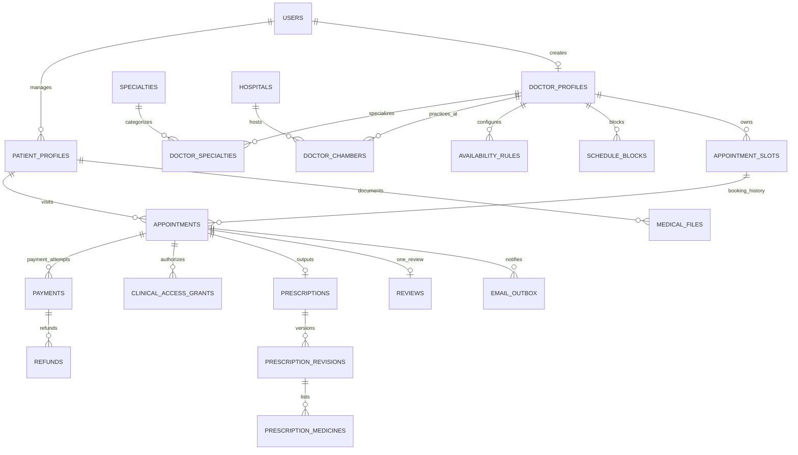

# 02 — Database Design, ERD, Constraints and Reasoning

**Database:** MySQL 8 / InnoDB · **ORM:** TypeORM · **ID representation:** `CHAR(36)` UUID for MVP simplicity · **Time:** UTC `DATETIME(3)` persisted and converted to Asia/Dhaka at the presentation boundary.

## Conceptual ERD

The same diagram is available standalone at [`../spec/schema.mmd`](../spec/schema.mmd), which can be pasted into Mermaid Live Editor or rendered by an editor supporting Mermaid.

This is an abbreviated overview. The complete ERD includes document verification, session security, gateway events, status events, video sessions and audit records.

## Why these separations matter

1. **`users` vs `patient_profiles`:** one account can manage a parent/child; appointment must identify the treated person, not just the payer.
2. **`availability_rules` vs `appointment_slots`:** weekly patterns are not actual reservations; generate dated slots and apply date-specific blocks.
3. **`appointment_slots` vs `appointments`:** the slot represents capacity at a time; appointment rows are immutable history even if cancelled or replaced.
4. **`payments` vs `refunds`:** refund is a separate financial lifecycle and may happen days later; never rewrite captured payment amounts.
5. **`prescriptions` vs `prescription_revisions`:** 24-hour editing must not erase original clinical-demo content; each revision has its own medicines.
6. **`medical_files` vs file blobs:** DB stores identifiers and metadata; files live in encrypted private object storage.
7. **`clinical_access_grants`:** owning a doctor role does not entitle unrestricted access; authorization is tied to care relationship and consent.
8. **`email_outbox`:** jobs survive worker restart and repeated processing can be deduplicated independently of Redis scheduling.

## Data dictionary (essential fields)

All tables have `id`, `created_at_utc`, `updated_at_utc` unless otherwise noted. Financial integers use **minor currency units** (BDT × 100); convert without floating-point rounding.

### Accounts and directory

| Table | Essential fields | Constraints / special notes |
| --- | --- | --- |
| `users` | `email`, `password_hash`, `role`, `status`, `display_name` | UNIQUE(email); role=PATIENT/DOCTOR/ADMIN; seeded admin only |
| `idempotency_records` | `user_id`, `endpoint`, `idempotency_key`, `request_hash`, `response_status`, `response_body`, `expires_at_utc` | UNIQUE(user_id, endpoint, idempotency_key); never store medical content or secrets in replay cache |
| `refresh_sessions` | `user_id`, `token_hash`, `expires_at_utc`, `revoked_at_utc`, `device_label` | Token hashes only; rotation/revocation |
| `patient_profiles` | `managed_by_user_id`, `relation`, `full_name`, `date_of_birth` | Restrict editing to manager; one SELF per manager |
| `doctor_profiles` | `user_id`, `bmdc_number`, `approval_status`, `approval_reason`, `bio`, `qualifications`, `languages`, `experience_years`, `video_fee_minor`, `chamber_fee_minor` | UNIQUE(user_id); UNIQUE(bmdc_number), public only if APPROVED and account ACTIVE |
| `doctor_documents` | `doctor_id`, `type`, `private_storage_key`, `scan_status` | Admin can inspect verification documents under controlled access; not medical content |
| `specialties` | `name`, `slug`, `active` | UNIQUE(slug) |
| `doctor_specialties` | `doctor_id`, `specialty_id` | Composite primary key |
| `hospitals` | `name`, `area`, `address`, `active` | Normalized hospital list |
| `doctor_chambers` | `doctor_id`, `hospital_id` (nullable), `address`, `area`, `name` | Hospital relation optional for private chambers |

### Scheduling, appointment and payment

| Table | Essential fields | Constraints / special notes |
| --- | --- | --- |
| `availability_rules` | `doctor_id`, `chamber_id` nullable, `weekday` 0–6 (Sunday=0), `start_local`, `end_local`, `slot_minutes` 10/15/20, `mode_policy` | Reject overlapping effective doctor rules; do not edit booked slots in place |
| `schedule_blocks` | `doctor_id`, `start_at_utc`, `end_at_utc`, `reason`, `created_by` | `start < end`; also used for leave/emergency |
| `appointment_slots` | `doctor_id`, `source_rule_id`, `chamber_id` nullable, `start_at_utc`, `end_at_utc`, `mode_policy`, `current_appointment_id` nullable | UNIQUE(`doctor_id`,`start_at_utc`), `start < end`; scheduling service enforces *no overlapping intervals* (unique start alone is not enough) |
| `appointments` | `slot_id`, `doctor_id`, `patient_profile_id`, `booked_by_user_id`, `modality`, `status`, `fee_minor`, `hold_expires_at_utc`, `confirmed_at_utc`, `completed_at_utc`, `cancelled_at_utc`, `rescheduled_from_id` | Multiple history rows per slot okay, but slot has at most one `current_appointment_id`; reschedules log old/new slot IDs immutably |
| `appointment_events` | `appointment_id`, `actor_user_id`, `old_status`, `new_status`, `old_slot_id` nullable, `new_slot_id` nullable, `reason` | Append-only status audit |
| `payments` | `appointment_id`, `gateway_tran_id`, `gateway_val_id`, `gross_minor`, `currency`, `commission_minor`, `status`, `validated_at_utc` | UNIQUE(gateway_tran_id), normalized gateway statuses, avoid storing card information |
| `payment_events` | `payment_id`, `gateway_event_key`, `external_status`, `received_at_utc`, `validated_at_utc` | UNIQUE(gateway_event_key), idempotency; sanitize callback logs |
| `refunds` | `payment_id`, `appointment_id`, `reason`, `refund_percent`, `refund_minor`, `status`, `provider_refund_id` | Status distinguishes SIMULATED from actual successful provider refund |

### Medical-demo, review and operations

| Table | Essential fields | Constraints / special notes |
| --- | --- | --- |
| `medical_files` | `patient_profile_id`, `uploaded_by_user_id`, `private_storage_key`, `mime_type`, `byte_size`, `checksum_sha256`, `scan_status` | No public URL; no data contents in audit logs |
| `clinical_access_grants` | `appointment_id`, `doctor_id`, `patient_profile_id`, `scope`, `expires_at_utc`, `revoked_at_utc`, `consented_by_user_id` | Authorization uses grant and appointment state; admin excluded |
| `consultation_sessions` | `appointment_id`, `opaque_room_name`, `started_at_utc`, `closed_at_utc` | UNIQUE(appointment_id), room generated from random ID, no patient name |
| `prescriptions` | `appointment_id`, `public_verify_id`, `current_revision_id`, `locked_at_utc` nullable until completed, `issued_at_utc`, `demo_only` | UNIQUE(appointment_id), UNIQUE(public_verify_id), no public diagnosis |
| `prescription_revisions` | `prescription_id`, `version`, `diagnosis_demo`, `tests_demo`, `advice_demo`, `created_by_doctor_id` | UNIQUE(prescription_id,version); immutable rows; generated PDF refers to revision |
| `prescription_medicines` | `revision_id`, `sort_order`, `medicine_name`, `dose`, `frequency`, `duration_days`, `instructions` | Controlled schema per revision, not copied from suggestions blindly |
| `reviews` | `appointment_id`, `rating`, `comment`, `moderation_status` | UNIQUE(appointment_id), rating 1–5, completed only |
| `email_outbox` | `appointment_id`, `recipient`, `template_key`, `due_at_utc`, `dedupe_key`, `delivery_status`, `attempt_count` | UNIQUE(dedupe_key); jobs retry without double send intent |
| `audit_logs` | `actor_user_id`, `action`, `resource_type`, `resource_id`, `occurred_at_utc`, `request_id` | No clinical contents, no secrets |

**Auxiliary data:** a read-only demo medicine suggestion dictionary can be stored as a seed JSON file rather than a dedicated database table for Day-12.

## Index and integrity plan

- `idempotency_records(user_id,endpoint,idempotency_key)` unique; `users(email)` unique; `doctor_profiles(bmdc_number)` unique; `doctor_profiles(approval_status, user_id)`.
- `doctor_specialties(specialty_id, doctor_id)`; `doctor_chambers(hospital_id, doctor_id)`.
- `appointment_slots(doctor_id, start_at_utc)` **unique**; `appointment_slots(start_at_utc, current_appointment_id)` query helper.
- `appointments(patient_profile_id, status, slot_id)` and `appointments(doctor_id, status, slot_id)`; for fast interval collision detection, query joined slot intervals under patient-profile row lock.
- `payments(gateway_tran_id)` unique; `payment_events(gateway_event_key)` unique; `refunds(payment_id, status)`.
- `prescriptions(public_verify_id)` unique; `prescription_revisions(prescription_id, version)` unique; `reviews(appointment_id)` unique.
- `email_outbox(due_at_utc, delivery_status)` and UNIQUE(dedupe_key).
- Foreign keys default `ON DELETE RESTRICT` for bookings, payments and prescription history; do not cascade clinical or financial records on account deletion.

## No-overlap guarantee beyond unique starts

MySQL has no native exclusion constraint for arbitrary time ranges. To prevent two differently starting doctor slots from overlapping, the **slot generation/update transaction must lock the `doctor_profiles` row**, examine all affected intervals, and only then insert/update dated slots. All slot-producing paths use the same locking discipline. Prevent `UPDATE` of booked slot intervals; create a replacement and move via auditable reschedule if needed. Application tests must cover this invariant. A unique `(doctor_id,start_at_utc)` index by itself only prevents identical starts, **not interval overlap**.

To prevent the same patient being booked with two doctors simultaneously, booking transactions lock the patient-profile row before checking `appointments` joined to `appointment_slots` for `existing.start < requested.end AND existing.end > requested.start`, counting confirmed appointments and **non-expired** holds.

Lock order for every booking/rebooking/cancellation path: **patient profile → doctor profile (when schedule mutation is needed) → slot(s) by ID → appointment → payment**. For two-slot reschedules, lock the slot IDs in deterministic ascending order. Keep transactions short, and retry limited deadlocks safely using request idempotency keys.

## Privacy design notes

- Doctors are authorized by user-to-doctor-profile identity plus `clinical_access_grants`, not by role alone; expired/revoked grants deny unrelated-history access.
- Patient/guardian access requires `patient_profiles.managed_by_user_id = auth.user.id`.
- Admin permission to review doctor identity documents **does not** confer access to `medical_files` or prescriptions.
- Private object keys are never exposed in general metadata listings; only authorized time-limited download endpoints produce signed object links.
- Synthetic demo notes are visually marked and have no clinical value.

## Migration sequence (Day 1/Day 2)

1. Accounts/session/roles/idempotency, patient profiles.
2. Doctor profiles/documents/specialties/hospitals/chambers.
3. Weekly schedules, blocks and slots.
4. Appointments/events and payment/refund records.
5. Medical files/access grants, consultations and prescriptions/revisions.
6. Reviews, outbox, audit and demo seed data.

**Referential caveat:** `appointment_slots.current_appointment_id` references `appointments.id`, and `appointments.slot_id` references `appointment_slots.id`. Add the former foreign key in a later migration or omit the FK while retaining a manually verified transactional invariant to avoid a circular-creation migration dependency. The nullable pointer is changed only inside booking transactions.
