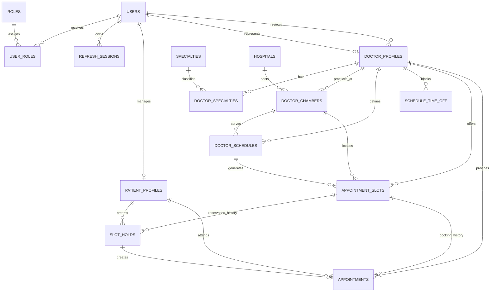

# Database Design and Migration Control

> Database: MySQL 8  
> ORM: TypeORM 0.3  
> Schema policy: Explicit migrations only  
> Time policy: UTC instants, `Asia/Dhaka` user display  
> Data policy: Synthetic development data only

## 1. Database responsibilities

MySQL is the authoritative source for:

- identities and roles;
- refresh sessions;
- doctor verification;
- directory metadata;
- recurring schedules and concrete slots;
- appointment holds and bookings;
- payments, refunds, and commission records;
- consultation membership;
- persistent messages;
- medical-document metadata and permissions;
- prescriptions and approvals;
- reviews, notifications, outbox events, and audit events.

Redis is not the permanent source for any of these records.

## 2. Core modeling principles

1. Use UUID primary keys for externally referenced records.
2. Name every foreign key, unique constraint, and important index.
3. Use InnoDB and `utf8mb4`.
4. Use `DECIMAL`, never floating point, for money.
5. Store real instants in UTC `DATETIME(3)`.
6. Store local recurring schedule clocks as `TIME`.
7. Store calendar-only values as `DATE`.
8. Use enums only for stable finite states; create migrations when states change.
9. Keep authentication identity separate from the person receiving care.
10. Preserve financial and clinical history instead of overwriting it.
11. Use database constraints as a final safety layer after service validation.
12. Avoid hard deletion of financial or clinical records after real operation begins.

## 3. Current entity relationship overview



## 4. Current tables

### 4.1 `roles`

Purpose: Stable authorization roles.

| Column | Type | Rule |
|---|---|---|
| `id` | `char(36)` | Primary key |
| `name` | `varchar(32)` | Unique; seeded values `PATIENT`, `DOCTOR`, `ADMIN` |
| `description` | `varchar(160)` | Nullable |

### 4.2 `users`

Purpose: Login identity, not necessarily the patient receiving care.

| Column | Type | Rule |
|---|---|---|
| `id` | `char(36)` | Primary key |
| `email` | `varchar(191)` | Unique, normalized lowercase |
| `password_hash` | `varchar(255)` | bcrypt hash only |
| `first_name` | `varchar(80)` | Required |
| `last_name` | `varchar(80)` | Required |
| `status` | enum | `ACTIVE`, `PENDING`, `SUSPENDED` |
| `email_verified_at` | `datetime(3)` | Nullable |
| `version` | unsigned integer | Optimistic version column |
| `created_at` | `datetime(3)` | UTC creation instant |
| `updated_at` | `datetime(3)` | UTC update instant |

### 4.3 `user_roles`

Purpose: Many-to-many identity role mapping.

- Composite primary key: `user_id`, `role_id`
- User deletion cascades mapping deletion.
- Role deletion is restricted.
- Index supports reverse lookup by `role_id`.

### 4.4 `refresh_sessions`

Purpose: Revocable, rotating login sessions.

Important fields:

- `user_id`
- unique SHA-256 `token_hash`
- `expires_at`
- `last_used_at`
- `revoked_at`
- `replaced_by_session_id`
- bounded `user_agent`
- IP address
- creation/update timestamps

Raw refresh tokens must never be stored.

### 4.5 `patient_profiles`

Purpose: Person receiving care for the initial own-profile workflow.

Important fields:

- unique `user_id`;
- phone;
- date of birth;
- biological sex value;
- address;
- timestamps.

Planned family support will allow one managing user to access multiple patient profiles
through explicit relationship and consent tables. It must not overload the current
one-to-one relation without a migration plan.

### 4.6 `doctor_profiles`

Purpose: Professional identity and verification state.

Important fields:

- unique `user_id`;
- unique `bmdc_number`;
- degrees, experience, biography, photo URL, languages;
- video consultation fee;
- application status;
- reviewer identity and review time;
- rejection reason;
- timestamps.

Application states:

```text
DRAFT → PENDING_REVIEW → APPROVED
                      ↘ REJECTED → PENDING_REVIEW
APPROVED → DRAFT when verified public details change
```

### 4.7 `specialties` and `doctor_specialties`

Purpose: Searchable medical specialty catalog and doctor mapping.

`specialties` has unique name and slug plus active status. The mapping uses a composite
primary key and prevents duplicate doctor/specialty relationships.

### 4.8 `hospitals`

Purpose: Public hospital/chamber location catalog.

Important fields:

- name;
- unique slug;
- area;
- address;
- active status.

### 4.9 `doctor_chambers`

Purpose: Doctor-specific hospital practice and fee.

Important constraints:

- unique doctor/hospital pair;
- positive bounded consultation fee validated by the API;
- active status;
- optional room or unit;
- foreign keys to doctor and hospital.

### 4.10 `doctor_schedules`

Purpose: Recurring local-time availability rules.

Important fields:

- `doctor_profile_id`;
- day of week from `0` Sunday through `6` Saturday;
- local `start_time` and `end_time`;
- slot duration;
- `VIDEO` or `CHAMBER` mode;
- chamber for chamber mode;
- active status.

Database checks enforce valid day, increasing time range, and valid mode/chamber
combination. Service validation prevents overlapping rules across both modes.

### 4.11 `schedule_time_off`

Purpose: Full-day or partial-day schedule exceptions.

- `date` is a Dhaka calendar date.
- Both start and end are null for a full day.
- Both are present and increasing for partial-day leave.
- Index supports doctor/date range lookup.

### 4.12 `appointment_slots`

Purpose: Concrete future appointment opportunities and booking authority.

Important fields:

- doctor and optional originating schedule;
- optional chamber;
- UTC `start_at` and `end_at`;
- mode;
- fee snapshot;
- slot status;
- `held_until` for temporary reservation;
- timestamps.

Constraints and indexes:

- unique doctor/start instant prevents two slots at the same doctor time;
- availability index supports doctor/status/start queries;
- hold-expiry index supports stale reservation cleanup.

Slot states:

```text
AVAILABLE
HELD
BOOKED
BLOCKED
```

### 4.13 `slot_holds`

Purpose: Reservation history for temporary slot control.

Important fields:

- slot;
- patient profile;
- status;
- expiry instant;
- release instant;
- timestamps.

Hold states:

```text
ACTIVE → CONVERTED
ACTIVE → EXPIRED
ACTIVE → RELEASED
```

The application locks the slot row before it examines or writes active hold state.

### 4.14 `appointments`

Purpose: Patient/doctor booking record with immutable schedule and fee snapshots.

Important fields:

- slot and unique originating hold;
- patient and doctor;
- scheduled start/end;
- mode;
- fee amount;
- appointment status;
- payment reference;
- cancellation reason;
- timestamps.

There may be historical failed/cancelled attempts for one slot. The slot state and row
lock, rather than a permanent unique slot constraint on appointments, prevent two
active bookings.

Appointment states:

```text
PENDING_PAYMENT
CONFIRMED
CANCELLED
PAYMENT_EXPIRED
COMPLETED
NO_SHOW
```

## 5. Planned tables

Names and fields are controlled designs, not implemented schema, until a migration is
created and tested.

### 5.1 Family and consent

#### `patient_guardians`

- `id`
- `patient_profile_id`
- `guardian_user_id`
- relationship type
- verification status
- active period
- timestamps

#### `patient_consents`

- `id`
- patient profile
- granted-to identity or participant
- scope
- granted/revoked timestamps
- evidence metadata

### 5.2 Doctor credentials

#### `doctor_credentials`

- doctor profile
- credential type
- private object key
- original filename and MIME type
- scan state
- reviewer identity
- review result
- timestamps

Do not place private credential object keys in the public doctor view.

### 5.3 Payments

#### `payments`

Implementation update (2026-10-19): `payments`, `payment_events`, and `refunds` now exist in migration `1761220800000-add-payments.ts`. The design below remains the broader target. The current exact columns, unique keys, and lifecycle are documented in [payments](./payments.md); refund execution and commission persistence remain future work.

Recommended fields:

- `id`
- `appointment_id`
- unique internal transaction ID
- gateway
- currency, normally `BDT`
- expected amount
- status
- gateway session key
- gateway validation ID
- initiated, paid, failed, cancelled, and expiry timestamps
- version/timestamps

Recommended states:

```text
CREATED → SESSION_CREATED → PENDING
PENDING → SUCCEEDED
PENDING → FAILED
PENDING → CANCELLED
PENDING → EXPIRED
SUCCEEDED → PARTIALLY_REFUNDED
SUCCEEDED → REFUNDED
```

#### `payment_events`

- payment ID
- unique gateway event or validation key
- event type
- safe normalized payload metadata
- received/processed timestamps
- processing result

The unique external key is the primary idempotency defense.

#### `refunds`

- payment and appointment;
- requested and approved amount;
- percentage and policy reason;
- gateway reference;
- status;
- requested/processed timestamps;
- admin actor when manual.

#### `commission_entries`

- appointment/payment;
- gross amount;
- platform commission;
- doctor earning;
- refund adjustment;
- immutable ledger type and timestamp.

### 5.4 Domain events and jobs

#### `outbox_events`

- unique event ID;
- aggregate type and ID;
- event type and version;
- JSON payload containing no unnecessary private content;
- occurred, published, and attempt timestamps;
- publish status.

#### `idempotency_keys`

- key;
- owner/scope;
- request fingerprint;
- resource/result reference;
- expiry and creation timestamps.

### 5.5 Consultations

#### `consultation_rooms`

- appointment ID, unique;
- provider and provider-room name;
- room status;
- opens/closes timestamps;
- created/ended timestamps.

#### `consultation_participants`

- room;
- identity or invitation;
- participant role;
- permissions;
- joined/left timestamps;
- revoked timestamp.

#### `consultation_invitations`

- room;
- inviter;
- intended participant email or opaque target;
- token hash;
- expiry;
- consent status;
- accepted/revoked timestamps.

Do not store audio or video recordings in the first delivery.

### 5.6 Messaging

#### `conversations`

- appointment ID, unique;
- opened/closed timestamps;
- status.

#### `conversation_participants`

- conversation;
- user;
- participant role;
- joined/removed timestamps.

#### `messages`

- conversation;
- sender;
- client-generated idempotency key;
- body;
- message type;
- sent/edited/deleted timestamps.

#### `message_reads`

- message or last-read sequence;
- participant;
- read timestamp.

### 5.7 Medical documents

#### `medical_documents`

- owning patient profile;
- uploader identity;
- optional appointment;
- private object key;
- original display filename;
- size and MIME type;
- checksum;
- scan state;
- document category;
- created/deleted timestamps.

#### `document_access_grants`

- document;
- granted user/doctor;
- grant reason/scope;
- appointment or care relationship;
- granted/revoked/expiry timestamps.

#### `document_reviews`

- document;
- doctor;
- status;
- reviewed timestamp;
- high-level note where permitted.

#### `document_comments`

- review/document;
- author;
- comment text;
- optional page/region metadata for later extension;
- timestamps.

### 5.8 Prescriptions

#### `prescriptions`

- appointment ID, unique active prescription;
- patient and doctor snapshots;
- current version;
- status;
- approved timestamp;
- PDF private object key;
- timestamps.

#### `prescription_versions`

- prescription;
- version number;
- structured advice/tests/follow-up;
- author;
- immutable creation timestamp.

#### `prescription_items`

- version;
- medicine display name;
- strength;
- dosage;
- frequency;
- duration;
- route;
- instructions;
- sort order.

#### `prescription_approvals`

- prescription version;
- approving doctor;
- approval instant;
- document checksum;
- identity metadata snapshot.

### 5.9 Reviews, notifications, and audit

#### `doctor_reviews`

- completed appointment, unique;
- patient;
- doctor;
- rating;
- text;
- moderation status;
- timestamps.

#### `notifications`

- recipient;
- type;
- safe structured payload;
- channel;
- status;
- scheduled/sent/read timestamps;
- idempotency key.

#### `audit_logs`

- actor ID and role;
- action;
- safe resource type and ID;
- request ID;
- success/failure result;
- IP metadata where policy permits;
- creation instant.

Audit logs must not store clinical bodies, raw tokens, or payment secrets.

## 6. Critical transaction designs

### 6.1 Slot hold

1. Begin transaction.
2. Load appointment slot with `FOR UPDATE`.
3. Verify start time satisfies lead rule.
4. If held and expired, expire previous hold/appointment state.
5. Reject booked, blocked, or active-held slot.
6. Insert hold.
7. Mark slot `HELD` with `held_until`.
8. Commit.

### 6.2 Payment confirmation

The external validation call happens before the database transaction. Then:

1. Begin transaction.
2. Lock hold, slot, appointment, and payment in that order. After waiting for locks, use locking/current reads for deduplication so MySQL repeatable-read snapshots cannot hide committed events.
3. Return existing result if payment is already successful.
4. Verify stored expected amount matches validated amount and currency.
5. Verify hold and appointment are eligible.
6. Mark payment `SUCCEEDED`.
7. Mark appointment `CONFIRMED`.
8. Mark hold `CONVERTED`.
9. Mark slot `BOOKED` and clear hold expiry.
10. Insert ledger and outbox events.
11. Commit.

### 6.3 Cancellation/refund request

1. Lock appointment and payment.
2. Verify actor and cancellable state.
3. Calculate policy from scheduled start and authoritative clock.
4. Store cancellation state and immutable policy result.
5. Create refund request/ledger entry.
6. Release or block slot according to policy and timing.
7. Insert outbox event.
8. Commit.
9. Process external refund outside the lock through an idempotent worker.

### 6.4 Prescription approval

1. Lock prescription aggregate.
2. Verify authenticated doctor owns the appointment relationship.
3. Verify appointment state permits prescription.
4. Freeze current version.
5. Insert approval metadata.
6. Mark prescription approved.
7. Insert PDF-generation outbox event.
8. Commit.

## 7. Index strategy

Create indexes from real query patterns, not guesses.

Required patterns include:

- normalized email lookup;
- active refresh token hash;
- doctor application status;
- doctor directory specialty/hospital/area/fee;
- doctor/day schedule;
- doctor/date time off;
- doctor/status/start availability;
- slot/status/hold expiry;
- patient/scheduled start appointments;
- doctor/scheduled start appointments;
- payment internal transaction ID;
- gateway validation/event ID;
- appointment/payment status;
- conversation/sent sequence messages;
- patient/document date;
- outbox publish status/occurred time.

Review query plans for directory and dashboard aggregation before claiming performance.

## 8. Migration standard

Migration filenames use an increasing timestamp and a concise action:

```text
1761134400000-add-appointment-booking.ts
```

Every migration must:

- implement `MigrationInterface`;
- have a stable class/name value;
- use named constraints/indexes;
- implement a safe `down` path when practical;
- avoid relying on TypeORM `synchronize`;
- register in `data-source.ts`;
- match entity metadata exactly;
- preserve existing rows or explicitly migrate them;
- be tested on the current development schema.

Commands:

```bash
npm run build
npm run db:migrate
npm run db:seed
```

Never edit an already applied shared migration to change history. Add a new corrective
migration. During the current unshared local phase, corrections still require careful
database verification.

## 9. Seed-data standard

Seed operations must be idempotent.

Allowed seed data:

- roles;
- specialties;
- fictional hospitals;
- explicitly synthetic patient, doctor, and admin accounts;
- synthetic schedules and availability.

Rules:

- Password comes from private environment configuration.
- Seeded professional identifiers must be marked non-real.
- Rerunning seed must not duplicate mappings or schedules.
- Never seed real medical data.
- Never place the demo password in tracked documentation.

## 10. Backup, retention, and deletion

Before any production use, define and test:

- encrypted backup frequency;
- point-in-time recovery requirements;
- restore procedure and measured restore time;
- retention periods for sessions, logs, messages, documents, prescriptions, and
  financial records;
- account deletion/anonymization rules;
- legal hold and clinical-record requirements;
- object storage lifecycle and orphan cleanup.

For the synthetic demonstration, migrations and seeds provide rebuildability, but
they are not a substitute for a backup of manually created demonstration scenarios.

## 11. Database review checklist

- [ ] Is the table owned by the correct module?
- [ ] Are identity and patient person modeled separately?
- [ ] Are required foreign keys present?
- [ ] Is deletion behavior intentional?
- [ ] Are finite states explicit?
- [ ] Are money and timestamps represented safely?
- [ ] Does the unique constraint match the real business invariant?
- [ ] Can historical records coexist with current state?
- [ ] Are contested writes protected by a lock or atomic condition?
- [ ] Does the index match an actual query?
- [ ] Can sensitive content be excluded from admin queries?
- [ ] Is the migration reversible and registered?
- [ ] Does seed remain idempotent?
