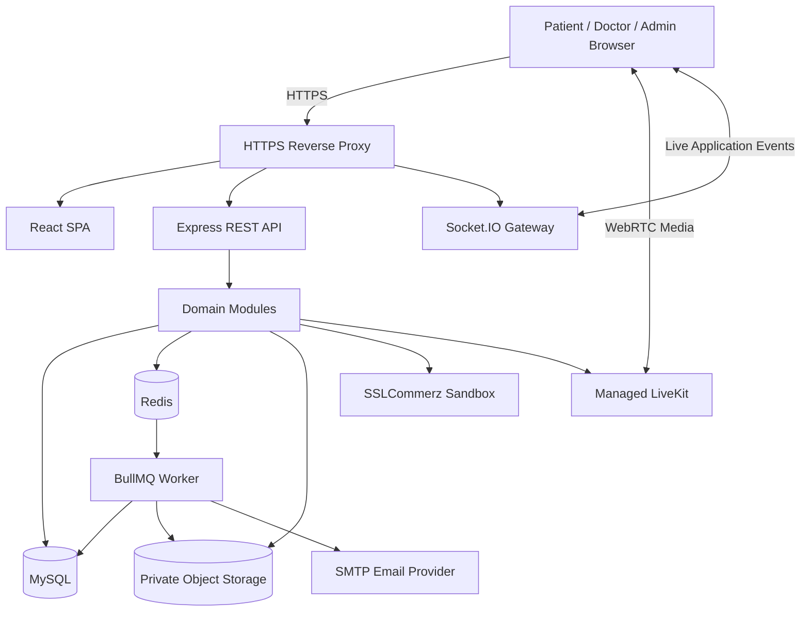
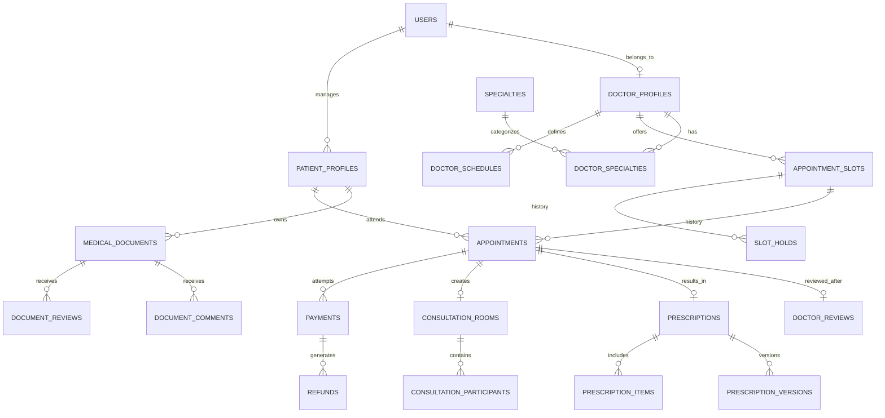
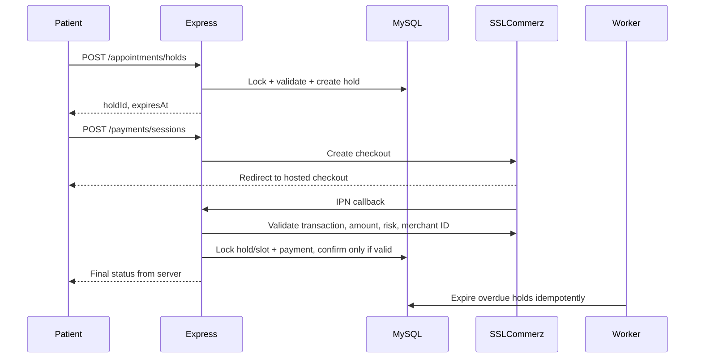

# MediConnect BD — Full Technical Development Plan

> **Version:** 1.0 · **Prepared:** 18 October 2026 · **Status:** Proposed implementation blueprint (not implemented)  
> **Project:** MediConnect BD — browser-based doctor discovery, booking and telemedicine platform  
> **Primary stack:** React + TypeScript · Express + TypeScript · TypeORM + MySQL · Redis + BullMQ · Socket.IO · LiveKit · SSLCommerz · Docker  
> **Delivery target:** Public **synthetic-data / sandbox-payment demo** in **12 working days**. A production healthcare launch requires additional clinical, legal, privacy, operational, penetration-testing and reliability work.

---

## Table of contents

1. [Executive decisions and success criteria](#1-executive-decisions-and-success-criteria)
2. [Requirements inventory and scope](#2-requirements-inventory-and-scope)
3. [Assumptions and questions for the client](#3-assumptions-and-questions-for-the-client)
4. [Quality attributes and nonfunctional targets](#4-quality-attributes-and-nonfunctional-targets)
5. [Technology decisions and alternatives](#5-technology-decisions-and-alternatives)
6. [System context and container architecture](#6-system-context-and-container-architecture)
7. [Domain modules and ownership](#7-domain-modules-and-ownership)
8. [Database schema and constraints](#8-database-schema-and-constraints)
9. [Business state machines and policies](#9-business-state-machines-and-policies)
10. [Atomic booking and payment design](#10-atomic-booking-and-payment-design)
11. [Doctor scheduling and slot generation](#11-doctor-scheduling-and-slot-generation)
12. [Video, group calling, audio and screen share](#12-video-group-calling-audio-and-screen-share)
13. [Messaging and notifications](#13-messaging-and-notifications)
14. [Medical documents, review and commenting](#14-medical-documents-review-and-commenting)
15. [Prescription drafting, approval and PDF](#15-prescription-drafting-approval-and-pdf)
16. [Complete API endpoint inventory](#16-complete-api-endpoint-inventory)
17. [Frontend information architecture](#17-frontend-information-architecture)
18. [Repository and backend code structure](#18-repository-and-backend-code-structure)
19. [Local setup, Docker and environment configuration](#19-local-setup-docker-and-environment-configuration)
20. [Background jobs and event processing](#20-background-jobs-and-event-processing)
21. [Security, privacy and clinical safeguards](#21-security-privacy-and-clinical-safeguards)
22. [Testing strategy and acceptance tests](#22-testing-strategy-and-acceptance-tests)
23. [Detailed 12-working-day execution plan](#23-detailed-12-working-day-execution-plan)
24. [Deployment, demo and operations](#24-deployment-demo-and-operations)
25. [Risk register and scope reduction](#25-risk-register-and-scope-reduction)
26. [Definitions of done, Git workflow and deliverables](#26-definitions-of-done-git-workflow-and-deliverables)
27. [Learning roadmap and official resource library](#27-learning-roadmap-and-official-resource-library)
28. [First 2 hours: exact next actions](#28-first-2-hours-exact-next-actions)
29. [Appendix: sample data and handoff templates](#29-appendix-sample-data-and-handoff-templates)

---

## 1. Executive decisions and success criteria

### 1.1 The architectural decision

Build a **modular monolith**: one TypeScript Express API organized into domain modules, one React web application with role-aware routes, one worker process for asynchronous jobs, one transactional MySQL database, and integrations for managed video, payment, email and object storage. Avoid building microservices in the 12-day period.

**High-level boundary:**

- **React**: user interface, forms, route handling, accessibility, optimistic display only where safe.
- **Express**: business authorization, state transitions, application-layer orchestration.
- **MySQL**: single source of truth for accounts, reservations, appointments, payments, clinical metadata and messages.
- **Redis/BullMQ**: job transport and short-lived operational coordination; never sole source of booking truth.
- **LiveKit**: group WebRTC audio/video tracks, screen sharing, room lifecycle.
- **Socket.IO**: application-level events such as persistent messages, document statuses, presence and notifications.
- **Private S3-compatible storage**: medical files and prescription PDFs; database stores metadata and access grants.
- **SSLCommerz**: sandbox payment session, IPN/payment verification, refund workflows.

### 1.2 What Day 12 must demonstrate

- [ ] Visitor searches doctors and inspects verified profiles.
- [ ] Patient registers, logs in, creates family profile, selects 7-day available slot.
- [ ] Two simultaneous booking requests cannot both reserve one slot.
- [ ] Video slot is held 10 minutes with authoritative expiry, sandbox payment confirmed.
- [ ] Patient receives email confirmation and simulated/real scheduled reminders.
- [ ] Patient and doctor join an appointment-specific room from browsers.
- [ ] A small **invited** group (target up to 4 participants) can join with appropriate consent.
- [ ] Audio-only controls, mute/unmute, camera, basic screen sharing on supported browsers.
- [ ] Persistent consultation-linked chat is retained on refresh/reconnection.
- [ ] Patient uploads a **synthetic** medical report; doctor reviews and comments.
- [ ] Doctor completes consultation, generates a structured prescription **draft**, explicitly approves it, patient downloads a PDF.
- [ ] Doctor manages schedule and today's queue.
- [ ] Admin verifies doctor, manages operational metadata, sees dashboard without accessing medical content.
- [ ] Refund-policy and no-double-booking tests pass; internet demo, README, GitHub commit history available.

### 1.3 Not a medical production go-live

Do **not** use actual medical files, actual patient identities, or real payment credentials in the initial public demo. For real clinical operation, add an independently assessed privacy/consent model, verified medical and regulatory requirements for Bangladesh, secure clinical governance, incident response, backups/restore verification and penetration testing. Avoid any claim that the software is legally certified or clinically validated merely because it runs.

---

## 2. Requirements inventory and scope

### 2.1 Roles

| Role | Domain capabilities | Restrictions |
|---|---|---|
| Visitor | Search doctor directory, view public profiles | Cannot book or see private details |
| Patient account | Own/family bookings, payment, calls, messages, reports, prescriptions, reviews | Access restricted to authorized patient profiles |
| Doctor | Register with BMDC number, apply, schedules, visits, reports, prescriptions, earnings | Must be approved; only permitted patient relationships |
| Administrator | Doctor verification, suspensions, directory configuration, operational metrics, refunds | No medical document/prescription/chat contents by default |
| Invited participant | Authorized group-call attendance (specialist/caregiver) | Appointment-scoped, consented, no implicit record access |

**Identity modeling:** a `user` is a login identity; a `patient_profile` is the person receiving care. A caregiver managing family accounts must not automatically obtain indefinite access to all medical data without a clear consent/guardian policy.

### 2.2 Features and delivery tiers

`P0` = needed to satisfy Day-12 core demo; `P1` = include a basic version if time allows; `P2` = documented extension, do not block launch.

| Area | Feature | Priority | Day-12 approach |
|---|---|---|---|
| Accounts | Register, login, JWT/refresh, roles, account suspension | P0 | Secure basic workflow |
| Doctor verification | BMDC number, certificate upload, approve/reject | P0 | Manual admin process (not automated BMDC validity proof) |
| Directory | Name, specialty, hospital, location, fee search | P0 | Indexed SQL queries |
| Profiles | Photo, credentials, languages, chamber, fees, rating | P0 | Public doctor profile |
| Scheduling | Weekly recurring, 10/15/20 min, unavailability | P0 | Server-generated 7-day slots |
| Booking | 1-hour minimum lead, max 7 days, concurrency protection | P0 | Transactional slot reservation |
| Holds | Video payments: 10-minute release | P0 | DB authoritative + worker |
| Payment | SSLCommerz sandbox, verified IPN | P0 | Hosted checkout and verification |
| Cancellation | Tiered refund, doctor cancellation full | P0 | Policy + tests, sandbox refunds/reconciliation |
| Notifications | Confirmation, 24h and 30m reminders | P0 | Email worker (sandbox/testing modes) |
| Calls | One-to-one video/audio + group room | P0 | Managed LiveKit, small room |
| Screen share | Present desktop screen/tab | P1 | Supported browsers; mobile fallback file share |
| Chat | Persistent appointment messaging | P0 | REST history + Socket.IO events |
| Medical reports | Private upload, download and doctor access | P0 | Supported PDF/JPG/PNG, scan workflow |
| Document review | Review status, general comments | P0 | Basic doctor workflow |
| Detailed annotation | PDF page/region annotation and collaborative review | P2 | Design schema, defer rich editor |
| Prescription | Structured medication/tests/advice form, PDF | P0 | Doctor authored and approved |
| Automatic prescription | Deterministic draft from doctor's entries | P0 | **No autonomous diagnosis or drug choices** |
| Speech-to-text | Consultation transcript | P2 | Requires consent and risk review |
| AI report summary | Clinician-assist draft | P2 | Not clinically trusted without evaluation |
| Family | Book for dependents | P1 | Basic linked patient profiles |
| Reviews | One review per completed appointment | P0 | Verified and moderated |
| Earnings | Day/month estimates, 10% commission | P1 | Aggregated paid/refund-adjusted amounts |
| Admin metrics | Appointments, revenue, patients, specialties, top doctors | P0 | Operational nonclinical aggregates |
| Video recording | Recording calls | Excluded | Off by default |
| Native app, SMS, lab booking, medicine delivery, insurance, Bangla | Later | P2 | Explicitly out of initial scope |

### 2.3 User stories (representative)

- **US-P01** As a visitor, I can filter approved doctors by specialty, hospital, area and fee.
- **US-P02** As a patient, I can view valid availability within the next 7 days.
- **US-P03** As a patient, I can reserve and pay for a video slot without racing another user.
- **US-P04** As a patient, I can cancel and see the calculated refund before confirming.
- **US-P05** As a patient, I can upload a lab report and grant my treating doctor read access.
- **US-P06** As a patient, I can join a call and message my doctor, even after page refresh.
- **US-D01** As an applicant doctor, I submit a BMDC number and private certificate documents for review.
- **US-D02** As an approved doctor, I set weekly hours, mode-specific prices, slot length and leave.
- **US-D03** As an authorized treating doctor, I read permitted reports and annotate reviews.
- **US-D04** As an authorized doctor, I prepare, verify and sign/approve prescription content.
- **US-A01** As an admin, I approve or reject doctor verification with a reason.
- **US-A02** As an admin, I process/monitor refunds without seeing private clinical content.
- **US-G01** As a consented invited participant, I can join a room with appointment-specific permission.

---

## 3. Assumptions and questions for the client

Create `docs/decision-log.md`. Each answer gets an ID, author, date and impact.

| ID | Question | Working assumption if no quick reply | Affected module |
|---|---|---|---|
| Q01 | Can caregivers/specialists join group calls? | Up to 4 invited participants; patient consent required | Consultation |
| Q02 | Can doctor have video and chamber consultations concurrently? | No: one doctor can conduct only one consultation at a time | Scheduling |
| Q03 | Is payment required to reserve chamber slots? | No, pay in chamber | Booking |
| Q04 | What if a gateway success arrives after hold expiry? | Reconciliation/refund, never double-book | Payments |
| Q05 | What is the rescheduling policy for already-paid visits? | Cancel + create new booking; apply stated cancellation policy until approved | Booking |
| Q06 | Who bears transaction costs and partial-refund fees? | Not assumed; financial reporting labels fee treatment as pending | Payments |
| Q07 | How are BMDC credentials checked? | Manual admin verification of supplied materials; do not claim automatic validation | Doctors |
| Q08 | How do family/guardian medical permissions work? | Explicit family relationship and authorization; needs legal/clinical review | Patients/Medical |
| Q09 | Who can inspect report history? | Assigned authorized doctor, with patient access grant/care relationship | Medical |
| Q10 | Should appointments be recorded? | No audio, video or message recording of media by default | Consultation |
| Q11 | Is there an approved medicine nomenclature/catalog? | Start with text suggestions from an approved/synthetic catalog | Prescriptions |
| Q12 | Who signs the prescription and how? | Authenticated doctor approval + printed doctor metadata; legal digital-signature validity pending review | Prescriptions |
| Q13 | What is the exact time boundary for refunds? | Exactly 24h = 50%, exactly 2h = 50%; >24h = 100%, <2h = 0% | Refunds |
| Q14 | Who may message before/after visits? | Participants of confirmed appointment; configurable retention/window | Messaging |
| Q15 | What happens if doctor blocks a booked day? | Cancel affected bookings, notify, full refund for doctor cancellation | Scheduling |
| Q16 | Does “live on the internet” mean production care? | Public synthetic-data demo, not live patient use | Deployment |

**Do not block Day 1 on every answer.** Record assumption + implementation consequence + date for review, and proceed on reversible choices.

---

## 4. Quality attributes and nonfunctional targets

| Attribute | Day-12 measurable target or principle |
|---|---|
| Responsiveness | Mobile-first responsive pages; test common widths at 360, 390, 768 and 1440 px |
| Accessibility | Semantic forms, keyboard control, visible focus, labels, contrast review |
| Time | Persist instants in UTC; display `Asia/Dhaka` (UTC+06:00); inclusive/exclusive windows explicit |
| Availability | Graceful errors and worker recovery; no unsupported uptime claim |
| Security | HTTPS, hashed passwords, validated input, no secrets in Git |
| Concurrency | Exactly one active reservation/booking for one doctor slot |
| Financial integrity | Idempotent callbacks, decimal BDT values, refund/commission audit trail |
| Privacy | No medical content in admin APIs, public URLs, logs or analytics |
| Media | 1:1 and one small-group call validated on real devices |
| Operability | Health checks, structured logs, request IDs, backup and restore test |
| API | OpenAPI docs, consistent errors, pagination and access controls |
| Testing | Automated booking, cancellation, callback and authorization integration tests |
| Maintainability | Module ownership, small services, explicit interfaces, TypeScript strictness |

**Measure actual performance before claiming numbers.** Do not promise medical uptime, accurate AI prescriptions, or universal mobile screen sharing for an MVP.

---

## 5. Technology decisions and alternatives

| Concern | Selected | Why | Alternative / caution |
|---|---|---|---|
| Frontend | React + Vite + TS | Fast setup, existing team familiarity | Next.js unnecessary for first demo |
| Styling | Tailwind + reusable UI components | Consistent UI | Plain CSS modules acceptable |
| Data fetching | TanStack Query | Cache/refetch/server state | Fetch + hooks for simplest prototype |
| Forms | React Hook Form + Zod | Validation and typed forms | Plain forms for tiny views |
| Backend | Express + TS | Meets client spec, team familiarity | Do not change framework mid-sprint |
| Database | MySQL 8 + TypeORM | Relational consistency and migration workflow | `synchronize: false` outside disposable local DB |
| Queue | BullMQ + Redis | Delayed/retry jobs | Cron alone insufficient for reliable distributed work |
| Messaging | Socket.IO + MySQL | Realtime delivery with persisted history | LiveKit transient chat is **not** persistent |
| Calls | Managed LiveKit | WebRTC group audio/video/screen share | Raw WebRTC signaling/SFU too risky for 12 days |
| Files | Private S3-compatible storage | Protected blobs + signed URLs | Local MinIO for development only |
| Email | Nodemailer + SMTP | Straightforward API | Verify deliverability, use test inbox first |
| Payment | SSLCommerz sandbox | Meets requirement | Need server-side validation/IPN and refund checks |
| PDF | pdf-lib or PDFKit | Server-generated printable output | Verify fonts/layout and identity metadata |
| Test | Vitest, Supertest, Playwright | Unit, HTTP integration, E2E | Run with disposable test DB |
| Deployment | Docker Compose + HTTPS proxy | Reproducible single-host demo | Real production needs hardened infrastructure |

Do not pin unverified “latest” package versions in the plan; lock tested versions in `package-lock.json` once installed.

---

## 6. System context and container architecture

### 6.1 System container diagram



**Trust boundaries:** public browser↔HTTPS; API↔database; API↔payment gateway; browser↔LiveKit; user files↔private storage; worker↔third-party email. Restrict every boundary separately.

### 6.2 Three types of communication

1. **REST / HTTPS:** create appointment, load profile, upload metadata, approve prescription, fetch history.
2. **Socket.IO / secure WebSocket:** `message:new`, `appointment:changed`, `document:reviewed`, online state. Authorize socket connection *and* every room subscription.
3. **WebRTC through LiveKit:** microphone, camera, audio-only, group participant tracks and supported screen-share tracks. Do not pipe media through Express.

### 6.3 Reliability patterns

- Transactional **outbox** record created with critical DB mutation; worker dispatcher publishes to BullMQ later.
- Redis jobs are **at least once in effect**, so processors must be idempotent.
- Financial and appointment status transitions only occur in MySQL transactions.
- Fail closed for medical-content access.
- Provide a public `/health/live` and internal `/health/ready` without exposing secrets.

---

## 7. Domain modules and ownership

| Module | Owns | Consumes |
|---|---|---|
| `auth` | Users' credentials, refresh sessions, login/logout | `users` |
| `users` | Role membership, suspension, user profiles | `auth` |
| `patients` | Patient profiles, family relationships, guardians | `users` |
| `doctors` | Doctor verification, BMDC evidence, doctor profile | `users`, `documents` |
| `directory` | Specialties, hospitals, chambers, doctor search | `doctors` |
| `scheduling` | Weekly rules, leave, concrete slots | `doctors` |
| `appointments` | Holds, bookings, cancellations, reschedule policies | `patients`, `scheduling` |
| `payments` | Gateway transactions, refunds, commission ledger | `appointments` |
| `consultations` | Room grants, participants, attendance, invitation | `appointments` |
| `messaging` | Conversations, messages, read status | `consultations`, `auth` |
| `medical-records` | Files, access grants, report review, comments | `patients`, `appointments` |
| `prescriptions` | Clinical drafts, versions, approval, downloadable PDFs | `appointments`, `medical-records` |
| `reviews` | Doctor reviews, one-per-appointment, moderation | `appointments` |
| `notifications` | Email, in-app notifications, reminder policy | Domain events |
| `admin` | Operational moderation/metrics | **Metadata-only** projections |

Implementation preference: route/controller/service/repository/schema/entity/tests within each feature; keep cross-domain orchestration in service interfaces/events, not circular imports.

---

## 8. Database schema and constraints

### 8.1 Entity groups

**Identity:** `users`, `roles`, `user_roles`, `refresh_sessions`.  
**Patients:** `patient_profiles`, `patient_guardians`, `patient_consents`.  
**Doctors/directory:** `doctor_profiles`, `doctor_verifications`, `doctor_credentials`, `specialties`, `doctor_specialties`, `hospitals`, `doctor_chambers`.  
**Scheduling/booking:** `doctor_schedules`, `schedule_exceptions`, `appointment_slots`, `slot_holds`, `appointments`, `appointment_status_history`.  
**Finance:** `payments`, `payment_transactions`, `refunds`, `commission_entries`.  
**Video:** `consultation_rooms`, `consultation_participants`, `consultation_sessions`, `consultation_invitations`.  
**Messaging:** `conversations`, `conversation_participants`, `messages`, `message_attachments`, `message_reads`.  
**Clinical:** `medical_documents`, `document_access_grants`, `document_reviews`, `document_comments`, `prescriptions`, `prescription_items`, `prescription_versions`, `prescription_approvals`.  
**Operations:** `doctor_reviews`, `notifications`, `outbox_events`, `audit_logs`, `idempotency_keys`.

### 8.2 ERD — primary relationships



### 8.3 Critical field definitions

**`users`**: `id`, `email UNIQUE`, `password_hash`, `status`, `email_verified_at`, `created_at`, `updated_at`. No clinical columns.  
**`patient_profiles`**: `id`, `managed_by_user_id`, `full_name`, `date_of_birth`, `relationship`, `created_at`. Sensitive identifiers minimized.  
**`doctor_profiles`**: `id`, `user_id UNIQUE`, `bmdc_registration_number UNIQUE (once normalized/verified)`, `approval_status`, `full_name`, `bio`, `years_experience`, `languages`, `chamber_fee`, `video_fee`.  
**`doctor_schedules`**: `id`, `doctor_id`, `day_of_week`, `local_start_time`, `local_end_time`, `slot_duration_minutes IN (10,15,20)`, `timezone`, `is_active`.  
**`schedule_exceptions`**: `id`, `doctor_id`, `starts_at_utc`, `ends_at_utc`, `type`, `reason`, `created_by`.  
**`appointment_slots`**: `id`, `doctor_id`, `starts_at_utc`, `ends_at_utc`, `status`, `active_hold_id NULL`, `hold_expires_at_utc NULL`, `version`. Persist **one capacity slot per doctor interval**, not separate conflicting chamber/video reservations.  
**`slot_holds`**: `id`, `slot_id`, `patient_profile_id`, `expires_at_utc`, `status`, `created_at`, `idempotency_key`. Historical rows may repeat per slot; only one can be active by slot state.  
**`appointments`**: `id`, `slot_id`, `doctor_id`, `patient_profile_id`, `booking_user_id`, `consultation_type`, `status`, `fee_amount DECIMAL(12,2)`, `currency='BDT'`, `booked_at`, `cancelled_at`, `completed_at`.  
**`payments`**: `id`, `appointment_id NULL` or `hold_id`, `provider`, `merchant_transaction_id UNIQUE`, `provider_validation_id`, `amount DECIMAL(12,2)`, `status`, `verified_at`. Model each attempt; do not overwrite history.  
**`refunds`**: `id`, `payment_id`, `amount DECIMAL(12,2)`, `reason`, `status`, `provider_reference`, `requested_at`, `completed_at`.  
**`consultation_participants`**: `id`, `room_id`, `user_id NULL`, `invitation_id NULL`, `role`, `consent_status`, `joined_at`, `left_at`.  
**`messages`**: `id`, `conversation_id`, `sender_user_id`, `client_message_id`, `body`, `created_at`, `edited_at`, `deleted_at`; unique `(conversation_id, client_message_id)` for retries.  
**`medical_documents`**: `id`, `patient_profile_id`, `uploaded_by_user_id`, `storage_key`, `original_display_name`, `mime_type`, `size_bytes`, `sha256`, `scan_status`, `created_at`.  
**`document_access_grants`**: `id`, `document_id`, `grantee_doctor_id`, `appointment_id NULL`, `grant_basis`, `granted_at`, `revoked_at`.  
**`document_comments`**: `id`, `document_id`, `author_doctor_id`, `page_number NULL`, `anchor_json NULL`, `comment`, `created_at`; page annotations are later.  
**`prescriptions`**: `id`, `appointment_id UNIQUE`, `patient_profile_id`, `doctor_id`, `status`, `verification_code UNIQUE`, `approved_at`, `editable_until`, `current_version`, `pdf_storage_key`.  
**`prescription_items`**: `id`, `prescription_id`, `medicine_name`, `strength`, `dose`, `route`, `frequency`, `timing`, `duration`, `instructions`, `sort_order`.  
**`prescription_versions`**: immutable snapshot JSON or normalized version children, `version_number`, `edited_by`, `edited_at`, `change_reason`.  
**`outbox_events`**: `id`, `event_type`, `aggregate_id`, `payload_json` (non-clinical minimum), `published_at`, `attempts`.

### 8.4 Indexes and invariants

- Unique `users.email`, normalized BMDC registration, `payments.merchant_transaction_id`, `prescriptions.verification_code`, `doctor_reviews.appointment_id`.
- Unique `appointment_slots(doctor_id, starts_at_utc)` **plus validation** for interval overlap (uniqueness on starts alone cannot protect against 5:00–5:20 overlapping 5:10–5:30).
- Composite indexes: slots `(doctor_id, starts_at_utc, status)`, appointments `(patient_profile_id, starts_at_utc)` and `(doctor_id, starts_at_utc)`, messages `(conversation_id, created_at, id)`.
- Foreign keys and explicit deletion/restriction policies. Prefer suspension/soft deletion over deleting appointment and financial history.
- Store BDT with DECIMAL types, never JS floating-point as accounting truth; use a decimal library or integer minor units internally.
- UTC database timestamps; local `Asia/Dhaka` only for UI and weekly schedule interpretation.
- Avoid PHI in logs, queues and analytics; references rather than full clinical content in job payloads.
- Migration scripts reviewed; disable automatic schema synchronization on shared/production databases.

### 8.5 Database migration order

1. Roles/users/session tables.
2. Patient/doctor profiles and specialties.
3. Hospitals/chambers/schedule rules.
4. Slots/holds/appointments/status history.
5. Payments/refunds/commission entries.
6. Rooms/participants/conversations/messages.
7. Medical documents/grants/reviews/comments.
8. Prescriptions/items/versions/approvals.
9. Notifications/outbox/audit/metrics support.

---

## 9. Business state machines and policies

**Keep slot, appointment, payment and refund states independent.** One all-purpose enum leads to impossible transitions.

### 9.1 Slot states

`AVAILABLE -> HELD -> BOOKED`; `HELD -> AVAILABLE` on authoritative expiry/cancel; `AVAILABLE -> BLOCKED` for doctor leave; `BOOKED` is released or retired only by an explicit cancellation/reschedule transaction with historical appointments retained.

### 9.2 Appointment states

`PENDING_PAYMENT -> CONFIRMED -> IN_PROGRESS -> COMPLETED`  
`CONFIRMED -> CANCELLED_BY_PATIENT | CANCELLED_BY_DOCTOR | NO_SHOW`  
For in-person bookings, transition straight to `CONFIRMED` if policy permits unpaid chamber reservations.

### 9.3 Payment states

`CREATED -> PENDING_GATEWAY -> VERIFIED_PAID` or `FAILED` or `EXPIRED`.  
A verified late success is recorded as `VERIFIED_PAID` with `requires_refund/reconciliation` but **not** a booking confirmation if the hold has expired and slot can no longer be secured.

### 9.4 Refund states

`REQUESTED -> SUBMITTED -> PROCESSING -> COMPLETED` or `FAILED` (retriable/escalated). Refund eligibility is not equivalent to a successfully processed external refund.

### 9.5 Cancellation policy

Use **UTC instants** and freeze `appointment.starts_at_utc` when calculating an eligible cancellation. `hours_before = startsAt - cancellationRequestAt`.

| Cancellation by | Window | Refund | Notes |
|---|---|---|---|
| Patient | More than 24 hours | 100% | Strictly greater |
| Patient | 2–24 hours inclusive | 50% | Exactly 2h and 24h included by working assumption |
| Patient | Less than 2 hours | 0% | Includes after start: cancellation typically rejected/treated as no-show |
| Doctor | Any time | 100% | Also notify and offer rebooking |

Calculation uses actual settled amount and clarifies gateway/commission accounting before production.

### 9.6 Prescription states

`DRAFT -> REVIEWED -> APPROVED -> LOCKED`. Doctor approval is mandatory. Within 24h of consultation completion (as interpreted with client), doctor can create a **new revision**; old approved versions remain immutable. Once locked, no edit without governed correction workflow. Public verification returns only validity/issuer/time and non-sensitive fields; not diagnosis/medicines.

---

## 10. Atomic booking and payment design

This is the **highest-risk** module. Implement it before visual polish.

### 10.1 Atomic slot hold (transactional algorithm)

1. Authenticate the booking user and authorize chosen `patient_profile_id`.
2. Validate doctor is approved, proposed slot begins at least 1 hour from server now and no more than 7 days ahead, and duration/type is allowed.
3. Begin transaction; consistently lock necessary doctor-scheduling guard, patient-profile guard and selected slot row, avoiding lock-order inversions. In one simple approach, lock the **patient profile row first**, then the **doctor row**, then **slot**, consistently in every competing workflow.
4. Recheck no overlapping appointment or live hold for the patient. Check doctor time exceptions and interval overlaps.
5. Consider `HELD` with `expires_at <= database_now` expired; only reclaim after doing the checks under lock.
6. If available, write `slot_holds` (10 minutes), update `appointment_slots` active hold and status, record event, commit.
7. Return `201` with hold ID and authoritative `expiresAt`; otherwise `409 SLOT_UNAVAILABLE`.
8. Call SSLCommerz **outside** the DB transaction; never hold row locks across network calls.

**Illustrative pseudocode — adapt to actual entity names/schema:**

```ts
await AppDataSource.transaction(async (tx) => {
  // Lock order must match cancellation/rescheduling/doctor-leave workflows.
  const patient = await tx.getRepository(PatientProfile).findOne({
    where: { id: patientProfileId },
    lock: { mode: 'pessimistic_write' },
  });
  if (!patient) throw new NotFoundError('Patient');

  const doctor = await tx.getRepository(DoctorProfile).findOne({
    where: { id: doctorId },
    lock: { mode: 'pessimistic_write' },
  });
  if (!doctor?.isApproved) throw new ForbiddenError();

  const slot = await tx.getRepository(AppointmentSlot).findOne({
    where: { id: slotId, doctorId },
    lock: { mode: 'pessimistic_write' },
  });
  if (!slot) throw new NotFoundError('Slot');

  // Use authoritative DB/transaction time, verify bookability and patient
  // interval overlap. Reclaim only expired holds while still under locks.
  await ensureBookableAndNoOverlap(tx, patient, doctor, slot);
  const hold = tx.create(SlotHold, {
    slotId: slot.id,
    patientProfileId,
    expiresAtUtc: addMinutes(await getDatabaseUtcNow(tx), 10),
    status: 'ACTIVE',
  });
  await tx.save(hold);
  await tx.update(AppointmentSlot, slot.id, {
    status: 'HELD', activeHoldId: hold.id,
    holdExpiresAtUtc: hold.expiresAtUtc,
  });
});
```

> This is **design pseudocode**, not drop-in compiled application code. Declare/import entities, types, helpers and exception classes when implementing. TypeORM requires using the **transactional entity manager** for every query inside the transaction.

**Concurrency correctness caveat:** `SELECT ... FOR UPDATE` locks rows, not arbitrary time ranges automatically. Unique doctor starts plus **doctor-row serialized schedule mutation** prevent generation of overlapping slots; patient-row serialization prevents overlapping booking across *different* doctors. Test both invariants.

### 10.2 Video checkout and 10-minute expiration



- Callback can arrive twice, before or after browser redirect, or after hold expiry. Ensure a unique provider transaction ID and idempotent state update.
- Never trust `success_url` browser query parameters as payment proof.
- Match payment amount/currency/merchant transaction ID to server-side order.
- Handle `risk_level` according to approved business policy; risky transactions should not automatically unlock consultation.
- On late success, retain financial audit record and initiate refund/manual reconciliation.
- Hold expiry worker improves prompt release, but the **booking API** independently evaluates `expires_at` in MySQL; do not rely on BullMQ timer precision.

### 10.3 Rescheduling

For MVP, implement reschedule as **one explicit server operation** that locks original appointment and target slot, checks policy and avoids temporarily losing both appointments. If payment policy is unresolved, offer cancel/rebook instead of inventing financial treatment. Log state history and suppress obsolete reminder jobs.

---

## 11. Doctor scheduling and slot generation

### 11.1 Model

- Weekly rule: weekday, local start/end, allowed appointment mode(s), slot duration (10, 15, 20), chamber location, mode-specific fees.
- Exception rule: date-range leave, holiday, emergency, special hours.
- Doctor single-capacity timeline: **the same doctor cannot simultaneously offer separately bookable video and chamber slots**.
- Define slot length as appointment duration and compute concrete UTC starts within the 7-day booking horizon.
- Slot generation can be idempotent per doctor/day with unique constraints; or compute on demand and insert when holding. For Day 12, pre-generate/persist 7-day slots when schedules change and reconcile exceptions.

### 11.2 Availability algorithm

1. Load approved doctor and active weekly schedule for desired Bangladesh-local day.
2. Generate candidate intervals in local timezone.
3. Exclude date exceptions, existing reserved/held intervals (unless hold expired), and past/too-near starts.
4. Confirm start `>= now + 1 hour` and `<= now + 7 days` according to agreed inclusive boundary.
5. Present slots with distinct chamber/video fee choices but **shared time capacity**.
6. Revalidate absolutely everything inside booking transaction.

### 11.3 Doctor emergency leave

When leave is approved, serialize against booking, block unbooked intervals, find affected appointments, transition to doctor-cancelled, create full-refund records for verified payments, write outbox events, and notify patients. Do not simply delete the appointments.

---

## 12. Video, group calling, audio and screen share

### 12.1 Provider architecture

Use LiveKit-managed WebRTC rooms for initial delivery (one room per booked consultation). Backend uses the LiveKit server SDK to generate a signed short-lived participant token after verifying authorization; React joins through `LiveKitRoom`.

**Room rules:**

- Appointment must be confirmed and correct type (or policy-approved mixed mode).
- Issue new join tokens only starting `starts_at - 5 minutes`; define a late-join grace window.
- Booked patient and assigned doctor are first-class room members.
- Specialist/caregiver invitations require patient consent, invitation expiry, role and max participants (target 4 for demo).
- No admin snooping, no public room URLs, no automatic recording.
- End room access once consultation ends; ensure short-lived tokens, room teardown and provider-specific revocation/participant removal behavior are understood.
- Sensitive clinical content stays off LiveKit participant metadata/room names.

**Call controls:** microphone toggle, camera toggle, audio-only, participant grid, connection status, leave call, device selection, supported screen-sharing controls, open messages, upload/view report panel, access prescription draft for doctor.

### 12.2 LiveKit + messaging separation

LiveKit's ready-made Chat component is **non-persistent**. Use Socket.IO + MySQL for persistent consultation history; optionally show LiveKit transient data events for in-room indicators, but avoid having two conflicting chat histories.

### 12.3 Mobile screen-sharing reality

Browser `getDisplayMedia()` is a **limited-availability Web API**. Some mobile browsers, especially Android browser variants, may not allow starting device screen share. Always feature-detect the API, hide/disable unsupported control with explanation, and provide **secure file upload / report-view sharing** as a fallback. Test actual Android and iOS browsers; do not promise screen sharing from every phone.

### 12.4 Media encryption and consent

Consider LiveKit E2EE for media and data; implement secure room-key distribution, key rotation policy and privacy review. E2EE does not protect screenshots or files once they are shared with an authorized participant. Recording/transcription require separate explicit consent and are deferred.

### 12.5 Call acceptance test

- Patient and doctor join on separate networks/devices.
- Third invited person joins with consent; uninvited user denied.
- Audio-only without camera functions.
- Browser switch/reconnect handles transient interruption.
- Doctor shares desktop tab on supported platform.
- Patient opens linked document while call continues.
- Token cannot be issued before allowed window or for cancelled appointment.

---

## 13. Messaging and notifications

### 13.1 Persistent message lifecycle

`Client compose -> POST /messages (or authenticated socket command) -> authorize conversation -> DB commit -> outbox -> Socket.IO delivery -> recipient refresh/replay from DB`.

Fields: `conversation_id`, `sender_user_id`, `client_message_id` (for dedupe), `body`, `message_type`, `created_at`, optional attachments; separate read markers.

### 13.2 Events

```text
conversation:joined
message:created
message:read
typing:start
typing:stop
appointment:status-changed
document:submitted
document:reviewed
prescription:issued
notification:new
```

Never treat an emitted socket event as proof that the message is durably saved or seen. On reconnection, fetch messages after the last stored cursor. Gate each conversation join by membership/care relationship. Use rate limits and attachment validation.

### 13.3 Notification matrix

| Event | Email | In-app | Recipient |
|---|---|---|---|
| Registration/verification | Yes | Yes | Applicant |
| Booking confirmed | Yes | Yes | Patient + doctor |
| 24h reminder | Yes | Yes | Patient + doctor |
| 30m reminder | Yes | Yes | Patient + doctor |
| Doctor cancellation | Yes | Yes | Patient |
| Refund started/completed | Yes | Yes | Patient |
| New medical document review | Optional | Yes | Patient |
| Prescription issued | Yes (notification/link only) | Yes | Patient |
| New message | Optional digest | Yes | Authorized recipient |

Reminder job handlers must re-read current appointment status and start time: cancelled/rescheduled visits must not trigger obsolete reminders.

---

## 14. Medical documents, review and commenting

### 14.1 Upload process

1. Patient/authorized guardian requests upload authorization.
2. API validates ownership, permitted category, size limit, content type and upload policy.
3. Upload to private quarantine/object storage; **not** web public directory.
4. Server validates actual file signatures/content (not just browser MIME), runs malware scanning before making file available, stores hash and metadata.
5. Patient grants treating doctor access to specific document/appointment.
6. Doctor obtains short-lived signed download URL after server check.
7. Reviewer creates status and comments; patient gets notification.

**MVP supported types:** PDF, JPEG, PNG. A proposed initial limit such as 10 MB/file needs approval and load/security testing. Do not accept executable file types.

### 14.2 Review model

`SUBMITTED -> SCANNING -> AVAILABLE -> IN_REVIEW -> REVIEWED | FOLLOW_UP_REQUIRED` (or `REJECTED` for failed validation). Keep review records separate from file metadata.

Basic review supports document list, preview, comments and status. Page-number / rectangle annotations are schema-compatible enhancements, but richer PDF annotation UI can be deferred.

### 14.3 Privacy

- Access: owner/authorized guardian + explicitly authorized treating clinicians.
- Admin receives workflow metadata (`status`, `count`, `file scan state`) but not report bytes or free-text clinical comments.
- Audit read/download/grant/revoke events with IDs and timestamps, not copied report contents.
- Signed URLs are bearer credentials; make them short-lived, avoid logging them, and prohibit sharing.

---

## 15. Prescription drafting, approval and PDF

### 15.1 What “automatic” means safely in MVP

**Safe automation:** doctor writes structured diagnosis, medicines, dose, frequency, duration, tests and advice; server automatically formats a draft, adds patient/doctor metadata, validates required fields, assigns a verification code and produces PDF **after doctor approval**.

**Not safe to promise:** system independently diagnoses patient, picks medicines, infers dosages from tests or signs prescription without doctor review. This is outside the Day-12 scope.

### 15.2 Workflow

`Appointment completed -> Doctor opens draft -> Adds clinical items -> Draft validated -> Doctor reviews and approves -> Immutable version saved -> PDF generated in worker -> Patient securely downloads -> Lock at 24h according to policy`.

- Require doctor identity, active approved status, assigned appointment and a completed consultation to issue.
- Keep historical versions and approval audit (`approved_by`, timestamp, clinician identity, content checksum).
- A later edit creates a new version; never silently replace previous issued record.
- Public prescription verification by code returns limited metadata only (not medical content).
- Medicine suggestion list from an approved and maintained catalogue; no fabricated medication choices.
- Do not call a typed doctor's name a legally valid digital signature without verifying the applicable legal rules.

### 15.3 PDF fields

Provider/organization header, prescription ID, issuance timestamp in BDT, physician display name/BMDC number, patient display name/age as appropriate, visit date, diagnosis, medicines (name/strength/dose/route/frequency/duration), tests, advice, follow-up, verification code/QR linking to public **minimal** verification page.

---

## 16. Complete API endpoint inventory

Version prefix: `/api/v1`. Protected endpoints require auth plus contextual authorization. `:id` parameters are opaque UUIDs or equivalent public identifiers. Mark endpoint status in the OpenAPI file as `PLANNED`, `IMPLEMENTED` or `TESTED` in your tracking document.

### 16.1 Identity and account

| Method | Endpoint | Purpose |
|---|---|---|
| POST | `/auth/register` | Create patient/doctor account |
| POST | `/auth/login` | Start authenticated session |
| POST | `/auth/refresh` | Refresh access token/session |
| POST | `/auth/logout` | Revoke session |
| POST | `/auth/forgot-password` | Start reset workflow |
| POST | `/auth/reset-password` | Complete reset |
| GET | `/users/me` | Identity + effective roles |
| PATCH | `/users/me` | Nonclinical account data |
| POST | `/admin/users/:id/suspend` | Suspend user (audited) |

### 16.2 Patients and doctors

| Method | Endpoint | Purpose |
|---|---|---|
| GET | `/patients/me` | My patient profiles |
| POST | `/patients/family-members` | Create associated patient profile |
| GET | `/patients/family-members` | List associated profiles |
| PATCH | `/patients/family-members/:id` | Edit allowed details |
| GET | `/doctors` | Search/filter approved doctors |
| GET | `/doctors/:id` | Public doctor profile |
| POST | `/doctors/applications` | Doctor application with evidence metadata |
| GET | `/doctors/me` | Own doctor profile |
| PATCH | `/doctors/me` | Update approved fields |
| GET | `/specialties` | Directory list |
| GET | `/hospitals` | Directory list |
| PATCH | `/admin/doctors/:id/verification` | Approve/reject with reason |
| POST | `/admin/doctors/:id/suspend` | Suspend doctor |

### 16.3 Scheduling and appointments

| Method | Endpoint | Purpose |
|---|---|---|
| GET | `/doctors/:id/slots?from=&to=` | Availability, next 7 days only |
| GET | `/doctors/me/schedules` | Doctor schedule rules |
| PUT | `/doctors/me/schedules` | Upsert weekly schedule |
| POST | `/doctors/me/blocked-dates` | Register leave/emergency |
| GET | `/doctors/me/appointments` | Doctor queue/list |
| POST | `/appointments/holds` | Atomic hold |
| GET | `/appointments/holds/:id` | Hold/expiry status |
| GET | `/appointments` | Patient appointment list |
| GET | `/appointments/:id` | Authorized appointment detail |
| POST | `/appointments/:id/cancel` | Cancel with refund policy |
| POST | `/appointments/:id/reschedule` | Move appointment if implemented |
| POST | `/appointments/:id/start` | Doctor marks in progress |
| POST | `/appointments/:id/complete` | Doctor marks completed |
| POST | `/appointments/:id/no-show` | Doctor marks no-show |

### 16.4 Finance

| Method | Endpoint | Purpose |
|---|---|---|
| POST | `/payments/sessions` | Begin hosted sandbox checkout for active hold |
| POST | `/payments/sslcommerz/ipn` | Payment IPN callback, public endpoint validated server-side |
| GET | `/payments/:id` | Own or operational payment state |
| GET | `/refunds/:id` | Refund status |
| GET | `/doctors/me/earnings` | Aggregated doctor earnings |
| GET | `/admin/payments` | Operational payment list |
| POST | `/admin/refunds/:id/retry` | Authorized retry/escalation |

### 16.5 Live consultations, messaging and medical data

| Method | Endpoint | Purpose |
|---|---|---|
| POST | `/appointments/:id/room-token` | Authorized scoped LiveKit join credential |
| POST | `/appointments/:id/invitations` | Invite guest participant |
| POST | `/appointments/:id/invitations/:inviteId/accept` | Consent + accept invitation |
| GET | `/appointments/:id/participants` | Authorized room roster |
| GET | `/conversations` | Own conversations |
| GET | `/conversations/:id/messages` | Paginated stored history |
| POST | `/conversations/:id/messages` | Persist message then broadcast |
| POST | `/documents/uploads` | Request allowed upload / metadata |
| POST | `/documents/:id/complete-upload` | Finalize scan pipeline |
| GET | `/documents` | List authorized patient files |
| GET | `/documents/:id` | Document metadata |
| POST | `/documents/:id/download-url` | Signed URL after authorization |
| POST | `/documents/:id/access-grants` | Permit treating doctor |
| POST | `/documents/:id/reviews` | Doctor review/status |
| POST | `/documents/:id/comments` | Doctor comments |
| GET | `/appointments/:id/prescription` | Authorized prescription/draft |
| POST | `/appointments/:id/prescription-drafts` | Structured draft from doctor data |
| PATCH | `/prescriptions/:id` | Authorized draft edit |
| POST | `/prescriptions/:id/approve` | Clinician approval |
| GET | `/prescriptions/:id/pdf` | Authorized PDF download |
| GET | `/prescriptions/verify/:code` | Privacy-minimal verification response |
| POST | `/appointments/:id/review` | One doctor review after completed visit |

### 16.6 Admin and operations

| Method | Endpoint | Purpose |
|---|---|---|
| GET | `/admin/dashboard` | Aggregated nonclinical metrics |
| GET | `/admin/appointments` | Operational appointment metadata |
| GET | `/admin/doctors/applications` | Pending applications |
| POST | `/admin/specialties` | Add specialty |
| POST | `/admin/hospitals` | Add hospital |
| DELETE | `/admin/reviews/:id` | Remove abusive review, audit reason |
| GET | `/health/live` | Basic liveness |
| GET | `/health/ready` | Internal dependency readiness |

**Sample success envelope:**

```json
{
  "success": true,
  "data": {
    "appointmentId": "example-uuid",
    "status": "CONFIRMED",
    "startsAt": "2026-10-20T11:00:00.000Z",
    "displayTimeZone": "Asia/Dhaka"
  },
  "requestId": "example-request-id"
}
```

**Sample error:**

```json
{
  "success": false,
  "error": {
    "code": "SLOT_UNAVAILABLE",
    "message": "This slot is no longer available."
  },
  "requestId": "example-request-id"
}
```

Use HTTP `201` created, `400` invalid, `401` unauthenticated, `403` unauthorized, `404` not found, `409` conflict, `422` semantic invalidity, `429` rate limit and `5xx` unexpected server failures. Never include stack traces/medical details in public error payloads.

---

## 17. Frontend information architecture

### 17.1 Route plan

```text
/                           Home / public search
/doctors                    Search doctors
/doctors/:id                Doctor profile and free slots
/login                      Login
/register                   Register

/patient/dashboard          Dashboard
/patient/appointments       Upcoming/history
/patient/family             Family profiles
/patient/documents          Upload/permission/reviews
/patient/messages           Conversations
/patient/prescriptions      Prescription list

/doctor/dashboard           Today queue
/doctor/schedule            Weekly + exceptions
/doctor/appointments        Appointments
/doctor/documents           Authorized reports/review
/doctor/prescriptions       Prescription editor
/doctor/messages            Conversations
/doctor/earnings            Earnings

/admin/dashboard            Metrics
/admin/doctor-applications  Verify credentials
/admin/appointments         Appointment operations
/admin/payments             Transactions/refunds
/admin/directory            Specialties and hospitals
/admin/reviews              Moderation

/consultations/:id          Shared doctor/patient/group call UI
/prescriptions/verify/:id   Public validity-only page
```

### 17.2 Component inventory

**Public:** `Navbar`, `SearchFilters`, `DoctorCard`, `DoctorProfile`, `FeeBadge`, `SlotPicker`, `Footer`.  
**Patient:** `BookingWizard`, `HoldCountdown`, `PaymentStatus`, `AppointmentCard`, `FamilySwitcher`, `DocumentUploader`, `MedicalDocumentList`, `ChatPanel`, `PrescriptionViewer`.  
**Doctor:** `WeeklyScheduleEditor`, `LeaveCalendar`, `TodayQueue`, `PatientSummary`, `DocumentReviewPanel`, `PrescriptionEditor`, `MedicationAutocomplete`, `EarningsSummary`.  
**Consultation:** `LiveKitRoomShell`, `ParticipantGrid`, `CallControls`, `InviteParticipants`, `DeviceSelector`, `NetworkStatus`, `ScreenShareFallback`, `ConsultationSidePanel`.  
**Admin:** `VerificationQueue`, `ApprovalDialog`, `AppointmentsTable`, `RefundQueue`, `KPIOverview`, `ReviewModeration`.  
**Shared:** `AuthenticatedLayout`, `RoleGuard` (UX only), `DataTable`, `ErrorBoundary`, `Modal`, `Toast`, `Skeleton`, `Pagination`, `EmptyState`, `AccessibleFormField`.

### 17.3 Frontend data flow

- TanStack Query for API-derived data with meaningful query keys (e.g., `['doctor', id]`, `['slots', doctorId, date]`).
- React Context or small state store for login identity only; do not duplicate all server data in global state.
- Socket.IO events should invalidate or update relevant query caches; never trust only socket payload for billing or privacy checks.
- Use form Zod schema aligned to backend types via shared contracts where appropriate.
- Patient clinical PDFs/images should not be cached in publicly accessible browser storage or analytics.
- On mobile, show chat/documents/prescription as tabs or a drawer adjacent to the call; audio-only if bandwidth limited.

---

## 18. Repository and backend code structure

```text
mediconnect-bd/
├── apps/
│   ├── web/
│   │   ├── src/
│   │   │   ├── app/ routes/ pages/ components/
│   │   │   ├── features/
│   │   │   │   ├── auth/ patients/ doctors/ admin/
│   │   │   │   ├── directory/ scheduling/ appointments/
│   │   │   │   ├── consultations/ messaging/ medical-records/
│   │   │   │   └── prescriptions/
│   │   │   ├── hooks/ lib/ styles/
│   │   ├── index.html
│   │   └── package.json
│   ├── api/
│   │   ├── src/
│   │   │   ├── app.ts
│   │   │   ├── server.ts
│   │   │   ├── config/
│   │   │   ├── database/{data-source.ts,migrations/,seeds/}
│   │   │   ├── modules/{auth/,users/,patients/,doctors/,directory/,
│   │   │   │             scheduling/,appointments/,payments/,
│   │   │   │             consultations/,messaging/,medical-records/,
│   │   │   │             prescriptions/,reviews/,notifications/,admin/}
│   │   │   ├── integrations/{livekit/,sslcommerz/,storage/,email/}
│   │   │   └── common/{errors/,middleware/,security/,utils/}
│   │   └── package.json
│   └── worker/
│       └── src/{queues/,processors/,dispatcher.ts,worker.ts}
├── packages/
│   └── shared/src/{types/,schemas/,constants/}
├── infra/{docker/,nginx/}
├── docs/{srs.md,assumptions.md,architecture.md,erd.md,
│         api.yaml,security.md,test-plan.md,decision-log.md}
├── tests/{integration/,e2e/,fixtures/}
├── compose.yaml
├── package.json
├── package-lock.json
├── .env.example
├── .gitignore
└── README.md
```

Module shape (illustrative):

```text
appointments/
  appointment.routes.ts
  appointment.controller.ts
  appointment.schema.ts
  appointment.service.ts
  appointment.repository.ts
  appointment.entity.ts
  appointment.events.ts
  appointment.service.test.ts
```

Keep controller thin; validation in Zod; complex business logic in services; DB queries in repository/transaction helpers; integrations behind adapters so sandbox and production credentials can be changed safely.

---

## 19. Local setup, Docker and environment configuration

### 19.1 Prerequisites

- Linux/macOS/Windows + Docker Engine/Compose plugin (for one-command runtime).
- Node.js active LTS and npm for local development; record exact installed version in README.
- VS Code; DBeaver for inspecting MySQL; Git and GitHub account.
- Sandbox credentials from SSLCommerz; managed LiveKit project; test SMTP account; private object-storage bucket or local MinIO.
- Do **not** commit production secrets or credential screenshots.

### 19.2 Safe initial commands

```bash
mkdir mediconnect-bd && cd mediconnect-bd
git init
npm init -y
mkdir -p apps/api/src apps/worker/src packages/shared/src docs tests infra
npm create vite@latest apps/web -- --template react-ts
cd apps/web && npm install && cd ../..
```

Configure root npm workspaces in `package.json` once the individual apps have their package files:

```json
{
  "name": "mediconnect-bd",
  "private": true,
  "workspaces": ["apps/*", "packages/*"],
  "scripts": {
    "dev:web": "npm run dev -w apps/web",
    "dev:api": "npm run dev -w apps/api",
    "test": "npm run test --workspaces --if-present"
  }
}
```

For backend, initialize `apps/api/package.json` with dependencies such as Express, TypeScript, TypeORM, MySQL2, Zod, Helmet, CORS, JWT tooling, bcrypt/argon2, Socket.IO, LiveKit server SDK, SSLCommerz HTTP integration and OpenAPI. Add workers with BullMQ/IORedis and storage/PDF dependencies **as the relevant module is implemented**. Use lockfile and `npm ci` in CI.

### 19.3 Proposed Docker services

`web`, `api`, `worker`, `mysql`, `redis`, optional `minio`, and `proxy`. On an external hosted environment, managed storage/video/email/payment endpoints are configured as credentials, not containers. Include health checks and startup dependencies; migrations as a one-off successful init step.

**Target command** after Dockerfiles and Compose have actually been created:

```bash
cp .env.example .env
# Fill only your own local development credentials.
docker compose up --build
```

> This is a **future target workflow**, not an assertion that a ready-to-run Compose file already exists. Do not put real `.env` secrets in Git; have `compose.yaml` reference variables.

### 19.4 Suggested `.env.example` variable names

```dotenv
NODE_ENV=development
PORT=4000
APP_URL=http://localhost:5173
API_URL=http://localhost:4000
DB_HOST=mysql
DB_PORT=3306
DB_NAME=mediconnect
DB_USER=mediconnect_app
DB_PASSWORD=replace_with_local_secret
REDIS_URL=redis://redis:6379
JWT_ACCESS_SECRET=replace_with_secure_random_value
JWT_REFRESH_SECRET=replace_with_separate_secure_random_value
LIVEKIT_URL=wss://your-project.livekit.cloud
LIVEKIT_API_KEY=replace_me
LIVEKIT_API_SECRET=replace_me
SSLCOMMERZ_STORE_ID=replace_me
SSLCOMMERZ_STORE_PASSWORD=replace_me
SSLCOMMERZ_ENV=sandbox
S3_ENDPOINT=http://minio:9000
S3_BUCKET=private-medical
S3_ACCESS_KEY=replace_me
S3_SECRET_KEY=replace_me
SMTP_HOST=replace_me
SMTP_PORT=587
SMTP_USER=replace_me
SMTP_PASSWORD=replace_me
TZ=UTC
```

These are **names and placeholders**, not working credentials. `VITE_`-prefixed variables are exposed to the browser build: never place provider secrets there.

### 19.5 Database workflow

1. Start MySQL container/instance and connect using DBeaver.
2. Create TypeORM DataSource configured by env; `synchronize: false`.
3. Create first entity migration; run migration via the correct compiled JS or TS CLI loader matching project module system.
4. Seed roles, specialties, synthetic doctors/patients/hospitals/slots.
5. Verify tables/indexes in DBeaver and inspect rollback behavior.
6. Write seeders idempotently; demo data clearly labeled synthetic.

---

## 20. Background jobs and event processing

| Queue/job | Trigger | Key safeguards |
|---|---|---|
| `slot.expire` | Hold expiry timestamp | DB clock recheck, idempotent release |
| `appointment.confirm-email` | Confirmed appointment | Deduplicate by appointment/event ID |
| `appointment.remind-24h` | 24h before start | Recheck appointment active and time current |
| `appointment.remind-30m` | 30m before | Same recheck |
| `doctor.leave-notify` | Approved leave affects bookings | No duplicate cancellation/refunds |
| `payment.reconcile` | Callback issue/unknown state | Unique merchant ID and provider validation |
| `payment.refund` | Eligible cancellation | Exactly-once business effect, retry safe |
| `document.scan` | Uploaded file | Quarantine until scan passes |
| `document.review-notify` | Review/comment created | Non-sensitive email summary |
| `prescription.generate-pdf` | Clinician approval | Deterministic version/hash |
| `outbox.dispatch` | Pending DB outbox entries | Lease/dedupe/retry |

Use exponential retry backoff and alerts/dead-letter-like review for repeated failure. Never rely on delayed jobs firing at the exact second. Reminder correctness must be tested with fake clocks and status re-checks.

---

## 21. Security, privacy and clinical safeguards

### 21.1 Authorization matrix

| Action/resource | Patient | Doctor | Admin | Invited guest |
|---|---|---|---|---|
| Public doctor profile | Read | Read | Manage | Read |
| Own bookings | Manage | Assigned queue | Metadata only | None |
| Own medical reports | Read/manage | Authorized read/review | **No content** | None unless specifically granted |
| Prescriptions | Authorized patient | Assigned issuer/authorized | **No content** | None unless specifically granted |
| Medical chat | Member only | Member only | **No clinical text** | Member if expressly invited |
| Video room | If booked | If assigned | **Cannot join** | If invited + consented |
| Payment transactions | Own payments | Earnings aggregate | Admin operations | None |
| Doctor verification documents | Not general | Own application | Verification reviewers only | None |

### 21.2 Controls checklist

- [ ] Password hash with Argon2id or appropriately configured bcrypt; rate-limited login; reset token expiry.
- [ ] Access tokens short-lived; refresh rotation and revoke-on-logout; secure HTTP-only refresh cookies where applicable; CSRF protection where cookies authorize writes.
- [ ] Request/body validation; parameterized DB access through TypeORM; centralized safe errors.
- [ ] Role **and row-level/relationship** checks for each record. Never trust a user-supplied `patientId`, `doctorId` or room name.
- [ ] Secure file upload validation including MIME/content signature, malware scan, quotas and quarantine.
- [ ] Private object storage, encryption-at-rest, time-limited signed URLs, restricted service credentials.
- [ ] No healthcare content in public CDN caching, analytics, email bodies or application logs.
- [ ] Signed room token from server only; short TTL, least-privilege participant grants; no secret in frontend.
- [ ] HTTPS/WSS; CORS allowlist; rate limiting; Helmet; security headers.
- [ ] Audit reads, shares, revocations, prescribing and refund/doctor approvals with minimal metadata.
- [ ] Backups encrypted; restore tested; access to backup storage limited.
- [ ] Physician identity and BMDC process reviewed with client; medical signature validity verified before real care.
- [ ] Consent for family profiles, group participants and optional audio/AI processing.
- [ ] Admin UI denial must be matched by API and storage-encryption/key controls. For strict “admin cannot read medical content” including privileged operators, get independent cryptographic architecture review.

### 21.3 Threat model starters

| Threat | Primary protection/test |
|---|---|
| Other patient guesses report ID | Resource-level permission test yields 403/404, never bytes |
| Admin tries prescription file endpoint | Explicit deny and signed URL not issued |
| Forged payment callback | Server-to-server validation + ID/amount match |
| Replay callback | Idempotent unique transaction IDs |
| Race booking | Row/guard locks and concurrency tests |
| Persistent XSS in report comments | Output escaping, rich-text sanitization if ever added |
| Malicious PDF upload | File signature validation, quarantine, scan |
| Guest guesses call URL | Signed short-lived token + authorization/invitation |
| Leakage through logs | Redacted structured logging and safe traces |
| Delayed notification after cancellation | Recheck current authoritative appointment state |

### 21.4 Important compliance caveat

This document is an engineering plan, **not a legal compliance certification**. Before accepting real patients, engage qualified local legal/privacy and medical stakeholders to verify Bangladesh healthcare, telemedicine, digital prescription, practitioner verification, retention, patient-consent and data-protection obligations. Avoid making unsupported claims of HIPAA compliance; applicability depends on legal context and deployments.

---

## 22. Testing strategy and acceptance tests

### 22.1 Test pyramid

- **Unit / Vitest:** cancellation boundary logic, 7-day/1-hour booking windows, fee/commission calculations, role and state transition functions.
- **Integration / Supertest + MySQL test database:** auth, doctor approval, API route authorization, migrations, concurrent holds, cancellation/refund transaction, payment IPN idempotency, report ownership.
- **Frontend / component tests:** form errors, slot countdown state, document review controls, prescription approval confirmations.
- **End-to-end / Playwright:** doctor discovery→hold→sandbox payment status→appointment; doctor approves prescription→patient downloads synthetic PDF.
- **Live manual automation where feasible:** multi-browser room, invited guest denied/allowed, network reconnect, desktop screen sharing and mobile audio/video.
- **Security tests:** horizontal/vertical permission escalation and signed-download abuse.

### 22.2 Concurrency test (must pass)

```text
Given:
  1 approved doctor with 1 currently available slot
  20 valid patient profiles each with a valid session
When:
  20 POST /appointments/holds requests start simultaneously
Then:
  Exactly 1 returns 201 Created
  Exactly 19 return 409 SLOT_UNAVAILABLE (or equivalent explicit conflict)
  Exactly 1 active hold exists in DB for the slot
  Slot state is HELD and points to that hold
  After expiry, a new patient may reserve (if slot time still bookable)
```

Also test **same patient books simultaneous overlapping slots with two different doctors**: one must fail even if the slots have different IDs.

### 22.3 Cancellation test matrix

| Input | Expected policy |
|---|---|
| Patient cancels 25h before | 100% refund |
| Patient cancels exactly 24h before | 50% refund |
| Patient cancels 12h before | 50% refund |
| Patient cancels exactly 2h before | 50% refund |
| Patient cancels 1h59m before | 0% refund |
| Doctor cancels 10 minutes before | 100% refund |
| Second cancel request | Idempotent; no duplicate refund |
| Payment failed/not paid | No fictitious cash refund |

### 22.4 Critical other test cases

- Hold expired concurrently with payment callback; never two confirmed appointments.
- Callback delivered twice and browser redirect repeats; no duplicate finance entries.
- Session revoked/suspended cannot request room token.
- Patient cannot fetch another patient's reports/prescriptions/messages.
- Admin cannot see clinical PDFs, prescription body or chat history.
- Invited caregiver allowed only for approved appointment and consenting patient.
- Doctor blocked-date operation notifies existing booked patients and starts correct refunds.
- Appointment reschedule suppresses obsolete reminders.
- Prescription cannot be issued by another doctor, cannot edit after lock, version history retained.
- Review only completed appointment, exactly one per appointment.
- Mobile camera/mic permission denied produces actionable UI rather than blank page.
- Test restores from real backup to temporary DB (demo dataset only).

### 22.5 Definition of pass

Tests have deterministic fixtures and no dependency on uncontrolled real patient data. CI runs lint, typecheck, unit tests, targeted integration tests and build. Document manual demo media tests separately; passing automated REST tests is not proof that all WebRTC devices work.

---

## 23. Detailed 12-working-day execution plan

**Planning assumption:** approximately **12 PM–8 PM Bangladesh time**, one main developer, 8 hours/day. This is an aggressive demo sprint, not an assurance of production quality. Allocate daily ~30–60 minutes to testing, commits, decision log and stakeholder update. Start integration spikes early so dependencies do not fail on Day 10.

### Day 1 — Requirements, decisions and domain modeling

**12:00–13:00** Read requirements; divide P0/P1/P2; capture contradictions and client questions.  
**13:00–14:00** Create user stories and acceptance criteria; define patient vs user, doctor vs guest.  
**14:00–16:00** Create ERD for identity, scheduling, booking, payment, consultation, clinical records.  
**16:00–17:30** Outline route inventory, policies, role matrix and events.  
**17:30–19:00** Initialize Git, monorepo, docs; choose Docker/storage/LiveKit sandbox strategy.  
**19:00–20:00** Review, commit, prepare blocker/questions list.

**Done:** SRS, decision log, draft ERD, API list, repo, README stub.  
**Commit example:** `docs: capture requirements, domain model and API inventory`.

### Day 2 — Containers, database and technical spikes

**12:00–13:00** Build Compose scaffolding, MySQL/Redis health checks and API health route.  
**13:00–15:00** Configure TypeORM DataSource; identity/doctor/patient migrations.  
**15:00–16:00** Seed roles, specialties, hospitals and synthetic users.  
**16:00–17:00** Verify LiveKit managed project + sample room token connection.  
**17:00–18:00** Verify SSLCommerz sandbox credentials, IPN/public callback plan.  
**18:00–19:00** Prototype private file storage adapter and mail test inbox.  
**19:00–20:00** Execute migrations from clean database and commit.

**Done:** `docker compose up --build` target works for base app with documented environment; DB migrations/seed checked; external integration risk identified.  
**Dependency gate:** If sandbox credentials are unavailable, use a **clearly labeled payment simulator interface** for internal tests, while escalating that real sandbox demo acceptance will remain blocked.

### Day 3 — Auth and Day-3 review

**12:00–14:00** Register/login/access token/refresh/logout; password hashing + validation.  
**14:00–15:00** RBAC/role checks and suspended account denial.  
**15:00–17:00** Patient, doctor, admin role-aware login screens and protected routes.  
**17:00–18:00** Swagger/OpenAPI initial routes, auth tests.  
**18:00–19:00** Verify one-command install on clean environment.  
**19:00–20:00** Client demonstration, Git commit and status.

**Client checkpoint:** Requirements, ERD, planned APIs, one-command runtime and role logins.  
**Do not proceed with untested auth or broken migrations.**

### Day 4 — Doctor verification and directory

**12:00–14:00** Doctor profile/BMDC evidence upload metadata/approval states.  
**14:00–15:00** Admin approve/reject/suspend and reason audit.  
**15:00–17:00** Specialties, hospitals, chamber locations and searchable profiles.  
**17:00–19:00** Doctor profile forms/public listing UI.  
**19:00–20:00** Tests, role denial and seed polishing.

**Done:** only admin-approved doctors appear in public search; verification files private.

### Day 5 — Scheduling engine

**12:00–14:00** Recurring weekly schedule; 10/15/20-minute slots.  
**14:00–16:00** Doctor single-capacity timeline, exception/leave, timezone conversion.  
**16:00–18:00** Slot persistence/generation and indexed query.  
**18:00–19:00** Doctor schedule UI and patient slot picker.  
**19:00–20:00** One-hour/7-day boundary tests.

**Done:** deterministic free slots, no overlapping doctor sessions; API authoritative.

### Day 6 — Discovery and integration checkpoint

**12:00–14:00** Search by name/specialty/hospital/area/fee; pagination.  
**14:00–16:00** Public doctor details and 7-day availability UI.  
**16:00–17:30** Patient profile/family-member selection for booking.  
**17:30–18:30** LiveKit 1:1 media proof of concept on two browsers.  
**18:30–20:00** Fix core bugs, test, demo, commit.

**Client checkpoint:** Approved doctors set schedule; patients search and see valid slots.

### Day 7 — Booking engine and concurrency proof

**12:00–14:30** Slot/patient/doctor lock protocol, hold entities, idempotency.  
**14:30–16:30** Booking API, 10-minute expiry, release worker.  
**16:30–18:00** 20-request concurrency integration test; overlapping patient test.  
**18:00–19:00** Hold timer/checkout-pending UI.  
**19:00–20:00** Race-condition review and commit.

**Done:** exactly one valid reservation survives a 20-request same-slot race.

### Day 8 — Payment and cancellation

**12:00–14:30** SSLCommerz session, validation, IPN, redirect.  
**14:30–16:00** Confirm appointment transaction and handle late success.  
**16:00–17:30** Cancellation policy calculation, refund records and commissions.  
**17:30–18:30** Doctor cancellation/leave affected booking handling.  
**18:30–20:00** Duplicate callback/refund boundary tests.

**Done:** sandbox confirmed booking and idempotent financial workflow.

### Day 9 — Email, jobs, persistent chat, basic documents

**12:00–13:30** BullMQ worker/outbox/confirmation/reminders.  
**13:30–15:00** Socket.IO authenticated conversations, message persistence.  
**15:00–17:00** Private PDF/image upload, scan workflow and access grants.  
**17:00–18:30** Confirmation/24h/30m reminder testing with controlled clock.  
**18:30–20:00** Payment+booking+notification integration checkpoint.

**Client checkpoint:** slot hold, sandbox payment, confirmation and reminders demonstrably work.

### Day 10 — Consultations and group calling

**12:00–14:00** Appointment room tokens; 5-minute gate and participant security.  
**14:00–16:00** LiveKit React room, one-to-one/group/audio modes, call controls.  
**16:00–17:30** Guest invitations, consent, group room limit.  
**17:30–18:30** Desktop screen share + mobile fallback UI.  
**18:30–20:00** Multi-device testing, reconnect and messaging panel integration.

**Done:** two-person and 3–4-person room with secure join flow.

### Day 11 — Medical workflow, prescription and admin

**12:00–13:30** Doctor file review and comments.  
**13:30–16:00** Structured prescription draft, approval, revisions, PDF and verification.  
**16:00–17:30** Doctor day/month earnings and 10% commission display.  
**17:30–18:30** Reviews and admin KPI dashboard.  
**18:30–20:00** Clinical authorization tests, PDF check, commit.

**Done:** doctor can review synthetic documents and approve downloadable PDF without automatic clinical decisions.

### Day 12 — End-to-end quality, deployment and handoff

**12:00–13:30** Full regression: bookings/payment/refunds/authorization/clinical PDF.  
**13:30–15:00** Mobile/desktop call test; two different network paths if possible.  
**15:00–16:30** HTTPS deployment, migrations, data backup, seed demo accounts.  
**16:30–17:30** Smoke test public URL, provider callbacks and email.  
**17:30–18:30** README, architecture, API spec and known-issues list.  
**18:30–20:00** Live demo rehearsal + client handoff.

**Client checkpoint:** public **synthetic-data demo**, doctor/patient video call, document review, approved PDF, basic group call, admin dashboard, source code and tests.  
**If the project is late:** first complete a secure 1:1 consultation + booking + sandbox payment + clinician-approved PDF; group calling/annotations beyond basic chat are explicit fallback cuts.

---

## 24. Deployment, demo and operations

### 24.1 Deployment checklist

- [ ] Approved hosting with stable public HTTPS endpoint.
- [ ] Secure HTTPS/WSS reverse proxy and valid certificate.
- [ ] MySQL/Redis only on private network; no public admin ports.
- [ ] Secrets injected by environment/secret manager; separate sandbox/prod configuration.
- [ ] DB migrated and **synthetic** demo data seeded.
- [ ] LiveKit project configured and two-device room tested.
- [ ] SSLCommerz sandbox callback/IPN points to public server and provider validation passes.
- [ ] Test SMTP configured, reminders tested.
- [ ] Private S3 storage and restrictive ACL configured.
- [ ] Upload scanning/size enforcement enabled; disable unsafe document paths until ready.
- [ ] Redacted logs, request IDs, health checks, error monitoring.
- [ ] Full database backup and restore documented/tested.
- [ ] Operational README, test credentials kept separate from public repositories.
- [ ] Public `robots`/demo warnings and clear **no real patient data** banner.

### 24.2 Demo script (10–15 minutes)

1. Admin logs in and approves synthetic doctor application.
2. Doctor sets weekly schedule and 15-minute video fee.
3. Patient searches and selects a free slot.
4. Demonstrate parallel booking simulation or show concurrency test result.
5. Patient reserves, pays using gateway **sandbox**, receives email.
6. Doctor/patient open a call; invite third participant; audio/video controls and supported desktop screen share.
7. Patient uploads synthetic PDF; doctor reviews/comments; messaging persists after refresh.
8. Doctor completes appointment and signs off structured prescription draft; patient downloads generated PDF.
9. Patient reviews doctor; admin sees nonclinical metrics and refund records.
10. Show GitHub commits, tests, README and public demo URL.

### 24.3 Operating after Day 12

Document who rotates secrets, monitors queues, reviews dead jobs, handles refunds, verifies doctors, restores backups, scans uploaded files and responds to security incidents. Plan expansion to a staging environment and production hardening rather than treating the demo as finished clinical infrastructure.

---

## 25. Risk register and scope reduction

| Risk | Likelihood/impact | Early mitigation | Fallback |
|---|---|---|---|
| 12-day timeline exceeds scope | High / High | P0/P1/P2 gates, daily integration | Deliver secure core demo; defer AI/annotations |
| SSLCommerz sandbox access delayed | Medium / High | Validate account Day 2 | Clearly labeled internal simulator; flag client gate blocked |
| LiveKit room/auth or mobile issues | Medium / High | Two-browser spike Day 2/6 | Preserve 1:1 audio/video; restrict unsupported mobile screen share |
| Complex slot races | High / High | Locks + integration tests Day 7 | Block release until invariants proven |
| Late payment callbacks | High / High | Payment state machine, ID validation | Reconcile/refund instead of forcing booking |
| Medical data leak | Medium / Critical | Access matrix, restricted storage, tests | Disable document module until safe |
| Doctor digital signature misunderstanding | Medium / High | Confirm required legal method | Mark PDF as demo until approved |
| Email deliverability | Medium / Medium | Test inbox and sender validation early | In-app notice + test evidence |
| Background worker stops | Medium / High | DB authoritative expiry, process health | Worker restart and catch-up sweep |
| Free hosting sleeps/insufficient RAM | Medium / Medium | Prove deployment early | Use a stable paid/approved host if available |
| Developer unfamiliar with some stack | High / Medium | Official documentation + minimal examples | Avoid unnecessary libraries and abstractions |

**Cut order:** AI-based clinical summaries/transcription -> detailed PDF annotations -> sophisticated chat/read states -> expanded group limits -> advanced analytics. Do **not** cut booking atomicity, server-verified payment, authorization or doctor approval of prescriptions.

---

## 26. Definitions of done, Git workflow and deliverables

### 26.1 Definition of done per feature

- [ ] User story and explicit acceptance criteria exist.
- [ ] Entity/migration change committed and tested.
- [ ] Backend route and Zod schema implemented.
- [ ] Authorization checked at API and resource levels.
- [ ] Service contains business rules, not UI-only checks.
- [ ] Success/error and edge cases covered by tests.
- [ ] Frontend integrated and mobile-responsive.
- [ ] API spec/README updated, no secrets committed.
- [ ] Relevant user flow manually exercised.
- [ ] Commit created with meaningful message.

### 26.2 Git workflow

Use `main` as stable integrated demo branch; develop small branches, for example `feat/booking-holds`, `feat/livekit-room`, `feat/document-review`. Merge through reviewed PR when possible and keep main buildable. Use conventional commits:

```text
chore: bootstrap React Express workspace
feat(auth): add patient and doctor authentication
feat(schedule): generate seven-day doctor slots
feat(booking): enforce atomic ten-minute holds
test(booking): prove single winner in concurrent requests
feat(payment): validate sandbox IPN and reconcile callbacks
feat(consultation): add appointment-scoped group room
feat(records): add protected report review workflow
feat(prescription): generate approved PDF and versions
fix(security): block unauthorized document access
```

Suggested CI checks: `npm ci`, lint, TypeScript typecheck, Vitest unit tests, MySQL-backed integration tests, frontend build and optional Playwright smoke test. Store CI database secrets as environment secrets.

### 26.3 Final handoff package

- GitHub repository with regular commits and protected secret handling.
- `README.md`: setup, env, Docker command, migration/seed, test, deployment notes.
- `docs/srs.md`, `architecture.md`, `erd.md`, `api.yaml`, `security.md`, `test-plan.md`, `decision-log.md`.
- Dockerfiles and Compose, migration scripts, tests, sample synthetic dataset.
- Public demo URL, patient/doctor/admin **demo account details delivered securely**, not hardcoded on a public repository.
- Demo video/live demonstration, known-issues list, security/privacy caveats, future backlog.

---

## 27. Learning roadmap and official resource library

Read the **minimum required documentation for the next day's work**; do not spend a full day consuming tutorials. These links are primary/official references wherever possible; check current package APIs before copying older tutorials.

### 27.1 Foundation: React, TypeScript, Express, Node

1. React Learn — components, hooks and state: https://react.dev/learn
2. React reference: https://react.dev/reference/react
3. TypeScript Handbook: https://www.typescriptlang.org/docs/handbook/intro.html
4. Vite getting started: https://vite.dev/guide/
5. React Router documentation: https://reactrouter.com/home
6. TanStack Query React overview: https://tanstack.com/query/latest/docs/framework/react/overview
7. React Hook Form: https://react-hook-form.com/get-started
8. Zod documentation: https://zod.dev/
9. Tailwind CSS with Vite: https://tailwindcss.com/docs/installation/using-vite
10. Express official guide: https://expressjs.com/en/guide/routing.html
11. Node.js documentation: https://nodejs.org/en/learn
12. Node.js security best practices: https://nodejs.org/en/learn/getting-started/security-best-practices

### 27.2 MySQL, TypeORM and transactions

13. MySQL reference manual: https://dev.mysql.com/doc/refman/8.0/en/
14. InnoDB locking reads: https://dev.mysql.com/doc/refman/8.0/en/innodb-locking-reads.html
15. TypeORM transactions: https://typeorm.io/docs/transactions/
16. TypeORM CLI / migrations: https://typeorm.io/docs/using-cli/
17. TypeORM executing migrations: https://typeorm.io/docs/migrations/executing/
18. TypeORM repository API: https://typeorm.io/docs/working-with-entity-manager/repository-api/
19. DBeaver user guide: https://dbeaver.com/docs/dbeaver/
20. Mermaid ER diagrams: https://mermaid.js.org/syntax/entityRelationshipDiagram.html

### 27.3 Realtime, video and browser compatibility

21. LiveKit React components: https://docs.livekit.io/reference/components/react/
22. LiveKit `VideoConference`: https://docs.livekit.io/reference/components/react/component/videoconference/
23. LiveKit `LiveKitRoom`: https://docs.livekit.io/reference/components/react/component/livekitroom/
24. LiveKit access tokens and grants: https://docs.livekit.io/home/server/generating-tokens
25. LiveKit in-room chat **does not persist history**: https://docs.livekit.io/reference/components/react/component/chat/
26. LiveKit encryption overview / key responsibilities: https://docs.livekit.io/transport/encryption/
27. Socket.IO introduction: https://socket.io/docs/v4/
28. Socket.IO delivery guarantees: https://socket.io/docs/v4/delivery-guarantees/
29. MDN WebRTC API: https://developer.mozilla.org/en-US/docs/Web/API/WebRTC_API
30. MDN `getDisplayMedia()` browser screen sharing: https://developer.mozilla.org/en-US/docs/Web/API/MediaDevices/getDisplayMedia

### 27.4 Payment, background jobs, storage and mail

31. SSLCommerz developer documentation: https://developer.sslcommerz.com/
32. SSLCommerz integration documentation: https://sslcommerz.com/integration-document/
33. SSLCommerz sandbox docs: https://sandbox-gw.sslcommerz.com/docs
34. BullMQ guide: https://docs.bullmq.io/
35. BullMQ delayed jobs: https://docs.bullmq.io/guide/jobs/delayed
36. BullMQ retry strategy: https://docs.bullmq.io/guide/retrying-failing-jobs
37. Redis documentation: https://redis.io/docs/latest/
38. AWS S3 pre-signed URLs and security: https://docs.aws.amazon.com/AmazonS3/latest/userguide/using-presigned-url.html
39. MinIO documentation (local S3-compatible development): https://min.io/docs/minio/linux/index.html
40. Nodemailer documentation: https://nodemailer.com/
41. pdf-lib documentation: https://pdf-lib.js.org/
42. PDFKit guide: https://pdfkit.org/docs/getting_started.html

### 27.5 Security, API and testing

43. OWASP Cheat Sheet Series: https://cheatsheetseries.owasp.org/
44. OWASP file upload security: https://cheatsheetseries.owasp.org/cheatsheets/File_Upload_Cheat_Sheet.html
45. OWASP authorization security: https://cheatsheetseries.owasp.org/cheatsheets/Authorization_Cheat_Sheet.html
46. OWASP REST security: https://cheatsheetseries.owasp.org/cheatsheets/REST_Security_Cheat_Sheet.html
47. OWASP API Top 10: https://owasp.org/API-Security/editions/2023/en/0x11-t10/
48. OpenAPI specification: https://spec.openapis.org/oas/v3.1.1.html
49. Swagger UI: https://swagger.io/tools/swagger-ui/
50. Vitest guide: https://vitest.dev/guide/
51. Supertest repository/docs: https://github.com/ladjs/supertest
52. Playwright introduction: https://playwright.dev/docs/intro
53. Docker Compose docs: https://docs.docker.com/compose/
54. Docker health-check startup order: https://docs.docker.com/compose/how-tos/startup-order
55. GitHub Actions for Node: https://docs.github.com/en/actions/how-tos/write-workflows/choose-what-workflows-do/build-and-test-nodejs

### 27.6 Practical reading order

| Day | Read these first | Then build |
|---|---|---|
| 1 | OpenAPI, Mermaid ERD, TypeORM concepts | SRS + ERD + endpoint design |
| 2 | Docker Compose, TypeORM migrations, LiveKit tokens | Project bootstrap, DB, integration spikes |
| 3 | Express, Zod, OWASP authorization | Auth and roles |
| 4–5 | MySQL locking and transactions | Scheduling + slot engine |
| 6 | TanStack Query + React Router | Directory and booking UI |
| 7 | TypeORM transactions + InnoDB locking reads | Booking concurrency proof |
| 8 | SSLCommerz docs and IPN | Verified checkout/refund design |
| 9 | BullMQ + Socket.IO delivery + OWASP uploads | Background jobs/chat/reports |
| 10 | LiveKit React + tokens + MDN screen capture | Group consultation UI |
| 11 | PDFKit/pdf-lib + privacy | Doctor-approved prescription |
| 12 | Playwright + Docker production concepts | Deployment, audit and demo |

---

## 28. First 2 hours: exact next actions

If you have not created the repository, start here. The first two hours should produce **documents and a concrete architecture decision**, not dozens of empty files.

### First 30 minutes

- [ ] Create `mediconnect-bd` Git repository.
- [ ] Create `docs/srs.md`, `docs/decision-log.md`, `docs/erd.md`, `docs/api.yaml` placeholders.
- [ ] Write P0/P1/P2 from section 2 into `srs.md`.

### Next 30 minutes

- [ ] Resolve Q01 (group permission), Q04 (late payment), Q06 (gateway costs), Q12 (prescription signature) as explicit assumptions/client questions.
- [ ] Define three user stories that prove core value: book, video consult, approved prescription PDF.

### Next 40 minutes

- [ ] Draw the entities `users`, `patient_profiles`, `doctor_profiles`, `doctor_schedules`, `appointment_slots`, `slot_holds`, `appointments`, `payments`, `prescriptions`.
- [ ] Add relationships, unique indexes and transaction boundaries.

### Last 20 minutes

- [ ] Write endpoints for register/login, search doctors, get slots, create hold, initialize payment, verify callback and room token.
- [ ] Commit docs with `docs: establish MediConnect architecture and P0 scope`.

**Decision at end of Day 1:** Is the system using *one shared doctor-time slot capacity* for chamber/video? The answer should be **yes**, unless the client explicitly approves the doctor providing simultaneous independent services (which conflicts with ordinary single-doctor scheduling).

---

## 29. Appendix: sample data and handoff templates

### 29.1 Synthetic demo fixture set

- 1 admin account.
- 2 approved synthetic doctors and 1 pending synthetic doctor.
- 3 patient accounts, plus 2 family patient profiles.
- 4 specialties and 3 fictional hospitals/chambers.
- 7 days of generated doctor slots.
- 1 sample paid sandbox video booking, 1 chamber booking.
- 2 synthetic PDFs and 1 synthetic medical image **clearly labeled FAKE / DEMO**.
- 1 doctor-approved synthetic prescription with fake medicine/example instruction, no claim of clinical validity.
- 1 completed review and 1 refund scenario.

Never copy a real patient's prescription or lab report to create a fixture.

### 29.2 Daily progress template

```markdown
## MediConnect BD — Day N
**Date:** YYYY-MM-DD
**Hours:** 12:00–20:00 Asia/Dhaka

### Planned
- ...

### Completed
- ...

### Tests run
- ...

### Blockers / decisions
- ...

### Commit(s)
- ...

### Next day priority
- ...
```

### 29.3 Client acceptance signoff template

```markdown
# MediConnect BD — Demo Acceptance

- [ ] Day-3 architecture, migrations and role login
- [ ] Day-6 doctor search, schedules and free slots
- [ ] Day-9 atomic booking, sandbox payment, confirmation and reminders
- [ ] Day-12 one-to-one and invited group room; voice/video
- [ ] Day-12 documented screen-sharing compatibility/fallback
- [ ] Day-12 messaging and synthetic document review
- [ ] Day-12 doctor-approved downloadable prescription PDF
- [ ] Day-12 reviews, admin nonclinical dashboard, basic finance
- [ ] Concurrency and cancellation tests passed
- [ ] Secure synthetic data, no real medical information
- [ ] README, GitHub, demo accounts, live HTTPS link

Known limitations:
- ...

Approved by:
Date:
```

### 29.4 Future backlog (post-demo)

- Advanced PDF page/region annotations and collaborative report review.
- Carefully evaluated clinician-assist AI reporting and transcription with consent, data processing agreements and human verification.
- Patient-controlled granular data sharing across multiple doctors.
- Integrated catalog with medicines, contraindication and interaction validation from licensed clinical data sources (requires clinical governance).
- More comprehensive refund settlement/payout ledgers and tax accounting.
- HA hosting, disaster recovery exercises, security testing and medical workflow auditing.
- Native mobile apps, notifications via SMS, Bangla localization, lab/medicine integrations.

---

## Final working principle

> **Database is authoritative for bookings and money. Express owns authorization and business rules. LiveKit owns live media. Socket.IO delivers application events, while MySQL persists messages. The worker processes background tasks. Doctors—not automation—approve clinical decisions and prescriptions.**

**Start with the ERD, transactional booking constraints and security boundaries. Add features in vertical slices and test each slice end-to-end.**
