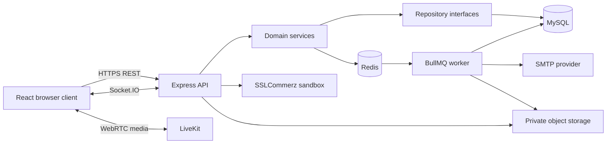

# Backend Architecture and Code Standard

> Applies to: `MediConnectBDbackend`, `worker`, and backend-owned shared types  
> Framework: Express 5 with strict TypeScript  
> Architecture: Modular monolith with explicit dependency boundaries

## 1. Technology standard

| Concern | Approved technology | Purpose |
|---|---|---|
| Runtime | Node.js 24+ | API and worker runtime |
| Language | TypeScript strict mode | Type safety and maintainability |
| HTTP framework | Express 5 | REST API and middleware |
| Request validation | Zod | Runtime input parsing and typed output |
| ORM | TypeORM | Entities, repositories, transactions, migrations |
| Database | MySQL 8 | Transactional source of truth |
| Cache/job transport | Redis | BullMQ transport and short-lived coordination |
| Background jobs | BullMQ | Reminders, email, file jobs, reconciliation |
| Authentication | JWT + opaque refresh token | Short access and revocable long session |
| Password hashing | bcrypt | Password protection |
| Realtime app events | Socket.IO | Persistent-chat delivery and status events |
| Video/audio | LiveKit | WebRTC media and screen sharing |
| Payments | SSLCommerz sandbox | Hosted checkout and verified callback flow |
| File storage | Private S3-compatible service | Medical files and prescription PDFs |
| Logging | Pino | Structured logs and request IDs |
| Tests | Vitest + Supertest | Unit and HTTP tests |
| PDF | PDFKit or pdf-lib | Server-generated prescription documents |
| Email | Nodemailer/SMTP | Transactional email through worker |

Do not add a competing library for an existing concern without a recorded technical
decision. For example, do not introduce Prisma beside TypeORM or another validation
library beside Zod.

## 2. Why Express remains the framework

The current code has the important structure NestJS would otherwise provide:

- modules grouped by business capability;
- dependency injection at application startup;
- schema validation;
- service/repository interfaces;
- centralized middleware and errors;
- testable services independent of Express;
- explicit database migrations.

Express is intentionally kept small. Structure is enforced through this document and
tests instead of framework decorators.

## 3. Runtime architecture



### 3.1 Process responsibilities

**API process**

- authenticates and authorizes users;
- validates requests;
- applies synchronous business rules;
- performs transactional state changes;
- returns stable API responses;
- issues signed external-service grants.

**Worker process**

- sends notifications;
- schedules reminders;
- expires and reconciles delayed work;
- scans or processes uploaded files;
- generates PDFs when asynchronous generation is appropriate;
- retries idempotent operations.

The worker must call the same domain/repository rules or dedicated job services. It
must not reproduce different business rules in a second implementation.

## 4. Source layout

```text
MediConnectBDbackend/src/
├── app.ts                         Express middleware and global errors
├── routes/v1.ts                   Versioned router composition
├── server.ts                      Dependency construction and process lifecycle
├── middlewares/                   Error handler, not-found, request IDs
├── utils/                         Stable errors and general helpers
├── config/
│   └── env.ts                     Environment validation
├── database/
│   ├── data-source.ts             TypeORM registration
│   ├── migrations/                Ordered schema history
│   └── seeds/                     Idempotent synthetic data
└── modules/
    └── <module>/
        ├── <module>.routes.ts
        ├── <module>.controller.ts
        ├── <module>.schema.ts
        ├── <module>.entity.ts
        ├── <module>.service.ts
        ├── <module>.repository.ts
        ├── typeorm-<module>.repository.ts
        └── <module>.types.ts
```

## 5. Dependency direction

Dependencies flow inward:

```text
Express route (URL and middleware)
    ↓
Controller (HTTP input/output)
    ↓
Zod schema
    ↓
Domain service
    ↓
Repository interface
    ↓
TypeORM repository
    ↓
MySQL
```

Rules:

- Routes bind URLs, authentication/role middleware, and controllers.
- Controllers depend on schemas and services, and format the HTTP response.
- Services may depend on repository interfaces and domain types.
- Services must not import Express request or response objects.
- Repository interfaces must not expose TypeORM entities or query builders.
- TypeORM repositories may depend on entities and TypeORM.
- Entities must not contain application orchestration.
- One module must not directly update another module's tables without an approved
  cross-module service/repository operation.

## 6. Application composition and dependency injection

Construct dependencies once in `server.ts`:

```ts
const doctorRepository = new TypeOrmDoctorRepository(AppDataSource);
const doctorService = new DoctorService(doctorRepository);

const schedulingService = new SchedulingService(
  new TypeOrmSchedulingRepository(AppDataSource),
  doctorRepository,
);
```

Do not instantiate repositories inside routes. Constructor injection makes services
testable with in-memory fakes.

## 7. Route standard

Routes register paths and middleware, then delegate to a controller. The controller should only:

1. read authenticated context;
2. parse parameters, query, or body with Zod;
3. call one service method;
4. choose the HTTP status and serialize the result.

Approved pattern (`.routes.ts`):

```ts
router.post(
  "/holds",
  authenticate,
  requireRole("PATIENT"),
  controller.holdSlot,
);
```

Do not place SQL, password hashing, payment verification, or complex state conditions
inside a route.

## 8. Validation standard

Every external value is untrusted, including:

- JSON body;
- route parameters;
- query strings;
- headers;
- cookies;
- payment callbacks;
- Socket.IO payloads;
- job data;
- file metadata;
- values returned by third-party APIs.

Use Zod at the boundary:

```ts
export const createHoldSchema = z.object({
  slotId: z.string().uuid(),
});
```

Validation rules:

- trim human-entered text;
- normalize emails to lowercase;
- set explicit maximum lengths;
- reject invalid enum values;
- validate money as a bounded decimal input;
- validate dates and time ranges semantically, not only with a regular expression;
- limit array sizes;
- reject or intentionally strip unknown security-sensitive fields;
- do not trust client-provided user IDs when identity is available from the token.

## 9. Service standard

Services own business meaning and state rules.

Example responsibilities:

- determine whether a doctor may publish availability;
- determine whether a hold is still valid;
- determine cancellation percentage;
- authorize a participant for a consultation;
- validate that a prescription may be approved.

Service methods should return domain views or throw `AppError` with a stable code.
They should be deterministic when supplied with a clock function.

Use an injectable clock for time-sensitive behavior:

```ts
export class AppointmentService {
  constructor(
    private readonly repository: AppointmentRepository,
    private readonly now: () => Date = () => new Date(),
  ) {}
}
```

This lets tests verify exact expiry boundaries.

## 10. Repository standard

Repository interfaces express business-oriented persistence operations:

```ts
export interface AppointmentRepository {
  createHold(input: CreateHoldCommand): Promise<CreateHoldResult>;
  bookHold(input: BookHoldCommand): Promise<BookHoldResult>;
}
```

Avoid generic interfaces such as `save(data: any)` because they move persistence
rules into services and weaken transaction boundaries.

TypeORM implementations own:

- entity mapping;
- query construction;
- row locks;
- transactions;
- database conflict translation;
- conversion of decimals and dates;
- relation loading;
- stable domain-view mapping.

## 11. Transaction standard

Use a MySQL transaction when one business action changes multiple rows or depends on
current database state.

Required transaction examples:

- rotating a refresh session;
- selecting an appointment slot;
- expiring a stale hold and replacing it;
- confirming payment and booking the slot;
- cancellation plus refund ledger creation;
- approving a prescription version;
- publishing an outbox event with a state change.

For contested resources, lock the authoritative row:

```ts
const slot = await manager.getRepository(AppointmentSlot).findOne({
  where: { id: slotId },
  lock: { mode: "pessimistic_write" },
});
```

Keep transactions short. Do not make network calls to SSLCommerz, LiveKit, SMTP, or
object storage while holding a database lock.

## 12. Error standard

Expected errors use `AppError`:

```ts
throw new AppError(
  409,
  "SLOT_UNAVAILABLE",
  "This appointment slot is no longer available",
);
```

Standard response:

```json
{
  "code": "SLOT_UNAVAILABLE",
  "message": "This appointment slot is no longer available"
}
```

Validation response:

```json
{
  "code": "VALIDATION_FAILED",
  "message": "The request data is invalid",
  "fieldErrors": [
    {
      "path": "slotId",
      "message": "Invalid UUID"
    }
  ]
}
```

Rules:

- Error codes are uppercase snake case.
- Messages are safe for users and contain no internal SQL or secrets.
- Expected errors are not logged as server failures.
- Unexpected errors return a generic `500` response and are logged with request ID.
- Do not expose stack traces outside local development.

## 13. Authentication and authorization

Authentication answers “who is this?” Authorization answers “may this identity do
this action on this resource?” Both checks are required.

### 13.1 Access tokens

- Short lifetime, currently 15 minutes.
- Signed with a strong private environment secret.
- Sent through `Authorization: Bearer <token>`.
- Never persisted in MySQL in raw form.

### 13.2 Refresh tokens

- Random opaque value.
- Stored in an HTTP-only, same-site cookie.
- Stored in MySQL only as SHA-256 hash.
- Rotated after every successful refresh.
- Reuse of a revoked token revokes the related session family.

### 13.3 Authorization order

1. Verify token.
2. Reload active user and roles.
3. Deny suspended or inactive account.
4. Check role.
5. Check resource ownership/care relationship.
6. Check resource state and time window.
7. Execute the operation.

Do not accept `patientProfileId`, `doctorId`, or `adminId` from a request when the
server can derive it from authentication.

## 14. API response standard

- JSON property names use `camelCase`.
- Database column names use `snake_case`.
- IDs use UUID strings.
- Instants use ISO 8601 UTC strings.
- Date-only values use `YYYY-MM-DD`.
- Time-only schedule input uses 24-hour `HH:mm` in `Asia/Dhaka`.
- Money is returned as a JSON number for display but stored as `DECIMAL`.
- List endpoints return an `items` array.
- Paginated endpoints also return `page`, `limit`, `total`, and `totalPages`.
- Empty deletion success uses HTTP `204`.
- Creation normally uses HTTP `201`.

Never include password hashes, raw refresh tokens, gateway secrets, private file keys,
or internal reviewer details in public views.

## 15. TypeScript standard

The project uses strict compiler settings. Follow these rules:

- Avoid `any`; use `unknown` and narrow it.
- Use `import type` for type-only dependencies.
- Prefer interfaces for object contracts and unions for state results.
- Model finite states with enums or literal unions.
- Represent nullable database values explicitly with `null`.
- Do not hide errors with non-null assertions unless a preceding guard proves safety.
- Use exhaustive checks for critical state machines.
- Keep functions focused and return early on invalid states.
- Prefer immutable input objects.
- Do not use boolean arguments when a named command or enum communicates meaning.
- Do not return TypeORM entities directly from API services.

### 15.1 Naming

| Item | Convention | Example |
|---|---|---|
| File | lowercase kebab case | `appointment.service.ts` |
| Class | PascalCase | `AppointmentService` |
| Function/variable | camelCase | `createHold` |
| Environment variable | uppercase snake case | `JWT_ACCESS_SECRET` |
| Database table | plural snake case | `appointment_slots` |
| Database column | snake case | `scheduled_start_at` |
| Error code | uppercase snake case | `HOLD_EXPIRED` |
| API JSON field | camelCase | `scheduledStartAt` |

## 16. Comment and documentation standard

Comments explain **why**, risk, policy, or non-obvious behavior. They must not narrate
obvious syntax.

Good comment:

```ts
// Lock the slot before checking status so concurrent patients cannot both create a hold.
```

Good security comment:

```ts
// Browser redirects are untrusted; confirmation requires gateway validation.
```

Good operational comment:

```ts
// Jobs are delivered at least once, so the event key must make this processor idempotent.
```

Bad comment:

```ts
// Set status to confirmed.
appointment.status = AppointmentStatus.CONFIRMED;
```

Use JSDoc for public or high-risk domain operations:

```ts
/**
 * Confirms a validated payment and books its appointment in one transaction.
 * Repeated gateway events return the existing result without duplicating ledger rows.
 */
async confirmPayment(command: ConfirmPaymentCommand): Promise<PaymentView> {
  // ...
}
```

JSDoc should record:

- important invariant;
- authorization expectation;
- transaction or idempotency behavior;
- units or timezone when unclear;
- intentional safety limitation.

Do not use comments to keep disabled code. Delete obsolete code and rely on version
control when commits are authorized.

## 17. Money standard

- Store BDT amounts as `DECIMAL(10,2)` or an approved larger precision.
- Never store money in floating-point database columns.
- Never trust an amount posted by the browser.
- Snapshot the fee on slot, appointment, and payment records where historical accuracy
  is required.
- Perform gateway comparison using normalized decimal strings or integer minor units.
- Store gross amount, gateway fees, refundable amount, refund amount, and commission
  separately when implemented.
- Record currency explicitly on payment records.

## 18. Date and time standard

- Persist real instants in UTC `DATETIME(3)`.
- Accept and display schedules in `Asia/Dhaka`.
- Persist date-only leave as `DATE`.
- Persist recurring local clock time as `TIME`.
- Use half-open ranges: start is inclusive, end is exclusive.
- Inject the clock into time-sensitive services.
- Test exact boundaries such as one-hour lead, ten-minute expiry, 24-hour refund, and
  two-hour refund.
- Never depend on the host operating-system timezone for domain calculations.

## 19. State-machine standard

Important state changes must be explicit and validated. Do not set arbitrary status
strings from request bodies.

Example slot transitions:

```text
AVAILABLE → HELD → BOOKED
AVAILABLE → BLOCKED
HELD → AVAILABLE      hold released or expired
```

Example video appointment transitions:

```text
PENDING_PAYMENT → CONFIRMED
PENDING_PAYMENT → PAYMENT_EXPIRED
CONFIRMED → CANCELLED
CONFIRMED → COMPLETED
CONFIRMED → NO_SHOW
```

Invalid transitions return a conflict error and do not partially modify data.

## 20. External integration standard

Every external provider must be wrapped behind an interface.

Example:

```ts
export interface PaymentGateway {
  createSession(input: GatewaySessionInput): Promise<GatewaySession>;
  validateTransaction(transactionId: string): Promise<GatewayValidation>;
}
```

Integration rules:

- set network timeouts;
- do not retry unsafe requests automatically;
- store provider identifiers;
- verify signatures or server-side validation;
- log metadata, not secrets or clinical bodies;
- translate provider errors to internal codes;
- use sandbox or test accounts in development;
- make callbacks idempotent;
- preserve raw callback evidence only when privacy and retention policy allow it.

## 21. Background-job standard

Every job requires:

- stable job name;
- versioned payload schema;
- idempotency key;
- maximum attempts;
- bounded exponential backoff;
- processor timeout;
- safe logging;
- success/failure metric;
- behavior for permanently failed jobs.

Critical state changes should use a transactional outbox:

1. Domain transaction changes MySQL state.
2. Same transaction inserts one outbox event.
3. Dispatcher publishes the event to BullMQ.
4. Worker processes it idempotently.
5. Outbox record is marked published.

Do not publish a critical job and then separately commit business state; a crash
between the two operations can lose or duplicate behavior.

## 22. Logging standard

Every request receives a request ID. Log structured fields such as:

- request ID;
- route name;
- user ID when authenticated;
- role;
- safe resource IDs;
- operation result;
- duration;
- external provider correlation ID.

Never log:

- passwords;
- raw access or refresh tokens;
- cookies;
- authorization headers;
- payment secrets or card information;
- medical document contents;
- prescription contents;
- full chat bodies;
- signed file URLs.

Use warning level for recoverable abnormal behavior and error level for unexpected
failures. Do not log expected validation or authorization rejection as a server error.

## 23. File-upload standard

- Prefer direct private object-storage upload using short-lived signed instructions.
- Restrict MIME type, file extension, and maximum bytes.
- Generate server-controlled object keys.
- Never use the original filename as a storage path.
- Store original display name separately after sanitization.
- Mark uploaded content `PENDING_SCAN` until checks complete.
- Never return a permanent public URL.
- Generate short-lived signed download URLs only after authorization.
- Record access and review metadata without exposing file bodies to admin analytics.

## 24. Testing standard

### 24.1 Unit tests

Test service business rules with fake repositories:

- successful transition;
- each expected error;
- exact time boundary;
- state conflict;
- idempotent retry.

### 24.2 HTTP tests

Test:

- input validation;
- missing authentication;
- wrong role;
- structured error response;
- correct HTTP status;
- sensitive-field omission.

### 24.3 Database integration tests

Use a disposable MySQL database for:

- migrations;
- constraints;
- transaction rollback;
- row-lock concurrency;
- unique idempotency keys;
- decimal and timezone persistence;
- real TypeORM mapping.

### 24.4 End-to-end tests

Before the demonstration, automate at least:

- patient registration to appointment confirmation;
- doctor verification to public discovery;
- doctor schedule update to slot availability;
- payment success and duplicate callback;
- appointment cancellation and refund boundary;
- authorized LiveKit grant and unauthorized denial;
- document upload and treating-doctor access;
- prescription approval and patient download.

## 25. Security checklist for every endpoint

- [ ] Is authentication required?
- [ ] Is the correct role required?
- [ ] Is resource ownership or care relationship checked?
- [ ] Is input parsed with explicit limits?
- [ ] Is the resource in the correct state?
- [ ] Does time affect authorization or validity?
- [ ] Is the mutation transactional?
- [ ] Can a retry duplicate the operation?
- [ ] Can the response leak private fields?
- [ ] Can the logs leak private fields?
- [ ] Does an external callback require verification?
- [ ] Are database constraints the final safety net?

## 26. Review checklist

Before considering code ready:

- [ ] Module boundaries follow the approved layout.
- [ ] Route contains no persistence logic.
- [ ] Service contains no Express or TypeORM details.
- [ ] Repository does not leak entities.
- [ ] State transitions are explicit.
- [ ] Money and time use approved representations.
- [ ] Migration and entity match.
- [ ] Indexes support actual filters and locks.
- [ ] Expected conflicts have stable codes.
- [ ] Comments explain non-obvious reasons only.
- [ ] Tests cover authorization, failure, retry, and concurrency.
- [ ] Documentation reflects the implemented contract.
