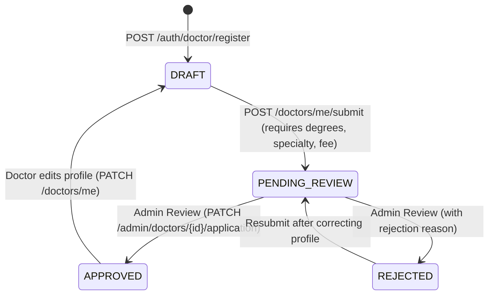
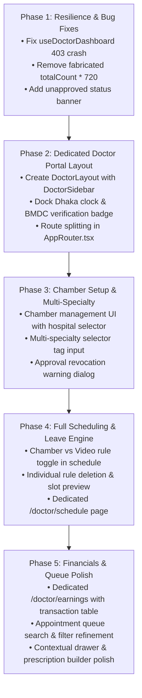

# Codebase Audit & Healthcare UX Architecture Report: MediConnectBD Doctor Portal

**Audit Date:** November 2, 2026  
**Auditor:** Senior Full-Stack Codebase Auditor & Healthcare UX Architect  
**Project Workspace:** `/home/mehedi/Desktop/MediConnectBD` (Symlink/alias: `mediconnect-bd`)  
**Scope:** Complete read-only audit of the Doctor Portal frontend and its backend contract surface.

---

## A. Executive Summary

MediConnectBD is a production-grade digital healthcare platform tailored for Bangladesh, supporting patient teleconsultations, physical chamber appointments, digital e-prescriptions, and administrator verification workflows. 

The application architecture is structured cleanly into an Express 5 + TypeORM + MySQL + BullMQ + Redis backend (`MediConnectBDbackend/`) and a React 19 + TypeScript 6 + Vite 8 frontend (`frontend/`). 

### Core Audit Takeaways for the Doctor Portal:
1. **Frontend Architecture & Navigation Gap:**  
   Unlike the Admin portal (which boasts a dedicated `AdminLayout` and `AdminSidebar`), the Doctor Portal currently lacks an isolated portal shell. It is rendered directly inside `MainLayout` beneath the general `PublicHeader`. Doctor functionality is fragmented between a monolithic overview page (`/doctor`), a queue page (`/doctor/appointments`), an issued prescriptions list (`/doctor/prescriptions`), and a shared communication hub (`/communication`).
2. **Critical Onboarding & Approval Crash:**  
   In `frontend/src/doctor/dashboard/hooks/useDoctorDashboard.ts:38`, `doctorsApi.getMySchedule()` is invoked inside `Promise.all` without an error catch. Because backend authorization strictly rejects unapproved doctors with `403 DOCTOR_NOT_APPROVED` on scheduling endpoints, **any newly registered doctor with `DRAFT`, `PENDING_REVIEW`, or `REJECTED` status crashes the dashboard immediately**, preventing them from viewing or submitting their profile for approval.
3. **Chamber Management is Completely Absent in UI:**  
   While the backend fully supports multi-chamber setup (`PATCH /api/v1/doctors/me` with `chambers: [{ hospitalId, roomOrUnit, consultationFee }]`), the frontend UI only displays the chamber count `<dd>{profile.chambers.length}</dd>`. There is no UI to add a chamber, select a hospital, or set chamber fees. Furthermore, weekly schedule rules hardcode `mode: "VIDEO"`, preventing doctors from configuring physical chamber visit hours.
4. **Credential Upload is Missing in Both Frontend and Backend:**  
   Neither the frontend nor the backend implements file upload for doctor verification documents (e.g., BMDC certificates, degrees, or national ID). Registration only records a text-based BMDC registration string.
5. **Fabricated Analytics Fallback:**  
   In `frontend/src/doctor/dashboard/components/DoctorPracticeAnalytics/DoctorPracticeAnalytics.tsx:49`, revenue calculation falls back to `totalCount * 720` when API data is absent, violating the strict requirement to display only real API data.
6. **Robust Clinical Features Already Implemented:**  
   The platform already possesses a functioning WebRTC consultation room (`VideoSessionPanel.tsx`) using Daily.co with pre-call lobby and post-consultation summaries, a 24-hour editable digital prescription engine with autocomplete and printable QR-code PDFs, and a contextual patient history drawer that adheres strictly to clinical confidentiality.

---

## B. Framework and Folder Structure

### 1. Repository Tooling & Environments
* **Git Status:** Clean working tree on branch `main` (commit `532c7a3`).
* **Frontend Root:** `/home/mehedi/Desktop/MediConnectBD/frontend`
  * **Framework:** React 19.3.1, React DOM 19.3.1, Vite 8.3.4
  * **Routing:** `react-router-dom` 7.18.4
  * **TypeScript:** `typescript` 6.0.3, strictly relative imports, `bundler` module resolution, `noEmit: true`, `erasableSyntaxOnly: true`. No path aliases configured.
  * **UI & Primitives:** Radix UI primitives (`@radix-ui/react-dialog` 1.3.1, `@radix-ui/react-dropdown-menu` 2.2.1, `@radix-ui/react-tabs` 1.2.1), `lucide-react` 1.62.0, `clsx` 2.1.1.
  * **Fonts:** `@fontsource-variable/inter` 5.3.0, `@fontsource/hind-siliguri` 5.3.0.
* **Backend Root:** `/home/mehedi/Desktop/MediConnectBD/MediConnectBDbackend`
  * **Framework:** Node.js (>=24), Express 5.1.0, TypeScript 5.9.3, TypeORM 0.3.27, MySQL2 3.15.3, ioredis 5.8.2, BullMQ 5.64.1, Zod 4.1.12, Pino 10.1.0, Helmet 8.1.0, Swagger UI Express 5.0.1.

### 2. Relevant Application Directory Tree (`frontend/src/doctor`)
```text
frontend/src/doctor/
├── appointments/
│   ├── components/
│   │   ├── ActiveAppointmentCard/
│   │   │   ├── ActiveAppointmentCard.module.css
│   │   │   ├── ActiveAppointmentCard.tsx
│   │   │   └── index.ts
│   │   └── PastAppointmentCard/
│   │       ├── PastAppointmentCard.module.css
│   │       ├── PastAppointmentCard.tsx
│   │       └── index.ts
│   ├── hooks/
│   │   └── useDoctorQueue.ts
│   ├── tests/
│   │   └── DoctorAppointmentsPage.test.tsx
│   ├── types/
│   │   └── doctorAppointments.types.ts
│   ├── utils/
│   │   ├── statusTone.test.ts
│   │   └── statusTone.ts
│   ├── DoctorAppointmentsPage.module.css
│   ├── DoctorAppointmentsPage.tsx
│   └── index.ts
├── dashboard/
│   ├── components/
│   │   ├── ClinicalStatusBar/
│   │   │   ├── ClinicalStatusBar.module.css
│   │   │   ├── ClinicalStatusBar.tsx
│   │   │   └── index.ts
│   │   ├── ContextualPatientDrawer/
│   │   │   ├── ContextualPatientDrawer.module.css
│   │   │   ├── ContextualPatientDrawer.tsx
│   │   │   └── index.ts
│   │   ├── DoctorBreadcrumbs/
│   │   │   ├── DoctorBreadcrumbs.module.css
│   │   │   ├── DoctorBreadcrumbs.tsx
│   │   │   └── index.ts
│   │   ├── DoctorDashboardHeader/
│   │   │   ├── DoctorDashboardHeader.module.css
│   │   │   ├── DoctorDashboardHeader.tsx
│   │   │   └── index.ts
│   │   ├── DoctorEarningsSection/
│   │   │   ├── DoctorEarningsSection.module.css
│   │   │   ├── DoctorEarningsSection.tsx
│   │   │   └── index.ts
│   │   ├── DoctorKpiCards/
│   │   │   ├── DoctorKpiCards.module.css
│   │   │   ├── DoctorKpiCards.tsx
│   │   │   └── index.ts
│   │   ├── DoctorPracticeAnalytics/
│   │   │   ├── DoctorPracticeAnalytics.module.css
│   │   │   ├── DoctorPracticeAnalytics.tsx
│   │   │   └── index.ts
│   │   ├── DoctorProfileSection/
│   │   │   ├── DoctorProfileSection.module.css
│   │   │   ├── DoctorProfileSection.tsx
│   │   │   └── index.ts
│   │   ├── DoctorScheduleSection/
│   │   │   ├── DoctorScheduleSection.module.css
│   │   │   ├── DoctorScheduleSection.tsx
│   │   │   ├── DoctorTimeOffSection.module.css
│   │   │   ├── DoctorTimeOffSection.tsx
│   │   │   └── index.ts
│   │   ├── DoctorViewSwitcher/
│   │   │   ├── DoctorViewSwitcher.module.css
│   │   │   ├── DoctorViewSwitcher.tsx
│   │   │   └── index.ts
│   │   ├── EmergencyLeaveModal/
│   │   │   ├── EmergencyLeaveModal.module.css
│   │   │   ├── EmergencyLeaveModal.tsx
│   │   │   └── index.ts
│   │   ├── FastRxModal/
│   │   │   ├── FastRxModal.module.css
│   │   │   ├── FastRxModal.tsx
│   │   │   └── index.ts
│   │   ├── IssuePrescriptionModal/
│   │   │   ├── IssuePrescriptionModal.module.css
│   │   │   ├── IssuePrescriptionModal.tsx
│   │   │   └── index.ts
│   │   ├── PatientHistoryPanel/
│   │   │   ├── PatientHistoryPanel.module.css
│   │   │   ├── PatientHistoryPanel.tsx
│   │   │   └── index.ts
│   │   ├── QuickPracticeTools/
│   │   │   ├── QuickPracticeTools.module.css
│   │   │   ├── QuickPracticeTools.tsx
│   │   │   └── index.ts
│   │   └── TodayPatientRadar/
│   │       ├── TodayPatientRadar.module.css
│   │       ├── TodayPatientRadar.tsx
│   │       └── index.ts
│   ├── data/
│   │   └── fastRxPresets.ts
│   ├── hooks/
│   │   └── useDoctorDashboard.ts
│   ├── tests/
│   │   ├── DoctorDashboardComponents.test.tsx
│   │   └── doctorDashboard.utils.test.ts
│   ├── types/
│   │   └── doctorDashboard.types.ts
│   ├── utils/
│   │   └── doctorDashboard.utils.ts
│   ├── DoctorDashboardPage.module.css
│   ├── DoctorDashboardPage.tsx
│   └── index.ts
└── prescriptions/
    ├── components/
    │   ├── DoctorPrescriptionCard/
    │   │   ├── DoctorPrescriptionCard.module.css
    │   │   ├── DoctorPrescriptionCard.tsx
    │   │   └── index.ts
    │   └── PrescriptionEditorForm/
    │       ├── PrescriptionEditorForm.module.css
    │       ├── PrescriptionEditorForm.tsx
    │       └── index.ts
    ├── hooks/
    │   └── useDoctorPrescriptions.ts
    ├── tests/
    │   └── prescription.utils.test.ts
    ├── types/
    │   └── doctorPrescriptions.types.ts
    ├── utils/
    │   └── prescription.utils.ts
    ├── DoctorPrescriptionsPage.module.css
    ├── DoctorPrescriptionsPage.tsx
    └── index.ts
```

---

## C. Page Inventory Table with Exact Paths

| Page / Capability | Route / URL | Component Path | CSS Module Path | Status |
| :--- | :--- | :--- | :--- | :--- |
| **A. Registration & Onboarding** | `/register` (tab `DOCTOR`) | `frontend/src/features/auth/RegisterPage.tsx:28-163` | `frontend/src/features/auth/AuthLayout.module.css` | **PARTIAL** (Registration works; onboarding wizard is MISSING) |
| **B. Verification & Docs** | `MISSING` (embedded in `/doctor`) | `frontend/src/doctor/dashboard/components/DoctorProfileSection/DoctorProfileSection.tsx:22-180` | `frontend/src/doctor/dashboard/components/DoctorProfileSection/DoctorProfileSection.module.css` | **PARTIAL / BLOCKED** (Badge & submit button exist; doc upload is MISSING in backend & UI) |
| **C. Profile & Qualifications** | `MISSING` (embedded in `/doctor`) | `frontend/src/doctor/dashboard/components/DoctorProfileSection/DoctorProfileSection.tsx:22-180` | `frontend/src/doctor/dashboard/components/DoctorProfileSection/DoctorProfileSection.module.css` | **PARTIAL** (Single specialty only; no photo upload; resets approval without warning) |
| **D. Chamber Setup & Fees** | `MISSING` | `MISSING` (only count in `DoctorProfileSection.tsx:177`) | None | **MISSING** (Backend supports it; frontend has 0 UI) |
| **E. Schedule & Leave** | `MISSING` (embedded in `/doctor`) | `frontend/src/doctor/dashboard/components/DoctorScheduleSection/DoctorScheduleSection.tsx:38-175` | `frontend/src/doctor/dashboard/components/DoctorScheduleSection/DoctorScheduleSection.module.css` | **PARTIAL** (Hardcodes VIDEO rules; cannot set chamber rules; time off works) |
| **F. Daily Dashboard** | `/doctor` | `frontend/src/doctor/dashboard/DoctorDashboardPage.tsx:31-158` | `frontend/src/doctor/dashboard/DoctorDashboardPage.module.css` | **WORKING** (Has crash bug for unapproved accounts) |
| **G. Appointment Queue** | `/doctor/appointments` | `frontend/src/doctor/appointments/DoctorAppointmentsPage.tsx:37-355` | `frontend/src/doctor/appointments/DoctorAppointmentsPage.module.css` | **WORKING** (Filters, search, actions complete/no-show/cancel work) |
| **H. Patient History Drawer** | Slide-out Drawer | `frontend/src/doctor/dashboard/components/ContextualPatientDrawer/ContextualPatientDrawer.tsx:16-195` | `frontend/src/doctor/dashboard/components/ContextualPatientDrawer/ContextualPatientDrawer.module.css` | **WORKING** (Visits, Rx history, reports download verified) |
| **I. Video/Chamber Workspace** | Modal via `/doctor/appointments` & `/communication` | `frontend/src/patient/appointments/components/VideoSessionPanel/VideoSessionPanel.tsx:38-450` | `frontend/src/patient/appointments/components/VideoSessionPanel/VideoSessionPanel.module.css` | **WORKING** (Daily.co WebRTC room, pre-call lobby, split notes, summary) |
| **J. Prescription Builder** | `/doctor/prescriptions` & Modal | `frontend/src/doctor/prescriptions/DoctorPrescriptionsPage.tsx:21-195` | `frontend/src/doctor/prescriptions/DoctorPrescriptionsPage.module.css` | **WORKING** (24h edit window, FastRx bundle prefill, PDF download, suggest API) |
| **K. Earnings & Breakdown** | `MISSING` (embedded in `/doctor`) | `frontend/src/doctor/dashboard/components/DoctorEarningsSection/DoctorEarningsSection.tsx:16-170` | `frontend/src/doctor/dashboard/components/DoctorEarningsSection/DoctorEarningsSection.module.css` | **PARTIAL** (Summary cards work; detailed transactions & withdrawal MISSING; fake calc in analytics) |
| **L. Doctor Settings** | `MISSING` | `MISSING` | None | **MISSING** (No account preferences, password change, or payout settings) |

---

## D. Existing Design System and CSS References

The frontend implements a strict CSS Module + CSS Variables design architecture governed by `frontend/src/styles/tokens.css`. Raw hex values are prohibited outside of `tokens.css`.

### 1. Color Tokens & Theme Presets
* **Active Brand Preset (Default Unauthenticated):** `aqua`
  * Primary: `--color-primary: #0891b2` (`tokens.css:21`)
  * Primary Hover: `--color-primary-hover: #0e7490`
  * Primary Active: `--color-primary-active: #155e75`
  * Primary Soft: `--color-primary-soft: #ecfeff`
  * Primary Soft Hover: `--color-primary-soft-hover: #cffafe`
* **Surface & Background Scales (Light Mode):**
  * App Background: `--color-bg: var(--slate-50)` (`#f4f7f7`) (`tokens.css:305`)
  * Subtle Background: `--color-bg-subtle: var(--slate-100)` (`#eaf0ef`)
  * Card Surface: `--color-surface: var(--slate-0)` (`#ffffff`)
  * Raised Surface: `--color-surface-raised: var(--slate-0)`
  * Sunken Surface: `--color-surface-sunken: var(--slate-25)` (`#fafcfc`)
* **Typography & Headings:**
  * Deep Navy Headings & Main Text: `--color-text: var(--slate-900)` (`#152220`) (`tokens.css:312`)
  * Muted Text: `--color-text-muted: var(--slate-600)` (`#546663`)
  * Subtle Text: `--color-text-subtle: var(--slate-500)` (`#6b7f7c`)
* **Borders & Elevation:**
  * Crisp 1px Border: `--color-border: var(--slate-200)` (`#dce6e5`) (`tokens.css:318`)
  * Strong Border: `--color-border-strong: var(--slate-300)` (`#c3d1cf`)
  * Restrained Shadows:
    * `--shadow-xs: 0 1px 2px rgb(8 59 54 / 0.05)` (`tokens.css:385`)
    * `--shadow-sm: 0 1px 3px rgb(8 59 54 / 0.08), 0 1px 2px rgb(8 59 54 / 0.04)`
    * `--shadow-md: 0 8px 24px rgb(8 59 54 / 0.08)`
    * `--shadow-lg: 0 16px 40px rgb(8 59 54 / 0.12)`
* **Corner Radii:**
  * `--radius-sm: 0.375rem` (6px) (`tokens.css:364`)
  * `--radius-md: 0.625rem` (10px)
  * `--radius-lg: 1rem` (16px)
  * `--radius-xl: 1.5rem` (24px)
  * `--radius-full: 999px`
* **Responsive Breakpoints:**
  * Small Mobile: `max-width: 640px`
  * Tablet Portrait / Navigation Drawer: `max-width: 768px` / `min-width: 768px`
  * Tablet Landscape / Small Desktop: `max-width: 960px` – `1024px`
  * Desktop Shell Containers: `--container-sm` (640px), `--container-md` (880px), `--container-lg` (1120px), `--container-xl` (1280px), `--container-2xl` (1560px) (`tokens.css:411-415`).

---

## E. Components That Can Be Reused

Rather than reinventing UI patterns, the future Doctor Portal overhaul should directly leverage the tested primitives in `frontend/src/shared/ui`:

1. **Foundational Layout & Structure:**
   * `Page` & `PageHeader`: Provides uniform padding, breadcrumb slots, titles, eyebrows, and descriptions (`shared/ui/Page/Page.tsx`).
   * `Container`: Enforces responsive max-widths (`lg`, `xl`, `2xl`) (`shared/ui/Layout/Container.tsx`).
   * `Grid`, `Stack`, and `Cluster`: Flexbox and grid utilities eliminating ad-hoc layout CSS (`shared/ui/Layout/`).
2. **Interactive Elements:**
   * `Button` & `IconButton`: Supports `primary`, `secondary`, `outline`, `ghost`, `danger`, built-in spinner loading states, and full `:focus-visible` styling (`shared/ui/Button/Button.tsx`).
   * `Card`: Provides tokenized surface backgrounds, crisp 1px borders, and header/footer subcomponents (`shared/ui/Card/Card.tsx`).
   * `Badge`: Multi-tone status badges (`success`, `warning`, `error`, `info`, `neutral`) (`shared/ui/Badge/Badge.tsx`).
   * `Dialog` (Radix UI): Accessible accessible modal dialogs with focus traps and ESC dismissal (`shared/ui/Dialog/Dialog.tsx`).
   * `Tabs` (Radix UI): Accessible tabbed views (`shared/ui/Tabs/Tabs.tsx`).
   * `DropdownMenu` (Radix UI): Context action menus (`shared/ui/DropdownMenu/DropdownMenu.tsx`).
3. **Forms & Data Display:**
   * `Field`, `Input`, `Select`, and `Textarea`: Accessible forms with labels, hints, and error states (`shared/ui/Form/`).
   * `Table`: Crisp 1px bordered tabular data representation (`shared/ui/Table/Table.tsx`).
   * `DescriptionList`: Clean `<dl>` key-value displays for clinical and credential summaries (`shared/ui/DescriptionList/DescriptionList.tsx`).
4. **Feedback, States & Skeletons:**
   * `Alert`: Inline clinical warnings and system notices (`shared/ui/Alert/Alert.tsx`).
   * `ToastProvider` (`useToast()`): Transient success and info notifications with audio chime support (`shared/utils/sound.ts`).
   * `Skeleton` & `Spinner`: Accessible loading indicators (`shared/ui/Skeleton/Skeleton.tsx`, `shared/ui/Spinner/Spinner.tsx`).
   * `EmptyState`: Clean zero-data placeholders (`shared/ui/EmptyState/EmptyState.tsx`).
5. **Domain Clinical Components:**
   * `ContextualPatientDrawer`: Can be embedded on any doctor page requiring patient history review (`doctor/dashboard/components/ContextualPatientDrawer/`).
   * `IssuePrescriptionModal` & `FastRxModal`: Proven prescription generation flows (`doctor/dashboard/components/`).
   * `VideoSessionPanel`: Fully functional Daily.co consultation workspace (`patient/appointments/components/VideoSessionPanel/`).

---

## F. Backend / API Integration Matrix

The following matrix documents the exact backend endpoints available to doctors, their schemas, and integration status:

| HTTP Method & Endpoint | Operation ID | Roles Allowed | Request Schema / Params | Response Schema / Type | Frontend API Client Call | Implementation Status |
| :--- | :--- | :--- | :--- | :--- | :--- | :--- |
| `POST /api/v1/auth/doctor/register` | `registerDoctor` | Public | `{ email, password, firstName, lastName, bmdcNumber }` | `AuthResponse` (`accessToken`, `user`) | `authApi.registerDoctor` | **Implemented** |
| `GET /api/v1/doctors/me` | `getMyDoctorProfile` | `DOCTOR` | None | `DoctorDetails` | `doctorsApi.getMyProfile` | **Implemented** |
| `PATCH /api/v1/doctors/me` | `updateMyDoctorProfile` | `DOCTOR` | `DoctorProfilePatch` (degrees, bio, languages, videoFee, specialtyIds, chambers) | `DoctorDetails` | `doctorsApi.updateMyProfile` | **Implemented** (Frozen during `PENDING_REVIEW`; resets `APPROVED` to `DRAFT`) |
| `POST /api/v1/doctors/me/submit` | `submitDoctorApplication` | `DOCTOR` | None | `DoctorDetails` | `doctorsApi.submitApplication` | **Implemented** (Requires degrees, 1+ specialty, 1+ fee) |
| `GET /api/v1/doctors/me/appointments` | `listDoctorAppointments` | `DOCTOR` | None | `{ items: DoctorAppointment[] }` | `doctorsApi.listMyAppointments` | **Implemented** |
| `GET /api/v1/doctors/me/earnings` | `getMyDoctorEarnings` | `DOCTOR` | None | `DoctorEarningsSummary` (`totals`, `byDay`, `byMonth`) | `doctorsApi.getMyEarnings` | **Implemented** |
| `GET /api/v1/doctors/me/patients/{id}/history` | `getDoctorPatientHistory` | `DOCTOR` | `patientProfileId: UUID` | `DoctorPatientHistory` (`patient`, `visits`, `prescriptions`, `reports`) | `doctorsApi.getPatientHistory` | **Implemented** (Requires treating relationship) |
| `GET /api/v1/doctors/me/schedule` | `getMySchedule` | `DOCTOR` | None | `Schedule` (`timezone`, `rules`, `timeOff`) | `doctorsApi.getMySchedule` | **Implemented** (Throws 403 if not `APPROVED`) |
| `PUT /api/v1/doctors/me/schedule` | `replaceMySchedule` | `DOCTOR` | `{ rules: ScheduleRule[] }` | `Schedule` | `doctorsApi.replaceMySchedule` | **Implemented** (Throws 403 if not `APPROVED`) |
| `POST /api/v1/doctors/me/time-off` | `addMyTimeOff` | `DOCTOR` | `{ date, startTime?, endTime?, reason? }` | `TimeOff` | `doctorsApi.addTimeOff` | **Implemented** (Throws 403 if not `APPROVED`) |
| `DELETE /api/v1/doctors/me/time-off/{id}` | `removeMyTimeOff` | `DOCTOR` | `timeOffId: UUID` | `204 No Content` | `doctorsApi.removeTimeOff` | **Implemented** |
| `POST /api/v1/doctors/me/slots/generate` | `generateMySlots` | `DOCTOR` | None | `{ generated: number }` | `doctorsApi.generateSlots` | **Implemented** |
| `POST /api/v1/appointments/{id}/complete` | `completeAppointment` | `DOCTOR` | `appointmentId: UUID` | `Appointment` (`status: "COMPLETED"`) | `appointmentsApi.completeAppointment` | **Implemented** (Idempotent) |
| `POST /api/v1/appointments/{id}/no-show` | `markAppointmentNoShow` | `DOCTOR` | `appointmentId: UUID` | `Appointment` (`status: "NO_SHOW"`) | `appointmentsApi.markNoShow` | **Implemented** (Idempotent) |
| `POST /api/v1/appointments/{id}/cancel` | `cancelAppointment` | `PATIENT`, `DOCTOR`, `ADMIN` | `{ reason: string }` | `CancellationOutcome` | `appointmentsApi.cancelAppointment` | **Implemented** (Doctor cancel gives 100% refund) |
| `GET /api/v1/appointments/{id}/video-session` | `getAppointmentVideoSession` | `PATIENT`, `DOCTOR` | `appointmentId: UUID` | `VideoSession` (`roomUrl`, `accessToken`, etc.) | `appointmentsApi.getVideoSession` | **Implemented** (Opens 5m prior to start) |
| `GET /api/v1/prescriptions/medicines/suggest` | `suggestMedicines` | `DOCTOR` | Query `q: string` | `{ items: MedicineSuggestion[] }` | `prescriptionsApi.suggestMedicines` | **Implemented** |
| `POST /api/v1/prescriptions/me/prescriptions` | `createPrescription` | `DOCTOR` | `{ appointmentId, diagnosis, medicines, tests?, advice? }` | `Prescription` | `prescriptionsApi.create` | **Implemented** |
| `GET /api/v1/prescriptions/me/prescriptions` | `listDoctorPrescriptions` | `DOCTOR` | None | `{ items: Prescription[] }` | `prescriptionsApi.listDoctorPrescriptions` | **Implemented** |
| `PUT /api/v1/prescriptions/{id}` | `updatePrescription` | `DOCTOR` | `{ diagnosis?, medicines?, tests?, advice? }` | `Prescription` | `prescriptionsApi.update` | **Implemented** (24-hour edit window) |
| `DELETE /api/v1/prescriptions/{id}` | `deletePrescription` | `DOCTOR` | `prescriptionId: UUID` | `204 No Content` | `prescriptionsApi.remove` | **Implemented** (24-hour delete window) |
| `GET /api/v1/prescriptions/{id}/pdf` | `downloadPrescriptionPdf` | `PATIENT`, `DOCTOR` | `prescriptionId: UUID` | `application/pdf` binary stream | `prescriptionsApi.downloadPdf` | **Implemented** |
| `GET /api/v1/patients/me/reports/{id}/download` | `downloadMedicalReport` | `PATIENT`, `DOCTOR` | `reportId: UUID` | `MedicalReportDetail` (`contentBase64`) | `reportsApi.downloadReport` | **Implemented** (Confidential; Admin excluded) |
| `GET /api/v1/catalog/hospitals` | `listHospitals` | Public | None | `{ items: Hospital[] }` | `doctorsApi.listHospitals` | **Implemented** |
| `GET /api/v1/catalog/specialties` | `listSpecialties` | Public | None | `{ items: Specialty[] }` | `doctorsApi.listSpecialties` | **Implemented** |

### Timezone & Date Conventions
* **Storage & Wire Format:** All timestamps returned by the API (`scheduledStartAt`, `scheduledEndAt`, `createdAt`, `updatedAt`, `expiresAt`) are standard ISO-8601 UTC strings (`YYYY-MM-DDTHH:mm:ss.sssZ`).
* **Dhaka Local Scheduling:** Scheduling rules (`startTime: "18:00"`, `endTime: "20:00"`) and time-off dates (`date: "2026-11-15"`) operate in `Asia/Dhaka` (UTC+6).
* **Display Formatting:** `formatDhakaDateTime()` converts UTC dates to Dhaka local time with AM/PM indicators. Realtime clocks in `DoctorBreadcrumbs.tsx:18` continuously render `Asia/Dhaka` time.

---

## G. Role and Permission Analysis

### 1. Token & Session Architecture
* **Access Token:** The JWT access token has a short 15-minute lifespan (`accessTokenExpiresIn: 900`). It is held **exclusively in memory** within `client.ts:16` (`let accessToken: string | null = null;`) and is never written to `localStorage` or `sessionStorage`.
* **Refresh Token:** Stored in a browser-managed, HTTP-only secure cookie named `mediconnect_refresh`. Cross-origin credential inclusion (`credentials: "include"`) enables seamless token restoration upon page refresh.
* **Single-Flight Guard:** `refreshSession()` implements a single-flight promise guard, preventing simultaneous 401 retries or React 19 StrictMode double-mounting from burning the single-use rotating refresh token.

### 2. Role Guards & Navigation
* Protected doctor routes are gated by `<RoleRoute roles={["DOCTOR"]} />` in `AppRouter.tsx:55`.
* Unauthenticated visitors attempting to access doctor routes are redirected to `/login`.
* Logged-in non-doctors (e.g. patients) attempting to visit `/doctor` are redirected to `/doctors` by `defaultHomePathFor()`.

### 3. Doctor Verification State Machine
Doctor accounts transition through four explicit states:

* **DRAFT:** Profile is editable. Cannot create schedule or generate bookable slots (`403 DOCTOR_NOT_APPROVED`). Profile does not appear in public doctor directory.
* **PENDING_REVIEW:** Profile is frozen (`409 APPLICATION_UNDER_REVIEW`). Schedule operations forbidden.
* **REJECTED:** Profile is editable. Rejection reason is viewable. Schedule operations forbidden.
* **APPROVED:** Full clinical privileges. Can manage weekly rules and time off. Profile is live in public directory.
* **CRITICAL RISK:** As documented in `MediConnectBDbackend/src/modules/doctors/doctor.service.ts:75`, whenever an approved doctor submits a `PATCH /api/v1/doctors/me`, the repository **immediately resets their status back to DRAFT**, revoking approval until an admin re-reviews it! The frontend currently does not display a confirmation dialog or warning regarding this business rule.

### 4. Confidentiality & Medical Privacy Boundaries
* **Patient History Separation:** A doctor cannot browse arbitrary patient profiles. `GET /api/v1/doctors/me/patients/{id}/history` enforces that at least one valid appointment exists between the requesting doctor and the patient.
* **Medical Report Exclusions:** Admin users are barred from downloading patient medical reports (`GET /api/v1/patients/me/reports/{id}/download`). Only the patient and their treating doctors have authorization.
* **Prescription Privacy:** Admin users cannot access clinical prescription PDFs (`GET /api/v1/prescriptions/{id}/pdf`). Only the prescribing doctor and patient can stream them. Public verification (`/verify-prescription`) exposes only the doctor's name, issue date, and validity status—never clinical diagnoses or medications.

---

## H. Missing Features, UX Gaps, and Architectural Risks

### 1. Critical Functional Gaps (Frontend)
1. **Unapproved Doctor Dashboard Crash (Priority 1):**  
   In `useDoctorDashboard.ts:38`, `doctorsApi.getMySchedule()` has no `.catch()` fallback. Any doctor with status `DRAFT`, `PENDING_REVIEW`, or `REJECTED` triggers an unhandled rejection because the backend returns 403. The doctor sees a blank error screen and cannot edit or submit their profile.
2. **Missing Chamber Management UI (Priority 1):**  
   The backend allows managing chambers via `chambers: [{ hospitalId, roomOrUnit, consultationFee }]` in `PATCH /api/v1/doctors/me`, and hospital listing via `GET /api/v1/catalog/hospitals`. However, the frontend has **zero UI** to view, add, or edit chambers.
3. **Hardcoded VIDEO Weekly Rules (Priority 1):**  
   In `DoctorScheduleSection.tsx:75`, when a doctor adds a weekly rule, `mode: "VIDEO"` is hardcoded. Physical chamber rules cannot be created, and existing rules cannot be deleted individually.
4. **No Standalone Doctor Layout or Sidebar (Priority 2):**  
   Doctors navigate via the public consumer header (`PublicHeader.tsx`). A clinical practitioner needs a professional, focused sidebar navigation (similar to `AdminSidebar`) with quick badge counts for the active queue.
5. **No Verification Document Upload (Priority 2):**  
   Neither backend nor frontend provides a file upload endpoint for doctors to upload their BMDC certificate or degree scans.
6. **Fabricated Revenue Fallback in Analytics (Priority 2):**  
   In `DoctorPracticeAnalytics.tsx:49`, `netRevenue` uses `totalCount * 720` when revenue map has no entry. This must be replaced with `0` to adhere to the real-data-only rule.
7. **Single Specialty Limitation (Priority 2):**  
   `DoctorProfileSection.tsx` only allows selecting one specialty from a dropdown, although the backend schema accepts up to 10 specialties in `specialtyIds`.
8. **Missing Standalone Pages:**  
   Currently, Schedule, Profile, Earnings, and Verification are compressed into tabs/modals on `/doctor`. Standalone routes (`/doctor/schedule`, `/doctor/profile`, `/doctor/earnings`, `/doctor/chambers`, `/doctor/settings`) do not exist.

---

## I. Recommended Implementation Order (Phased Frontend Upgrade)



### Phase 1: Clinical Resilience & Critical Bug Fixes (Immediate)
* Wrap `doctorsApi.getMySchedule()` in `useDoctorDashboard.ts` with `.catch(() => null)`.
* Replace `totalCount * 720` in `DoctorPracticeAnalytics.tsx` with `0`.
* Add a prominent notification banner for doctors in `DRAFT`, `PENDING_REVIEW`, or `REJECTED` state with an actionable "Complete Profile & Submit" button.

### Phase 2: Dedicated Doctor Layout & Shell Architecture
* Create `frontend/src/layouts/DoctorLayout.tsx` and `frontend/src/doctor/navigation/DoctorSidebar/`.
* Mirror the clean styling of `AdminSidebar`: collapsible mobile drawer, deep navy text, active Aqua pill highlights, and real-time appointment counter badges.
* Move doctor routes under `<Route path="/doctor" element={<DoctorLayout />}>` in `AppRouter.tsx`.

### Phase 3: Chamber Setup & Profile Completeness
* Implement Chamber Management UI: hospital dropdown populated from `doctorsApi.listHospitals()`, room/unit input, and consultation fee input.
* Support multiple specialties in `DoctorProfileSection` using a tag/checkbox selector.
* Add a confirmation modal warning approved doctors that saving profile changes will reset their account to `DRAFT`.

### Phase 4: Full Weekly Schedule & Time-Off Suite
* Enable mode selection (`VIDEO` vs `CHAMBER`) in schedule rule creation. If `CHAMBER`, enforce selecting an active chamber from the doctor's profile.
* Allow deleting individual rules by passing the updated filtered rule array to `PUT /api/v1/doctors/me/schedule`.
* Expose dedicated routes `/doctor/schedule` and `/doctor/chambers`.

### Phase 5: Financial Reconciliation & Queue Ergonomics
* Create a dedicated `/doctor/earnings` view with the payout breakdown, monthly trends, and an appointment transaction table.
* Polish the active consultation queue with quick filters for Today's Waiting, In-Room, and Completed visits.
* Ensure all surfaces strictly use `--color-bg: #f4f7f7`, `--color-surface: #ffffff`, `--color-border: #dce6e5`, deep navy text, and Aqua primary actions.

---

## J. Exact Files Likely Needing Modification

When implementing the future frontend overhaul, modifications will be concentrated in these files:

### 1. Router & Layout Shell
* `frontend/src/routes/AppRouter.tsx`: Register dedicated doctor routes (`/doctor/schedule`, `/doctor/chambers`, `/doctor/earnings`, `/doctor/profile`, `/doctor/settings`) wrapped in a new `DoctorLayout`.
* *New File:* `frontend/src/layouts/DoctorLayout.tsx` and `DoctorLayout.module.css`.
* *New File:* `frontend/src/doctor/navigation/DoctorSidebar/DoctorSidebar.tsx` and `DoctorSidebar.module.css`.

### 2. State & Data Hooks
* `frontend/src/doctor/dashboard/hooks/useDoctorDashboard.ts`: Fix `getMySchedule().catch(() => null)` to prevent crashing unapproved accounts.
* `frontend/src/doctor/dashboard/types/doctorDashboard.types.ts`: Update types for full chamber objects and multi-specialty selections.

### 3. Profile & Chamber Setup
* `frontend/src/doctor/dashboard/components/DoctorProfileSection/DoctorProfileSection.tsx`: Multi-specialty selector, warning on editing approved profiles, and chambers list.
* *New Component:* `frontend/src/doctor/chambers/ChamberManagementSection.tsx` (or standalone page).

### 4. Scheduling & Time-Off
* `frontend/src/doctor/dashboard/components/DoctorScheduleSection/DoctorScheduleSection.tsx`: Add chamber selection, rule deletion, and mode toggling.

### 5. Analytics & Financials
* `frontend/src/doctor/dashboard/components/DoctorPracticeAnalytics/DoctorPracticeAnalytics.tsx`: Remove fabricated `totalCount * 720` revenue multiplier.
* `frontend/src/doctor/dashboard/components/DoctorEarningsSection/DoctorEarningsSection.tsx`: Expand into detailed transaction ledger.

---

## K. Existing Verification and Test Commands

*DO NOT EXECUTE THESE COMMANDS DURING THIS AUDIT. Listed for reference during future implementation:*

### Frontend Commands (from `/home/mehedi/Desktop/MediConnectBD/frontend`)
* **TypeScript Check & Vite Production Build:**
  ```bash
  npm run build
  ```
* **JavaScript / TypeScript Linting (Oxlint):**
  ```bash
  npm run lint
  ```
* **CSS Modules & Stylelint:**
  ```bash
  npm run lint:css
  ```
* **Unit & Component Tests (Vitest):**
  ```bash
  npm test
  ```
* **End-to-End Tests (Playwright):**
  ```bash
  npm run test:e2e
  ```

### Backend Commands (from `/home/mehedi/Desktop/MediConnectBD/MediConnectBDbackend`)
* **Typecheck (noEmit):**
  ```bash
  npm run typecheck
  ```
* **Backend Build:**
  ```bash
  npm run build
  ```
* **Backend Unit & Integration Tests:**
  ```bash
  npm test
  ```
* **OpenAPI Schema Conformance Test:**
  ```bash
  npm run test:docs
  ```

---

## L. Important Questions and Unresolved Dependencies

Before executing the frontend overhaul, the following architectural and product clarifications should be resolved:

1. **Doctor Credential Document Upload:**  
   *Current state:* The backend only stores `bmdcNumber` as a string. There is no file upload endpoint for doctors (unlike patient reports at `POST /api/v1/patients/me/reports`).  
   *Question:* Should doctor document upload be added to the backend API first, or should the frontend UI collect document metadata as text/URLs in Phase 1?
2. **Profile Edit Approval Revocation:**  
   *Current state:* Editing an approved profile automatically sets `applicationStatus = DRAFT` in the backend, taking the doctor offline until re-approved by admin.  
   *Question:* Should the frontend require an explicit confirmation modal (e.g. *"Updating your degrees or fees will temporarily unpublish your profile until reviewed by an admin"*), or should certain fields (e.g. bio, languages) be requested as non-revoking from the backend?
3. **Dedicated Doctor Sidebar vs. Top Header:**  
   *Current state:* Doctors currently share the consumer `PublicHeader`.  
   *Question:* Does product design favor converting the doctor portal into a full-height sidebar layout (matching the admin console) or keeping a top-header bar with secondary tabs?
4. **Doctor Payout Settlement Method:**  
   *Current state:* `DoctorEarningsSection` states "Weekly Direct Settlement - bKash / Bank", but there is no API or field to collect the doctor's bKash wallet number or bank routing number.  
   *Question:* Should payout account details be stored in `DoctorProfilePatch` or deferred until backend financial payout models are created?
