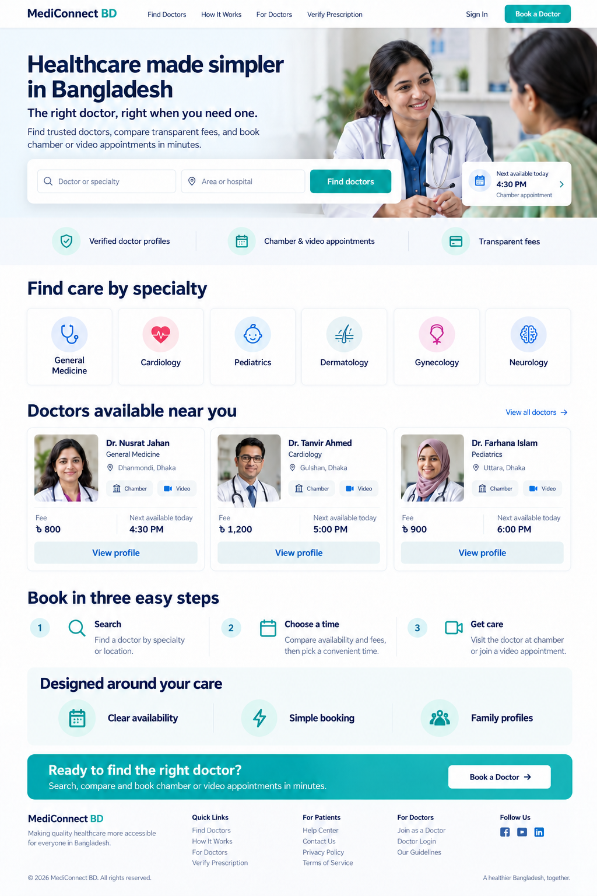

# Antigravity / Gemini implementation prompt: MediConnectBD public homepage

Copy everything below the divider into Antigravity/Gemini while the repository `/home/mehedi/Desktop/MediConnectBD` is open.

---

You are a senior React 19 + TypeScript frontend engineer working directly in this repository:

`/home/mehedi/Desktop/MediConnectBD`

Implement the new public homepage completely. Do not only describe a plan: inspect the existing code, edit the files, add tests, and run verification.

## Visual reference

Use this image as the design reference:

`/home/mehedi/Desktop/MediConnectBD/docs/ui-mockups/public-homepage-v1.png`



When using this prompt in Antigravity/Gemini, attach the PNG to the task as an image as well as pasting this document. If Antigravity cannot read the local path, the attached image is the authoritative visual reference.

Match its information hierarchy and overall feeling, but implement a responsive, accessible web page rather than copying pixels. The page must work in every existing theme preset and in light, dark, and system mode.

## Product goal

Create a new, separate, fully functional public homepage at `/`. The current doctor directory must remain at `/doctors`.

The homepage must help a visitor:

1. Search for a doctor or specialty.
2. Filter by area or hospital.
3. Open the existing doctor directory with those filters applied.
4. Browse common specialties.
5. Preview three real doctors returned by the existing API.
6. Open an existing doctor profile.
7. Understand the three-step booking process.
8. Sign in, register, verify a prescription, or visit the doctor directory.

## Non-negotiable constraints

- Preserve `ThemeToggle` exactly as a feature, but show the selector only to authenticated users. Public visitors must not see the theme selector. Patients, doctors, and admins must retain it.
- Keep the small Lucide icons in the header, search, benefits, specialties, doctor cards, and steps.
- Use existing CSS Modules and design tokens. Do not introduce Tailwind, styled-components, Sass, a UI framework, or another dependency.
- Do not change the backend or API contracts.
- Do not replace the current `/doctors` page. The homepage must navigate into it.
- Do not hardcode raw hex colors in new component CSS. Use the existing `--color-*`, spacing, radius, typography, shadow, and motion tokens.
- Do not add fake statistics, fake ratings, fake testimonials, fake security badges, fake partnerships, QR claims, or live-system telemetry.
- Featured doctors must come from `doctorsApi.listPublic`, not from hardcoded production data.
- Images may be absent initially. The UI must still look complete using initials/icons and CSS fallback surfaces.
- Preserve all current role-based navigation and authenticated behavior.
- Avoid unrelated refactors.

## Existing code that must be reused

- Router: `frontend/src/routes/AppRouter.tsx`
- Public layout: `frontend/src/layouts/MainLayout.tsx`
- Header: `frontend/src/public/shell/PublicHeader/PublicHeader.tsx`
- Footer: `frontend/src/public/shell/SiteFooter/SiteFooter.tsx`
- Theme selector: `frontend/src/shared/theme/ThemeToggle/ThemeToggle.tsx`
- Doctor API: `frontend/src/api/doctors.ts`
- Doctor types: `frontend/src/shared/types.ts`
- Existing doctor directory: `frontend/src/public/doctors/DoctorSearchPage.tsx`
- Search hook: `frontend/src/public/doctors/hooks/useDoctorSearch.ts`
- Query builder: `frontend/src/public/doctors/utils/doctorSearch.utils.ts`
- Shared UI components: `frontend/src/shared/ui`
- Current doctor card behavior: `frontend/src/public/doctors/components/DoctorCard/DoctorCard.tsx`

## Required file structure

Create this feature structure:

```text
frontend/src/public/home/
├── HomePage.tsx
├── HomePage.module.css
├── index.ts
├── components/
│   ├── HomeHero/
│   │   ├── HomeHero.tsx
│   │   ├── HomeHero.module.css
│   │   └── index.ts
│   ├── HomeSearchForm/
│   │   ├── HomeSearchForm.tsx
│   │   ├── HomeSearchForm.module.css
│   │   └── index.ts
│   ├── SpecialtyGrid/
│   │   ├── SpecialtyGrid.tsx
│   │   ├── SpecialtyGrid.module.css
│   │   └── index.ts
│   ├── FeaturedDoctors/
│   │   ├── FeaturedDoctors.tsx
│   │   ├── FeaturedDoctors.module.css
│   │   └── index.ts
│   ├── HowItWorks/
│   │   ├── HowItWorks.tsx
│   │   ├── HowItWorks.module.css
│   │   └── index.ts
│   └── CareBenefits/
│       ├── CareBenefits.tsx
│       ├── CareBenefits.module.css
│       └── index.ts
├── hooks/
│   └── useHomeData.ts
└── tests/
    └── HomePage.test.tsx
```

Keep components focused. Do not fragment simple text into unnecessary components beyond this structure.

## Routing changes

In `frontend/src/routes/AppRouter.tsx`:

- Import `HomePage` from `../public/home`.
- Replace the current `/` redirect with `<Route path="/" element={<HomePage />} />`.
- Leave `/doctors`, `/doctors/:doctorId`, authentication, patient, doctor, and admin routes unchanged.

In `PublicHeader.tsx`:

- Change the logo link from `/doctors` to `/`.
- Keep `Find a doctor` pointing to `/doctors`.
- Render `ThemeToggle` only when `user` exists. It must remain visible and working for authenticated patients and doctors, but must be absent for unauthenticated visitors on the homepage, doctor directory, login, and registration pages.
- Do not remove any role-based links.

In `AdminHeader.tsx`:

- Preserve the existing `ThemeToggle` for authenticated admins.
- Do not otherwise change the admin header for this task.

The global `ThemeProvider` and stored theme behavior must remain intact. Hiding the selector for visitors must not remove theme support or reset an authenticated user's preference.

In `SiteFooter.tsx`:

- Make the brand area link to `/`.
- Preserve current functional links.

## Full-width layout behavior

The homepage needs full-width section backgrounds while its content remains constrained.

Update `MainLayout.tsx` using `useLocation`:

- When `location.pathname === "/"`, render `<Outlet />` directly inside `<main>`.
- For every other route, retain the current `Container` wrapper exactly.
- Do not change authenticated container sizing.

Every homepage section must contain its own shared `Container size="lg"` or equivalent constrained inner wrapper.

## Homepage content

### Header and hero

Use this copy:

- Eyebrow: `Healthcare made simpler in Bangladesh`
- H1: `The right doctor, right when you need one.`
- Description: `Find trusted doctors, compare transparent fees, and book chamber or video appointments in minutes.`

Primary action is the search form. Secondary action can be a link to `/doctors` labelled `Browse all doctors`.

The hero image path is:

`/images/home/hero-doctor-patient.webp`

If it is missing or fails to load, render a polished token-based fallback panel with a `Stethoscope` icon and no broken-image indicator.

Do not display a made-up next appointment time. A small visual card may say `Chamber and video appointments` without claiming a real slot.

### Search form

Build a real `<form>` with two labelled inputs:

- `Doctor or specialty`
- `Area or hospital`

On submit:

- Trim both values.
- Construct `URLSearchParams`.
- Put the first value in `search`.
- Put the second value in `area`.
- Navigate to `/doctors?<params>`.
- If both are empty, navigate to `/doctors`.

Use semantic labels, Enter-key submission, visible focus states, and an accessible search icon.

### Trust/benefit row

Retain three small icon benefits:

- `Verified doctor profiles`
- `Chamber & video appointments`
- `Transparent fees`

These are product capabilities, not certifications. Do not say every doctor is BMDC verified unless the API actually guarantees and exposes it.

### Specialty section

Show these six specialties in a responsive grid:

- General Medicine: `medicine`
- Cardiology: `cardiology`
- Pediatrics: `pediatrics`
- Dermatology: `dermatology`
- Gynecology: `gynecology`
- Neurology: `neurology`

Use Lucide icons. Each card is a normal `Link` to `/doctors?specialty=<slug>`.

If catalog specialties are returned by `doctorsApi.listSpecialties`, prefer the matching API name/slug while retaining this display order. A missing catalog request must not break navigation.

### Featured doctors

`useHomeData` must load:

```ts
doctorsApi.listPublic(new URLSearchParams({ limit: "3" }).toString())
doctorsApi.listSpecialties()
```

Requirements:

- Use real `PublicDoctor` objects returned by the API.
- Display at most three.
- Provide loading skeletons, error text with a link to `/doctors`, and an honest empty state.
- Each card links to `/doctors/${doctor.id}`.
- Show name, specialties, first chamber/hospital area if available, chamber/video capability, and actual fees only when non-null.
- Do not invent availability. Since `listPublic` does not return next-slot data, do not show `Next available today` or a time.
- Use `doctor.photoUrl` first.
- In development only, a local seed-image mapping may be used when `photoUrl` is null:

```ts
const DEV_DOCTOR_IMAGES: Record<string, string> = {
  "Farhana Rahman": "/images/home/doctors/dr-farhana-rahman.webp",
  "Tanvir Ahmed": "/images/home/doctors/dr-tanvir-ahmed.webp",
  "Nusrat Jahan": "/images/home/doctors/dr-nusrat-jahan.webp",
};
```

Only use this mapping when `import.meta.env.DEV` is true. In production use `photoUrl` or initials.

Improve the shared `Avatar` component only if necessary so a failed image cleanly falls back to initials. Keep the public API backward compatible.

### How it works

Create three responsive steps with small Lucide icons:

1. `Search` — `Find a doctor by specialty or location.`
2. `Choose a time` — `Compare availability and fees, then pick a convenient slot.`
3. `Get care` — `Visit the chamber or join a video appointment.`

### Care benefits

Add a restrained section titled `Designed around your care` with:

- `Clear availability`
- `Simple booking`
- `Family profiles`

Do not add a testimonial yet.

### Final CTA

- Heading: `Ready to find the right doctor?`
- Copy: `Search, compare and book chamber or video appointments in minutes.`
- Button: `Book a Doctor`, linking to `/doctors`.

## Doctor-directory URL integration

The current `useDoctorSearch` starts every filter as an empty string, so homepage query parameters do not work. Fix it.

Use React Router's `useSearchParams` so the doctor directory:

- Initializes `search`, `specialty`, `hospital`, `area`, `minFee`, and `maxFee` from the URL.
- Keeps the URL synchronized when filters change, using `{ replace: true }` for filter typing.
- Preserves only supported filter parameters.
- Clears URL filters when `clearFilters()` runs.
- Correctly handles browser back and forward navigation.
- Avoids an update loop between component state and URL state.
- Continues to debounce API calls by 250ms.

Also preserve and expose the backend response metadata:

```ts
page
limit
total
totalPages
```

Update the results count to use `total`, not `doctors.length`. Do not build a full pagination UI unless it is straightforward; retaining metadata and correct count is required.

Update or add tests for URL initialization and clearing.

## Responsive behavior

- Desktop: two-column hero, six specialty cards, three featured doctor cards.
- Tablet: balanced two-column or stacked hero, three specialty columns, doctor cards may wrap.
- Mobile: single-column hero, search inputs stack, two specialty columns, one doctor card per row, full-width CTA buttons.
- No horizontal page scrolling at 320px.
- Do not use a permanently horizontal-scrolling specialty row on the homepage.
- Respect `prefers-reduced-motion`.

## Accessibility

- Exactly one homepage H1.
- Logical H2 section headings.
- Search inputs have real labels even if visually hidden.
- Decorative icons use `aria-hidden="true"`.
- Loading state uses an accessible status message.
- Error state is readable and actionable.
- All links and buttons have visible keyboard focus.
- Images have meaningful alt text; decorative fallbacks do not.
- Do not use color alone to communicate state.

## Tests

Add or update Vitest tests covering:

1. Homepage renders the H1 and major section headings.
2. Search submission navigates to `/doctors?search=...&area=...` with encoded values.
3. Empty search navigates to `/doctors`.
4. Specialty links contain the correct slug.
5. Featured doctors render from a mocked API response.
6. Loading, empty, and error states do not use hardcoded fake doctors.
7. ThemeToggle is absent for an unauthenticated visitor, present for an authenticated patient/doctor, and remains present in `AdminHeader`.
8. Doctor search initializes from homepage URL parameters.
9. Clearing doctor filters removes the URL parameters.

Add a Playwright journey:

```text
Visitor opens / → enters a specialty/name and area → submits → lands on /doctors → filters are populated → matching request is made.
```

Use role- and label-based selectors, not whole-page text assertions.

## Verification commands

Run from `frontend`:

```bash
npm run lint
npm run lint:css
npm test
npm run build
```

Run the relevant Playwright test if its backend/mock setup is available. If it cannot run, explain the exact environmental reason; do not claim it passed.

## Final response format

After implementation, report:

1. Files added and modified.
2. Functional behavior completed.
3. Tests and build results.
4. Any remaining asset files the user must generate.
5. Any deliberate difference from the mockup and why.

Do not stop after producing a plan. Implement, test, and then summarize.

